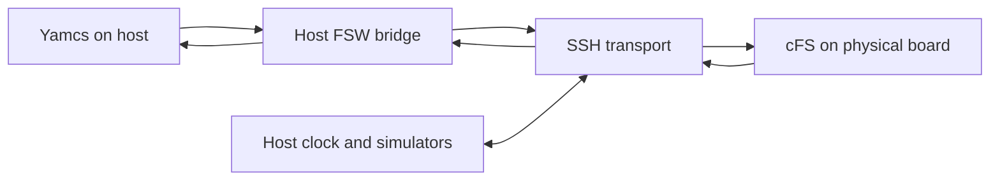

# Configurable Linux Board PIL

Run a matching Linux cFS target on an SSH-connected processor or in Zynq QEMU
while SHIRE controls time, dynamics, and device simulators on the host.
Board selection is a configuration choice in `cfg/boards/`.
The common launcher is `tools/shire-board.py`.

## Execution models

The `backend` profile field selects `ssh` or `qemu`.
Existing hardware profiles
that omit it retain the SSH backend.
Both backends use the same host simulation,
Yamcs interfaces, PREPARE/EXECUTE/COMMIT synchronization, and acceptance checks.
QEMU boots a public Linux guest inside the host FSW service.
The following diagram describes the SSH hardware backend.



The Compose service `shire-fsw`, whose container is named `shire-fsw-<spacecraft>`, runs the host bridge.
The cFS executable runs on the physical processor using its existing Linux kernel.
It uses a supplied userspace in a temporary chroot with separate mount, IPC, and PID namespaces.
The launcher does not boot an emulator or run Docker on the board.
It does not install a kernel, bootloader, FPGA bitstream, or board firmware.

PIL transactions use simulated devices on the host.
The runtime exposes only null, zero, and random device nodes.
Physical buses and FPGA peripherals require separate configuration and qualification.

## Profiles and evidence

| Profile | Processor/userspace contract | Evidence |
| --- | --- | --- |
| `qemu-zynq` | ARMv7 hard-float, `armv7l-shire`, public Zynq ZC702 Linux guest | Emulator acceptance with separate physical board and peripheral gates. |
| `zybo7020` | ARMv7 little-endian hard-float, `armv7l-shire`, matching public Buildroot SDK/userspace | Physical Zybo PIL validated with command acceptance, telemetry, fidelity, and repeatability. |
| `rpi5` | AArch64 little-endian, `aarch64-shire`, matching public SDK/userspace with 16 KiB page alignment | Physical RPi5 processor PIL was exercised on a 16 KiB-page kernel, but the profile still describes the hardware as unvalidated and the repository retains no acceptance report for it. |

The RPi example selects 64-bit userspace.
Select the actual OS and executable ABI rather than inferring it from the board name.
[Raspberry Pi OS documents its 32-bit and 64-bit variants](https://www.raspberrypi.com/documentation/computers/os.html#architecture).
An ARM32 Zybo executable and root filesystem are not an AArch64 build.
The launcher checks executable and module ELF architecture and rejects a mixed bundle.

Keep separate profiles and work directories for different boards or accounts.
All profiles currently use the normal mission service names and Yamcs host port.
Run one native, QEMU, or physical board lab at a time in a checkout.

## Common workflow

Save the default board selection in `build/active.yaml`:

```yaml
board: qemu-zynq
```

Selection uses an explicit `BOARD=<profile>` or Python `--profile` first,
then the saved `board` value, and finally `qemu-zynq` when the file or key is absent.
An invalid saved value fails rather than selecting a different target.
Both Make and direct Python calls resolve this selection in the common launcher.
The board details remain in `cfg/boards/<profile>.yaml`.

```bash
make board-inspect
make board-inspect BOARD=zybo7020
python3 tools/shire-board.py inspect --profile zybo7020
```

The first command uses the saved selection immediately, without requiring `make cfg`.
An explicit `BOARD=<profile>` or Python `--profile` validates and saves that profile as the active board.
Subsequent commands without an override reuse the last saved selection.
The update preserves other active settings and replaces the YAML file atomically.
Invalid profiles leave the saved selection unchanged.
A valid selection remains saved if the later build, SSH connection, or runtime operation fails.
Only the board profile selection is saved, while other launcher options remain per invocation.

```bash
make board-build BOARD=rpi5
make board-deploy
make board-inspect
```

All three commands select RPi5.
An explicit selection on another command switches the active board again.
To stop an older run after switching profiles, explicitly select its board with `BOARD=<profile>`.
Deployment manifests and acceptance reports retain the effective profile for that run.
The saved board selection affects only `board-*` commands.
Native `make build`, `make start`, and `make perf` retain their existing behavior.

Select `BOARD=qemu-zynq` for the emulator, or
`BOARD=rpi5` after setting `ssh.target` in `cfg/boards/rpi5.yaml` to your board, or passing `--target`, and preparing its matching artifacts.

| Command | SSH hardware backend | QEMU backend |
| --- | --- | --- |
| `board-prepare` | Build SDK/userspace when configured, otherwise check supplied inputs locally | Build public SDK, kernel, rootfs, and license artifacts. |
| `board-build` | Build host runtime and selected target cFS bundle | Build host runtime and ARM32 cFS bundle. |
| `board-deploy` | Validate and upload to a fresh temporary board directory | Validate bundle and package the guest runtime image and Compose. |
| `board-inspect` | Connect and inspect the actual board Linux environment | Inspect local platform/bundle provenance and validate bundle hashes/ABI. |
| `board-connect` | Establish/reuse the SSH control connection | Open an SSH shell in a running guest. |
| `board-scenario` | Build/deploy cFS and run a named scenario with host verification | Run the same scenario with the cross-built ARM32 guest. |
| `board-start` / `board-stop` | Run/stop physical cFS with host services, retaining archives | Run/stop emulated cFS with the same host services and retained archives. |
| `board-test` | Repeated processor acceptance plus physical telemetry checks | Repeated emulator acceptance, with hardware remaining unvalidated. |

For the fully open-source emulator path:

```bash
make board-prepare BOARD=qemu-zynq
make board-build BOARD=qemu-zynq
make board-deploy BOARD=qemu-zynq
make board-test BOARD=qemu-zynq
make board-start BOARD=qemu-zynq
```

See [Zynq QEMU PIL](qemu-pil.md) for source/license provenance and guest controls.
The supported emulator is the Zynq ZC702 reference.
RPi emulation is not supported.
QEMU profiles contain `schema_version`, `name`, `description`, `backend: qemu`,
`work_dir`, and `platform: zynq-zc702`.
The work directory must be inside the checkout.
Physical SSH, privilege, userspace upload, and serial-mirror settings apply only to SSH profiles.

The shared `board-*` commands replace the former QEMU-specific Make targets.

The remaining deployment details describe SSH hardware profiles.

Prepare the selected SDK and userspace before building cFS.
For the supplied Zybo profile, `make board-prepare BOARD=qemu-zynq` builds its shared
public ARM32 SDK and root filesystem.
Hardware `board-prepare` builds a matching SDK/userspace when `artifacts.buildroot_config` is configured.
Otherwise it checks that the supplied SDK, compiler, and userspace inputs exist.
It does not install a board OS.
A physical board deployment does not need a QEMU runtime image.
`board-build` resolves configuration, builds 42, Simulith, the configured device
simulators, CryptoLib, and Yamcs, then cross-builds the board cFS bundle.

```bash
make board-inspect BOARD=zybo7020
make board-build BOARD=zybo7020
make board-deploy BOARD=zybo7020
make board-start BOARD=zybo7020
```

Open [Yamcs](http://localhost:8090) and select `shire` and `realtime`.
Commands, telemetry, visualization, pause, and resume use the usual host interfaces.
Start defaults to real time and accepts `SIMULITH_SPEED` overrides.
It does not inject the acceptance scenario.
The configured cFS startup RTS still runs.

From another terminal, stop the same profile:

```bash
make board-stop BOARD=zybo7020
```

Ctrl-C in the start terminal also stops the session.
Logs and per-run Yamcs archives are retained.
Stop can clean up the host side without requiring a working SSH connection.
`board-stop` stops both target cFS and the host services.
A separate `make stop` is unnecessary.
If the controller record was lost, it recovers host containers belonging to the selected board configuration.
Shutdown failures are reported and recorded sessions remain available for retry.
Logs and archive volumes are preserved.

### Run a named scenario

Use the same mission scenarios as `make scenario`, with cFS executing on the selected target:

```bash
make board-scenario SCENARIO=checkout BOARD=rpi5
make board-scenario SCENARIO=adcs-modes-sweep BOARD=zybo7020
make board-scenario SCENARIO=checkout BOARD=qemu-zynq
```

Run one lab at a time.
An omitted `BOARD` uses the saved active selection.
Prepare the target SDK/platform with `board-prepare` first and configure SSH for physical boards.
The command selects the scenario and initial conditions, builds the matching target cFS and host images, deploys the bundle, then runs the scenario.
Separate `board-build`, `board-deploy`, and `board-start` calls are unnecessary.
Physical boards prompt for their sudo password before starting cFS.

The host retains the simulators, scenario timing, Yamcs command stacks, telemetry verification, and archive handling.
Only cFS executes on the physical board or QEMU guest.
Scenario-specific component settings and tables are compiled for that target on every invocation.
The runner checks completion markers and the scenario's configured verification and archive gates.
This command runs the selected scenario rather than the fixed acceptance scenario used by `board-test`.

Reports and logs appear under `build/scenario-runs/<scenario>-<UTC timestamp>/`.
`target.json` records the board profile and bundle/deployment details alongside the initial conditions and verification results.
Optional `BOARD_ARGS="--report-dir <path> --simulith-speed <number>"` overrides report placement and runtime speed.
Leave the scenario's speed unchanged when its command stacks depend on wall-clock time.
Ctrl-C stops the lab and retains diagnostics and the Yamcs archive.
`board-stop` can also stop a physical-board scenario from another terminal.

List the registered scenario names with:

```bash
python3 tools/shire-scenario.py --list-scenarios
```

For a 64-bit Linux RPi5, set `ssh.target` in `cfg/boards/rpi5.yaml` to your account and address, or pass `--target`, then prepare its AArch64 artifacts.
The shipped value is a private lab address that will not match your network.

```bash
make board-prepare BOARD=rpi5
make board-build BOARD=rpi5
make board-deploy BOARD=rpi5
make board-start BOARD=rpi5
make board-stop BOARD=rpi5
```

Use the SSH account and IP address reachable from the host running SHIRE.
The first preparation downloads public sources and the pinned Arm GNU AArch64 toolchain.
It uses the same pinned Buildroot release and build-tools image as the Zynq workflow,
but creates separate 64-bit SDK and userspace artifacts.
It builds no RPi kernel, firmware, bootloader, or SD-card image.
The Pi retains its installed Linux kernel and runs cFS in the temporary chroot.
This userspace is built alongside the SDK, so the installed OS does not need matching libc or application libraries.
The launcher cannot turn an existing ARM32 build into an AArch64 build.

The default RPi preparation writes the SDK under `build/board-targets/rpi5/sdk-16k`,
the matching userspace to `build/board-targets/rpi5/rootfs.tar`, and build output
under `build/board-targets/rpi5/sdk-16k-buildroot`.
The build output retains `preparation.json`, the resolved configuration,
and `legal-info` with source/license artifacts and toolchain distribution notes.
Preparation checks both a compiled probe and the userspace loader for the selected ELF architecture and page alignment.
The shipped RPi5 definition builds for 16 KiB pages, matching the standard Pi5 kernel.
Its Arm GNU loader supports this alignment, while the Bootlin 4 KiB loader used in an initial trial did not.
Inspect the actual kernel with `getconf PAGE_SIZE` when using a different image.
Deployment checks every bundled ELF against the observed kernel page size before executing it.
For another kernel page size, supply a compatible SDK/userspace and rebuild the complete bundle.
Changing the Buildroot definition requires a fresh SDK/output location to avoid mixing configurations.
The prepared SDK is built at its configured location and must remain there.
For an independently supplied SDK/userspace, omit `artifacts.buildroot_config`
and set the existing artifact paths to that matching pair.

After `make clean`, repeat `board-build`, `board-deploy`, and `board-test` or `board-start`.
The SDK/userspace are separate profile inputs and must still be available.
Deploy uploads existing artifacts, while test and start require the locally built runtime images.
They report missing images before allocating a run archive.

## What to configure

Copy a shipped YAML profile to a new file and edit its fields.
Choose it by name under `cfg/boards/` or by a repository-relative or absolute YAML path.

```bash
make board-inspect BOARD=cfg/boards/my-board.yaml
make board-start BOARD=cfg/boards/my-board.yaml
```

| Field | What changes for another target |
| --- | --- |
| `backend` (optional) | `ssh` for hardware, with omission preserving existing hardware profiles, with a separate minimal schema for QEMU |
| `name`, `description` | Unique profile identity and evidence status. |
| `work_dir` | Per-board SSH socket, host-key records, build output, deployment manifest, reports, and sessions. |
| `ssh.target`, `ssh.port` | Actual SSH account, host/address, and server port, without an account password in YAML. |
| `ssh.connect_timeout` | TCP connection and initial SSH handshake allowance in seconds, with 30 seconds in the shipped profiles. |
| `runtime.architecture` | `armv7hf`, `aarch64`, or a supported ELF architecture matching every executable and shared module. |
| `runtime.kernel_machines` | Accepted `uname -m` values on the target kernel, with userspace compatibility checked separately. |
| `runtime.cfs_system`, `runtime.cpu` | cFS toolchain/system selector and CPU target that exist in the mission build. |
| `runtime.executable` | Executable path relative to the packaged `app/` directory. |
| `runtime.loader` | Dynamic loader inside the supplied userspace, such as `/lib/ld-linux-armhf.so.3` or `/lib/ld-linux-aarch64.so.1`. |
| `runtime.staging_prefix` | Absolute prefix for fresh deployment directories on writable board storage with enough capacity. |
| `runtime.mqueue_max`, `runtime.rtprio` | Queue depth ceiling and real-time priority limit inside the isolated runtime. |
| `runtime.serial_console` (optional) | Board character device for mirroring live output, with omission or null disabling it by default. |
| `artifacts.buildroot_config` (optional) | Buildroot defconfig for public SDK/userspace generation during `board-prepare`, with omission selecting operator-supplied artifacts. |
| `artifacts.sdk`, `artifacts.compiler`, `artifacts.compiler_flags` | Matching cross SDK and compiler for cFS and the UDP helper, mounted read-only when outside the checkout. |
| `artifacts.tools_image` | Host build/bridge image with Python, PyYAML, Make, CMake, native build tools, SSH, and the SDK's host dependencies. |
| `artifacts.bundle` | Bundle directory containing `manifest.json` and `app/`, with `{mission}` and `{spacecraft}` expanded from active configuration. |
| `artifacts.rootfs` | Matching userspace tar archive, with the loader, libraries, shell, and basic utilities needed by cFS. |
| `network.sync_pub`, `network.sync_rep`, `network.tunnel` | Distinct TCP ports forwarded through SSH for tick phases/completions and framed UDP transport. |
| `network.command`, `network.telemetry` | UDP ports matching CI_LAB, TO_LAB, and the mission's Yamcs link configuration. |
| `network.gsw_host` | Reachable host Compose name for telemetry, normally `shire-gsw`. |
| `network.device_ports` | `auto` for standard Simulith UART/I2C/SPI/GPIO endpoints from spacecraft configuration, or an explicit list for another component layout. |

Profile validation rejects unknown fields, invalid ports, and conflicting TCP bindings.
Changing the profile or runtime scripts invalidates the recorded deployment and requires redeployment.
Changing the CPU ABI or SDK also requires rebuilding the cFS bundle.
SDK identity and toolchain configuration select a separate cFS build directory, preserving old compiler caches.
The report records the effective profile, its hash, application hashes, root filesystem hash,
runtime source hashes, and observed board identity.

## Build and bundle contract

After building the host services, `board-build` invokes the mission cFS build with
`SHIRE_FSW_SYSTEM` and `SHIRE_ARM_SDK`, and packages the selected CPU output.
The shipped ARM toolchain files expect a Buildroot SDK containing
`share/buildroot/toolchainfile.cmake`.
The environment variable name `SHIRE_ARM_SDK` applies to both ARMv7 and AArch64.
The AArch64 selector retains the same synchronized SHIRE PSP, OSAL, scheduler,
and software-bus observer as the ARM32 selector.
It does not supply an RPi BSP or boot image.

The SDK and root filesystem must be produced together for the selected architecture.
Include compatible libc, libstdc++, libgcc, ZeroMQ, libgcrypt, libgpg-error,
and any application-specific runtime libraries.
Supplying a cross compiler without its matching sysroot and target libraries is insufficient.
Keep public source revisions, package hashes, legal information, and SDK provenance with those artifacts.
The launcher reuses an existing boot environment and does not redistribute or change its licensing.

You may supply an independently built bundle instead of using `board-build`.
Its manifest must contain `system`, `mission`, `spacecraft`, and a `files` map
from every `app/` file path to its SHA-256 digest.
It must include the executable, dynamic application modules, `libsimulith.so`, startup script,
tables, and required writable directories such as `cf/data`, `cf/tmp`, and `d`.
Missing, modified, unmanifested, or wrong-architecture files fail deployment.
The board loader checks the packaged executable's dependencies after upload.
Complete startup and dynamically loaded application compatibility are verified by runtime acceptance.

## Changes beyond a board profile

| Change | Source of truth and required work |
| --- | --- |
| Account, address, or SSH port | Edit the profile's `ssh` settings, reconnect, and redeploy for the new target identity. |
| Same ABI on another Linux board | Edit the connection, accepted kernel machines, and storage settings, then inspect and repeat acceptance. |
| ARM32 to AArch64 | Supply the AArch64 SDK/userspace, select the matching profile architecture and loader, and rebuild every executable, module, and table for that cFS system. |
| New cFS system or compiler SDK format | Add or adapt `cfg/shire_defs/toolchain-<system>.cmake` and the system selection in `cfg/shire_defs/targets.cmake`, preserving `cfg/shire_defs/shire_simulation.cmake`. |
| New CPU target or application set | Update the mission CPU, startup files, platform settings, and source tables under `cfg/shire_defs` before rebuilding the bundle. |
| Different packet, bus, or ground protocol | Update the component/mission configuration and Yamcs MDB/link definitions, then match the profile's exposed transport ports and acceptance scenario. |
| Different kernel image | Prove namespace, queue, scheduling, and userspace compatibility again while keeping that board's boot and recovery procedure separate. |
| Physical bus access | Define a reviewed fixture, board pin mapping, device tree, drivers, and a separate hardware runtime instead of exposing physical devices through this PIL profile. |

## Host and board assumptions

| Layer | Required contract |
| --- | --- |
| Host | Linux or suitable WSL environment, Docker Engine/Compose, Make, Python with PyYAML, OpenSSH client, matching build image, and resolved SHIRE mission artifacts. |
| Board OS | Existing Linux with the selected CPU/userspace ABI and reachable SSH, without requiring board Docker or Python. |
| Board utilities | Shell, sudo, util-linux `unshare` with mount/IPC/PID namespaces and `--kill-child`, mount, chroot, mknod, tar, sha256sum, uname, ip, and preferably `prlimit` for resource limits. |
| Board privilege | Sudo access for namespaces, mounts, device nodes, queue limits, and real-time scheduling, using an empty password response for passwordless sudo. |
| Kernel services | PID, mount, and IPC namespaces, procfs, tmpfs, POSIX message queues, shared memory, futexes, sockets, and POSIX timing/scheduling services required by the selected OSAL. |
| Message sizes | A Linux message-size ceiling at least as large as the cFS message size, with 8192 bytes on the validated board and a separate review required for larger packets. |
| Userspace | Matching little-endian executable ABI and loader/library versions, including ARM hard-float when `armv7hf` is selected. |
| Storage | Space for the root filesystem, bundle, and per-launch writable copies that disappear on reboot when using temporary storage. |
| Network | Host-to-board SSH with remote forwarding and free profile/component loopback ports, without requiring direct board-to-host inbound access or TAP. |
| cFS configuration | Correct CPU/system selector, startup tables, app set, message ABI, device protocol, CI/TO ports, and SHIRE hooks beyond architecture selection alone. |

The launcher does not persistently alter board networking or replace its boot image.
Queue-depth changes live in the new IPC namespace.
The launcher uses `prlimit` to set message-queue and real-time priority limits for the chrooted process.
This works with Debian's dash shell, whose `ulimit` builtin does not support `-q`.
Images without `prlimit` can use the legacy shell path when both `ulimit -q` and `ulimit -r` are supported.
Device and synchronization connections use SSH reverse forwards.
The small UDP helper preserves datagram boundaries over a framed TCP connection.
Host resource statistics describe the bridge container rather than board CPU utilization.

## Show the same output on a serial console

Enable a demo mirror per session using a device path on the board:

```bash
make board-start BOARD=zybo7020 BOARD_ARGS="--serial-console /dev/ttyPS0"
```

The board duplicates the same process output to SSH and the selected serial console.
Minicom on the host's corresponding USB serial port shows the same cFS event lines.
Serial transcripts add session metadata and terminal line endings can differ.
The minicom keyboard still belongs to the board's Linux console, not the SSH-launched cFS process.
Use Yamcs for flight commands.

The mirror uses the board's util-linux `script` utility to retain terminal buffering
and propagate the child exit status.
The selected path must exist as a character device before flight software starts.
It is opened outside the chroot, without exposing physical devices inside the PIL runtime.
Existing baud, flow-control, console login, and boot settings are retained.
Serial output can limit logging throughput, so leave mirroring off for performance measurements.

The command-line override needs no rebuild or redeployment.
To enable it by default, add `serial_console: /dev/ttyPS0` under the profile's `runtime`
settings and redeploy for the changed profile.
Use `BOARD_ARGS=--no-serial-console` to disable a profile's mirror for a session.
For another board, select its actual serial device instead of copying the Zybo path.

## Authentication and overrides

Commands reconnect automatically if their per-board SSH control session expires.
Normal SSH authentication applies.
Account passwords and sudo passwords are not written to profiles or deployment manifests.
The sudo password is held in memory for the session.
If reconnecting stalls during the SSH banner exchange, check routing and the board's
SSH service through its console and adjust `ssh.connect_timeout` for that image.

```bash
make board-connect BOARD=zybo7020 BOARD_ARGS=--password-auth
python3 tools/shire-board.py inspect --profile rpi5 --target user@actual-host
```

`--ssh-control` and `--work-dir` allow explicit connection/state locations.
The board selection is remembered, while connection and work-directory overrides must be repeated for subsequent commands.
Separate boards must not share a control socket or work directory.

## Acceptance and portability gate

```bash
make board-test BOARD=zybo7020
python3 tools/shire-board.py test --profile zybo7020 --duration 10 --trials 1
```

Default acceptance runs three 30-second simulated-time trials with exact tick and
participant accounting, device transactions, accepted commands, dynamics phases,
control traces, advancing Yamcs truth, archives, and repeatability.
Each trial starts a fresh cFS process, so three launches are expected for a default test.
The terminal reports ground startup, trial progress, each trial's result, and the final acceptance result.
If the board launcher exits with an error, acceptance stops early and reports its exit status and retained log path.
This avoids waiting for the synchronization watchdog when cFS never started.
Use `board-start` for one continuous interactive run instead of repeated acceptance trials.
Physical acceptance also requires valid board telemetry on Yamcs's `debug-in` link.
Allow enough simulated time for the startup RTS to enable telemetry.
Compare a matching accepted QEMU report with `--baseline <report.json>` when available.

The acceptance scenario is still the DRM scenario in `cfg/perf-scenario.json`.
It assumes 10 ms ticks, the DRM scheduler/downlink cadence, the `shire/realtime` Yamcs
instance/processor at `http://localhost:8090`, and DRM ADCS acceptance events.
A different mission must adapt these shared acceptance definitions and its Yamcs configuration.
Selecting another board profile does not make that mission validated.

Before treating a new target as supported, establish successful SDK/bundle architecture checks,
clean startup, a Yamcs command accepted by physical cFS, returning board telemetry,
pause/resume, repeated full acceptance, and cleanup with its original board settings preserved.
Retain the resulting report as evidence for that specific profile and board image.
The `rpi5` profile has no such retained report in this repository, so treat it as an example until you produce one.
Physical peripheral compatibility and flight readiness remain separate gates.

***
Last reviewed: 20261027
