# Attitude Control

## Mission brief

The spacecraft is tumbling, and it has been since it separated from its launch vehicle.
It cannot charge its battery reliably or point at anything while it tumbles.
The team has to bring it under control, and then decide where to point it, because every direction it points costs something somewhere else.
This is the fourth lesson in the [lesson plan](overview.md#the-lesson-plan), in the Spacecraft systems unit.

## Objective

In this scenario, you will learn how the attitude determination and control system, or ADCS, works and how to command it.
As the flight controller, your job is to enable the ADCS, take most of the tumble out with the magnetic torquers, point the spacecraft at the Sun, at the Earth, and at a fixed direction in space, and check what the ADCS reports against what the dynamics model knows to be true.

## Prerequisites

This lesson needs three earlier lessons, [Commissioning](commissioning.md), [Simulation Time and Repeatability](simulation-time-repeatability.md), and [Power and Eclipse](power-eclipse.md).
You use these skills from them:

* Sending a command from its form and reading a parameter page
* Reading simulation time, and pausing the clock to study a state
* Reading `SOLAR_VOLTAGE` and knowing that the solar array only makes power when it faces the Sun

Before you begin, ensure you have:

* Completed [Getting Started](../manual/handbook/getting-started.md)
* Selected the default `sat-1` configuration with `scenario: nominal` in `build/active.yaml`, and run `make`
* About 15 minutes

This lesson starts from a freshly booted spacecraft, so it does not need anything that an earlier lesson left behind.
Stop any running lab with `make stop` before you start a new one.

The whole lesson takes about twelve minutes of simulation time, and it must happen before the spacecraft enters eclipse at 23:21:42 on the simulation clock.
In eclipse, Sun safe mode cannot turn the spacecraft toward the Sun.
If you need time to read, pause the clock as you learned in [Simulation Time and Repeatability](simulation-time-repeatability.md#pause-and-resume).

## Overview

The spacecraft has three parts that work together to control its attitude, which is the direction it faces.

| Part | What it does |
| --- | --- |
| Sensors | Measure the direction of the Sun, the magnetic field, and the rotation of the body. |
| Control law | Compares what the sensors say with the goal, and decides what torque to apply. |
| Actuators | Reaction wheels and magnetic torquers apply the torque. |

The spacecraft is a box with a body frame of three axes, X, Y, and Z.
The `+X` axis is the face that carries the solar array, and every pointing mode in this lesson aims `+X` at something.

Two sets of ADCS telemetry tell you where `+X` is relative to the goal.

| Telemetry | What it tells you |
| --- | --- |
| `SUN_X`, `SUN_Y`, `SUN_Z` | The direction of the Sun in the body frame, where `1, 0, 0` means that `+X` is on the Sun. |
| `POINT_VEC_BODY_X`, `POINT_VEC_BODY_Y`, `POINT_VEC_BODY_Z` | The direction of the current pointing goal in the body frame, where `1, 0, 0` means that `+X` is on the goal. |

`POINT_VEC_BODY` reads 0 in Sun safe mode, because that mode uses the Sun vector instead.

The ADCS has six modes, which you choose with `/ADCS/ADCS_SET_MODE_CC`.

| Mode | Number | What it does |
| --- | --- | --- |
| `PASSIVE` | 0 | Applies no control, so the spacecraft keeps whatever motion it has. |
| `BDOT` | 1 | Reduces the body rates with the magnetic torquers, using only the measured rate and the magnetic field. |
| `SUNSAFE` | 2 | Holds `+X` on the Sun and adds a slow roll about that line. |
| `NADIR` | 3 | Holds `+X` on the center of the Earth. |
| `TARGET` | 4 | Holds `+X` on a direction that you set, fixed in inertial space. |
| `INERTIAL` | 5 | Holds `+X` on an inertial direction too, and this lesson does not use it. |

The command form shows these mode names, and the telemetry `MODE` parameter shows the number.

The ADCS reports what it estimates from its sensors.
The dynamics model, 42, knows the exact state, and YAMCS receives it as `/SIM_42_TRUTH`.
No real mission has that view, and it is what lets you ask how good the estimate is.

You will follow these phases:

* Look at the tumble
* Enable the ADCS
* De-tumble with the magnetic torquers
* Point at the Sun
* Point at the Earth
* Point at a fixed direction
* Return to the Sun

The screenshots below show one completed run.
Simulation times, counters, and values will differ in your run.

## Look at the tumble

Start the lab and wait for the startup sequences to settle, as you did in [Commissioning](commissioning.md#startup):

```bash
make start
```

The ADCS is disabled, so the only rates you can read are the truth rates.
In YAMCS, select **Telemetry**, then **Parameters**, and open the `SIM_42_TRUTH` system.
Search for `WN_`.

`WN_1`, `WN_2`, and `WN_3` are the body angular rates in radians per second.

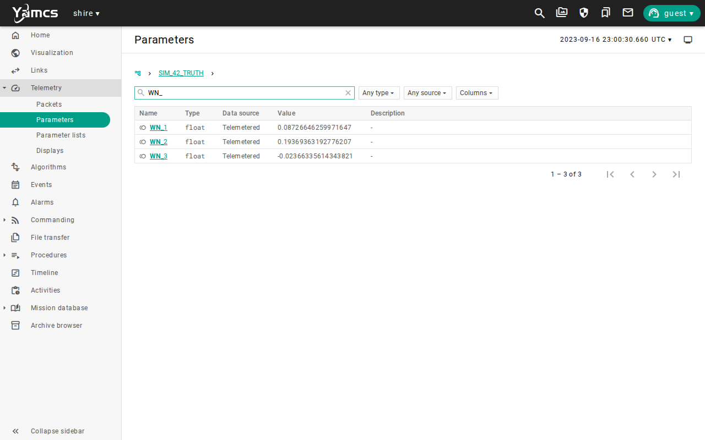

The three together are about 0.21 radians per second, which is about 12 degrees per second, so the spacecraft turns once in about 30 seconds.
The visualization shows the same thing on its `Rates` line.
This is the slow tumble that you saw in [Power and Eclipse](power-eclipse.md#point-at-the-sun), where the solar array flickered on and off.

## Enable the ADCS

Send `/ADCS/ADCS_ENABLE_CC`, wait for fresh housekeeping, and confirm that `DEVICE_ENABLED` reads `ENABLED`.
Then send `/ADCS/ADCS_CONFIG_CC`.
It pushes the control gains from the boot table to the device, as the `AdcsComponent` stack does.

The `AdcsComponent` stack that you ran in Commissioning sends these same commands for you.
Here you send them by hand so that you can see what each one does.

Open the `ADCS` parameters and search for `ANGRATE`.
The ADCS now reports the body rates that it measures.
`ANGRATE_X` matches `WN_1` because that rate does not change as the body tumbles, and the other two change as it turns, so compare them only at matching times.
`MODE` reads 0, which is `PASSIVE`, so the ADCS is enabled and applying no control.
The spacecraft is still tumbling.


## De-tumble with the magnetic torquers

The first thing a spacecraft does after separation is to slow its tumble, and it can do that without knowing where the Sun is.
The magnetic torquers are three coils that push against the magnetic field of the Earth.
B-dot control commands each coil in proportion to the body rate crossed with the field, so that the torque always opposes the rotation.
It needs only the measured rate and the magnetic field.

Open `/ADCS/ADCS_SET_MODE_CC`, choose `BDOT` for `MODE`, and send the command.


The torquers are weak, so this takes minutes and not seconds.
Send `/SHIRE_SERVER/BACKDOOR_SERVER_SET_SPEED` with `SPEED` set to `16`, as you did in [Simulation Time and Repeatability](simulation-time-repeatability.md#change-the-speed), and wait about 30 seconds.
Then send `SPEED` set to `1` to return to real time.

Read `WN_1`, `WN_2`, and `WN_3` in `SIM_42_TRUTH` again.
They have fallen from about 0.21 radians per second together to about 0.03 after about seven simulated minutes, so most of the tumble is gone.


The rates fall quickly at first and then flatten.
The torquers can only turn the part of the spin that is across the field, and they cannot remove spin about the field direction.
That last part is why a B-dot spacecraft is slow and not still, and why the next step uses the wheels.

## Point at the Sun

Open `/ADCS/ADCS_SET_MODE_CC`, choose `SUNSAFE` for `MODE`, and send the command.

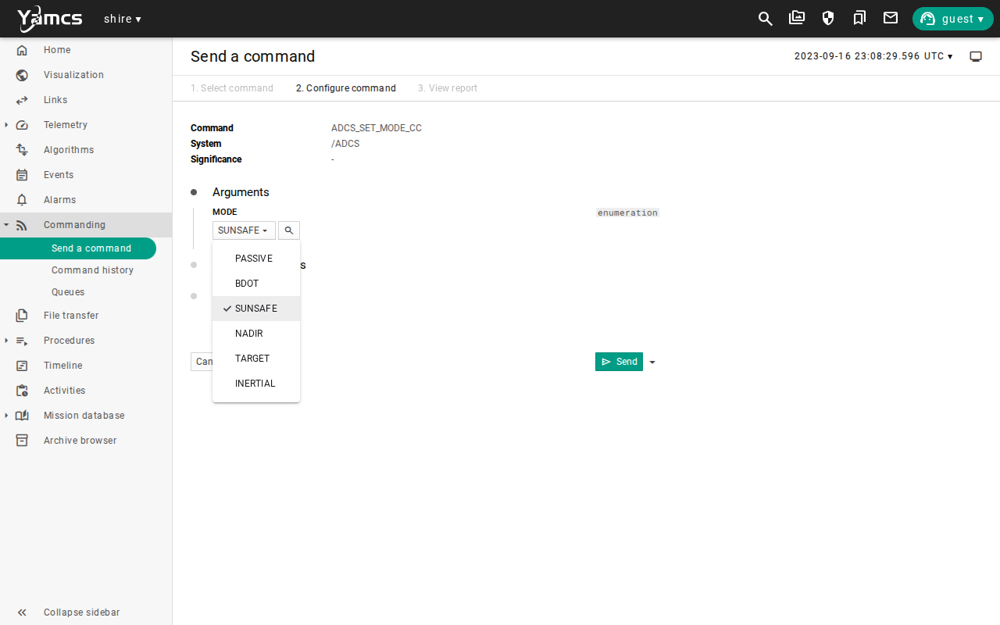

Watch `SUN_X`, `SUN_Y`, and `SUN_Z` in the `ADCS` parameters.
For a few seconds they swing as the spacecraft turns.
Within about 15 simulated seconds `SUN_X` settles near 1, and `SUN_Y` and `SUN_Z` settle near 0.
The rates fall to nearly nothing, which the wheels do in seconds and the magnetic torquers could not.


Now compare the estimate with the truth.
Open `SIM_42_TRUTH` and search for `SVB_`.
`SVB_1`, `SVB_2`, and `SVB_3` are the true Sun direction in the body frame, which is the same quantity as the three `SUN_` values.

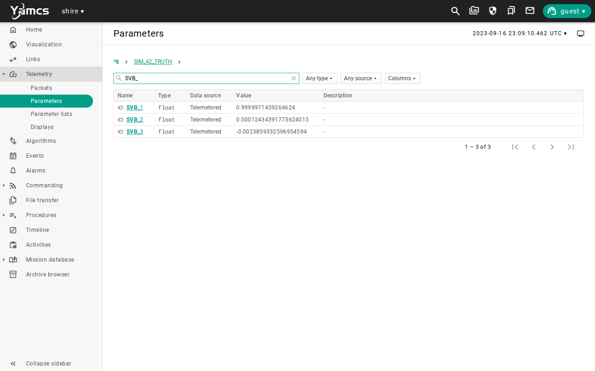

Once settled, the two sets of values agree to better than 0.001.
Before it settled they could differ by much more, because truth is sent once per second and ADCS housekeeping on its own schedule, so two readings can come from different moments.
While the spacecraft is turning, compare only values whose times match, and once it holds still the difference stops mattering.

Open the [visualization](http://localhost:8090/visualization/).
The red `+X` axis lies on the yellow Sun vector, and the two draw as a single orange line.

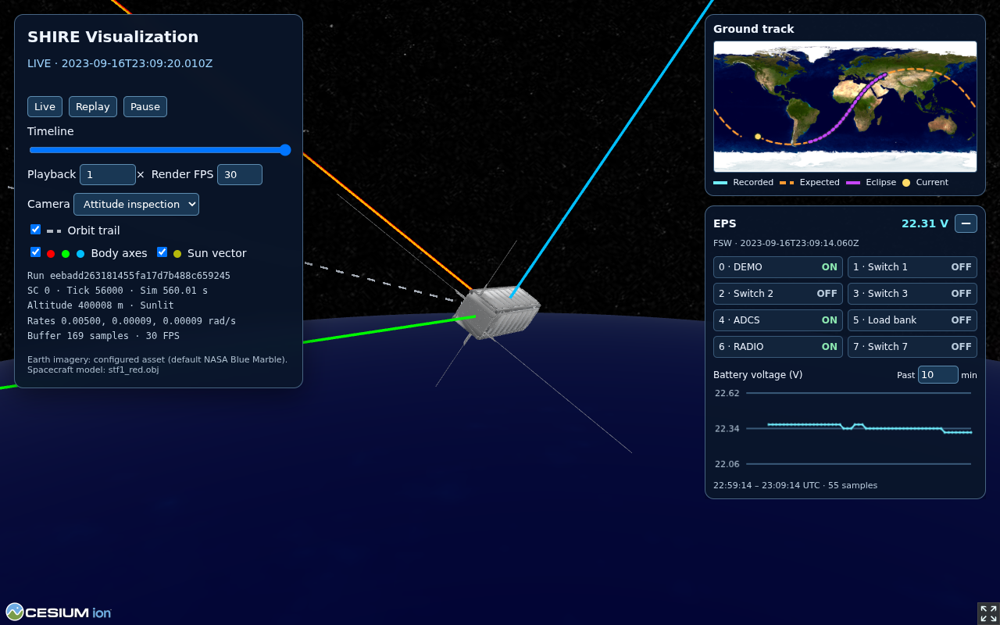

## Point at the Earth

Send `/ADCS/ADCS_SET_MODE_CC` with `MODE` set to `NADIR`.

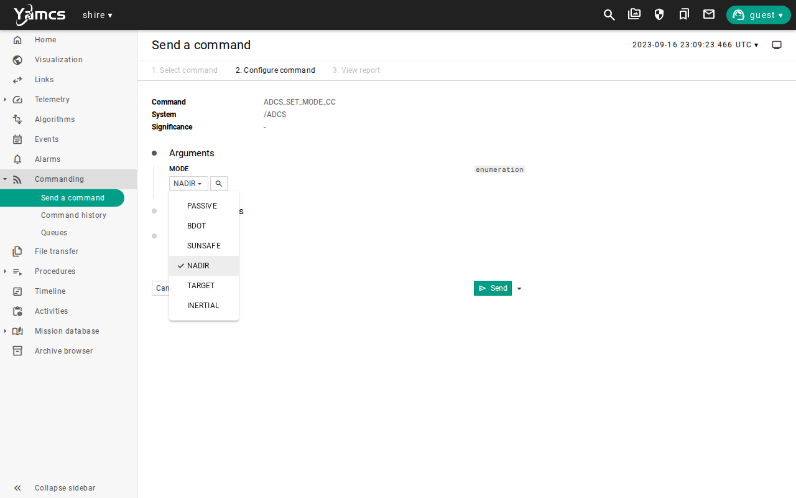

The spacecraft slews to the new goal.
Within about 20 simulated seconds `POINT_VEC_BODY_X` reaches 1 and `POINT_VEC_BODY_Y` and `POINT_VEC_BODY_Z` reach 0.
That is the signature of a pointing mode that has converged, which is the goal direction sitting on `+X`.

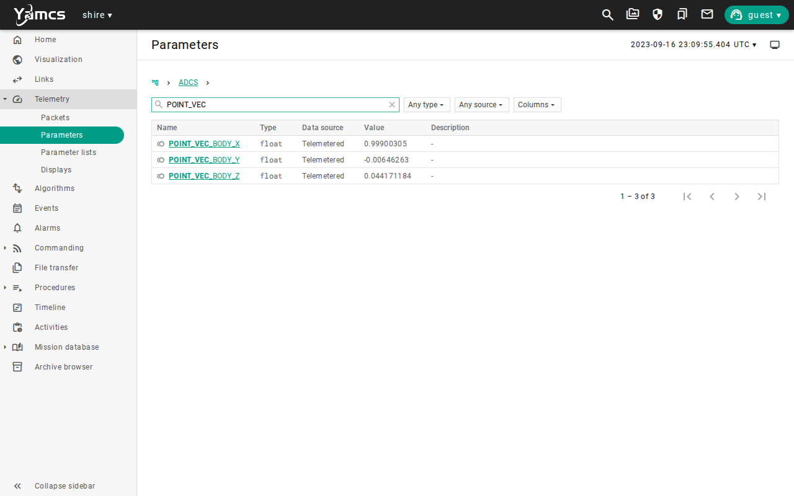

In the visualization, the red `+X` axis now points straight down at the Earth.
The yellow Sun vector has come off it.

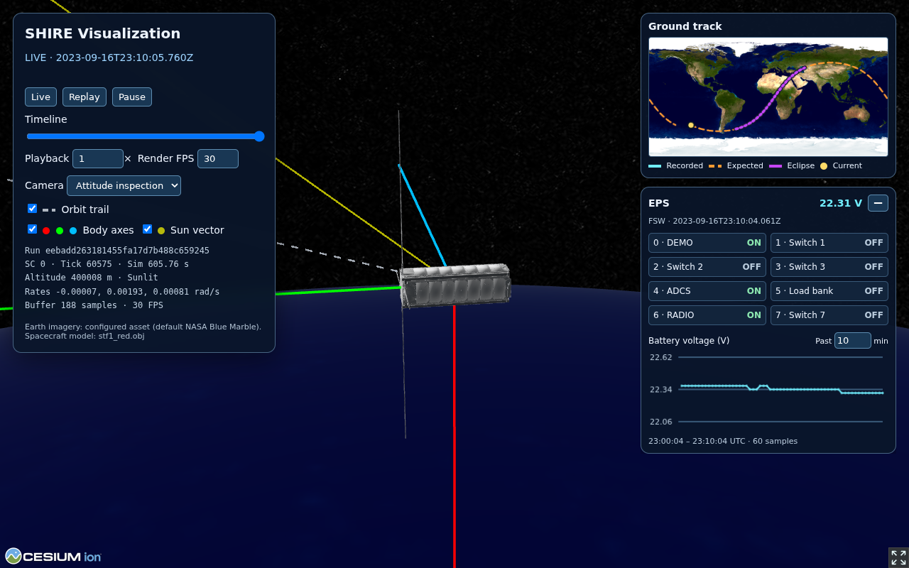

Pointing at the Earth has a price, and you learned it in [Power and Eclipse](power-eclipse.md).
`SUN_X` is now negative, which means that the array face is turned away from the Sun.
Wait for fresh EPS housekeeping and read `/EPS/SOLAR_VOLTAGE` in the `EPS` parameters.
It reads 0, so the array is making no power.

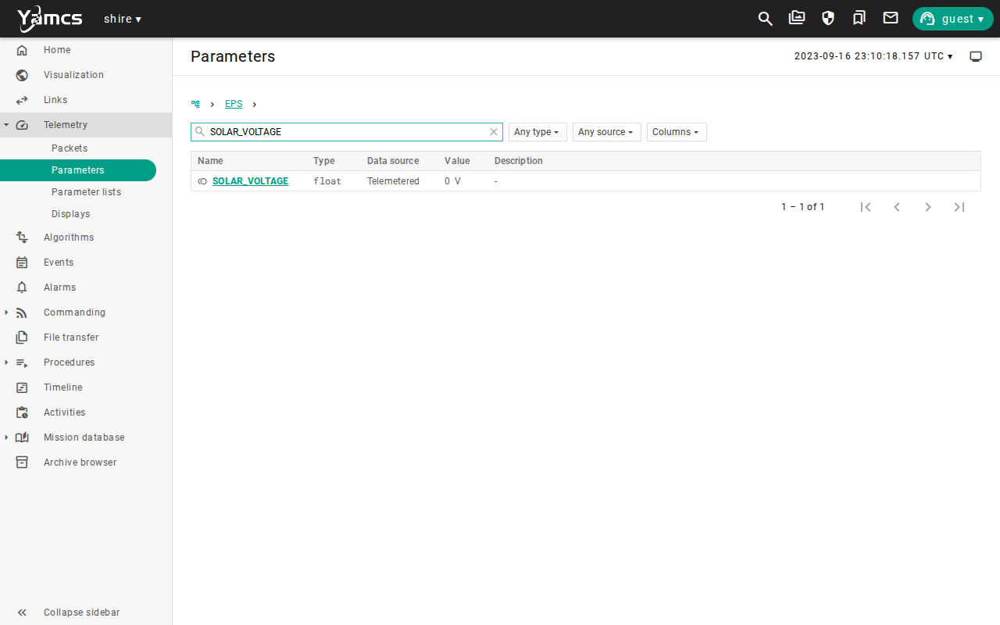

Any goal that turns the array face away from the Sun costs the array its power, and the battery pays.
A mission that must point at the Earth for an hour needs a battery that can carry it, which is the same arithmetic as eclipse.

## Point at a fixed direction

Target mode holds `+X` on a direction that does not move in inertial space, which is fixed against the stars.
First tell the ADCS the direction.
Send `/ADCS/ADCS_SET_TARGET_VECTOR_CC` with `TARGET_X` set to `0`, `TARGET_Y` set to `0`, and `TARGET_Z` set to `1`.
That direction is inertial `+Z`, toward the north celestial pole.

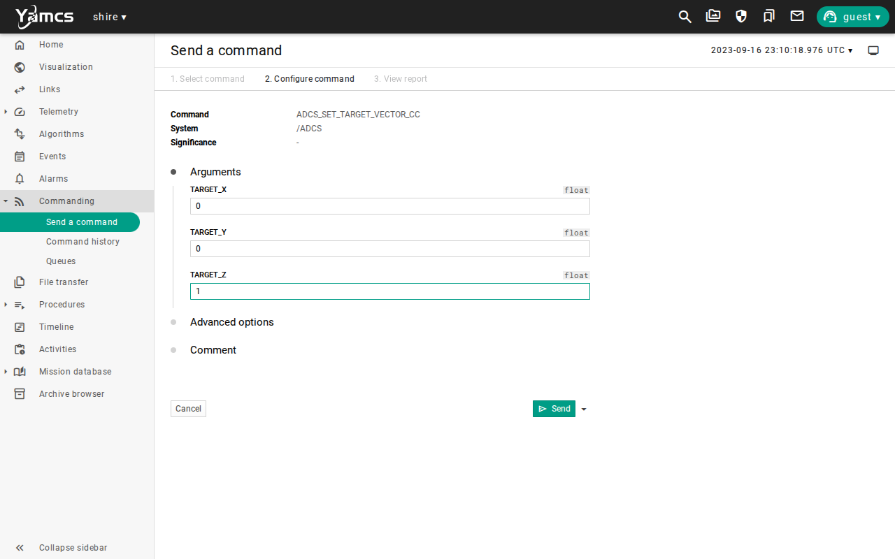

Then send `/ADCS/ADCS_SET_MODE_CC` with `MODE` set to `TARGET`.
The slew takes about 40 simulated seconds.
Wait for it, then read `POINT_VEC_BODY` again.
It is back at 1, 0, 0, but this time the goal is a direction in space, and the body is aimed at it.

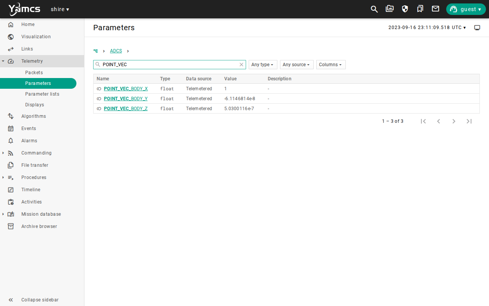

Compare the three goals so far.
The Sun direction moves very slowly, the direction to the Earth turns once per orbit, and the target direction does not move at all.
In every case the pointing vector reads the same when the mode has converged, and the difference is in what it is converging on.

## Return to the Sun

Send `/ADCS/ADCS_SET_MODE_CC` with `MODE` set to `SUNSAFE`.
Wait for `SUN_X` to settle near 1, then wait for fresh EPS housekeeping.
`/EPS/SOLAR_VOLTAGE` reads about 4.4 volts again.

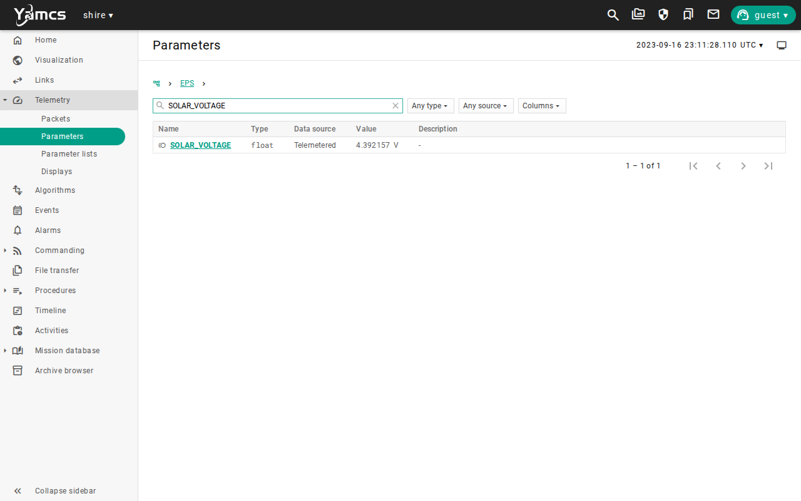

Sun safe is the safe place to leave the spacecraft, because the array makes power there.

## See it on the timeline

The parameter pages show one value at a time, and the Timeline shows how they change together.
In YAMCS, select **Timeline**, then choose the **Attitude** view from the view menu at the top.
Choose **Jump to...**, enter the date `2023-09-16` and the time `23:06:00`, and choose **OK**.
Choose **10 min**, then choose **-** once to zoom out.
The window now runs from 22:56:00 to 23:16:00, which holds the whole lesson.
The simulation clock starts at 23:00:00, so these times are the same in every run.
If you took longer than about fifteen minutes, choose **1 hour** instead so that the window holds all of your commands.

The view has five bands, from top to bottom.

| Band | What it shows |
| --- | --- |
| ADCS Mode | The mode that the ADCS is in, colored by mode. |
| Sun Vector | `SUN_X` in red, `SUN_Y` in green, and `SUN_Z` in blue. |
| Body Rates | The three measured body rates. |
| Pointing Vector | `POINT_VEC_BODY_X` in red, `POINT_VEC_BODY_Y` in green, and `POINT_VEC_BODY_Z` in blue. |
| Solar Voltage | The solar array indicator from the EPS. |

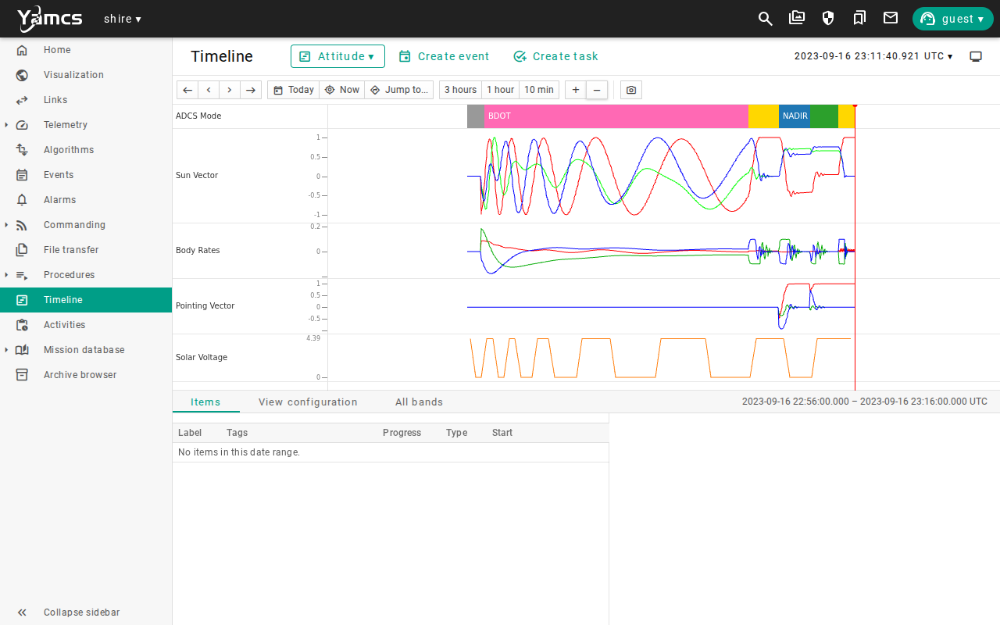

Read it from left to right, and match each change to a command that you sent.

* The mode band steps through `PASSIVE`, `BDOT`, `SUNSAFE`, `NADIR`, `TARGET`, and `SUNSAFE`.
* The body rates fall steadily in `BDOT` and then swing at each later mode change before they settle.
* The red Sun vector climbs to 1 in Sun safe mode and falls away when you point at the Earth.
* The red pointing vector climbs to 1 when nadir and target mode converge, and the other two traces sit near 0.
* The solar voltage flickers while the spacecraft tumbles, holds steady in Sun safe mode, and drops to 0 in nadir.

In target mode the solar voltage reads present, even though the array faces nearly edge on to the Sun.
`SUN_X` is only about 0.04 there, so the array makes about a third of a watt, and the indicator reads present for any power above zero.
The timeline shows that something is happening, and the parameter values tell you how much.

Stop the lab with `make stop`.

## Run it automatically

`make scenario SCENARIO=adcs-modes-sweep` runs `AdcsModesSweep.ycs` headless.
It enables the ADCS, commands Sun point, nadir, and target track in turn, and checks the Sun vector or the pointing vector and the body rates after each mode.
It takes about six minutes.
`make scenario SCENARIO=adcs-bdot-detumble` runs `AdcsBdotDetumble.ycs`, which commands `BDOT` and checks that every body rate falls inside 0.09 radians per second, as measured by the ADCS and as known to 42, which cannot happen unless the total has fallen by more than a quarter.
It takes about four minutes.
`make scenario SCENARIO=adcs-truth-verification` runs `AdcsTruthComparison.ycs`.
It checks that each `SUN_` value agrees with its `SVB_` truth value to within 0.02 once Sun pointing has settled.
It takes about a minute.
That agreement check uses a comparison that only the headless run can evaluate, so it does not work in the YAMCS web interface.
See the [ADCS validation](../manual/how-to/adcs-validation.md) guide for all eight ADCS scenarios and the manual truth comparison.

## Limitations

This scenario shows how the ADCS works in the DRM, and it does not qualify a control design.
Keep these limits in mind when you read its results:

* B-dot cannot remove spin about the magnetic field direction, so `BDOT` alone leaves about 0.03 radians per second here, and a real spacecraft would finish with wheels or wait for the field to turn.
* In eclipse, Sun safe mode only damps the rates with the magnetic torquers, which does not turn the spacecraft toward the Sun, so command it in sunlight.
* The sensors are simulated and healthy, so the estimates are close to truth, and no sensor or actuator faults can be injected yet.
* The target direction is a fixed point in inertial space, and it does not follow a moving object such as the Moon.
* Nadir means the direction to the center of the Earth, so it ignores the shape of the Earth.
* The pointing checks use loose limits, so a mode counts as converged within about 0.02, not at the precision of a real mission.
* The screenshots show one run, so values will differ in yours.

Use the [evidence packet](overview.md#evidence-packet) when you need to retain the result of a run.

## Review

You can now command the attitude of the spacecraft and say how far to trust what the ADCS reports.

You have:

* Read the tumble in the truth rates
* Enabled the ADCS, pushed its gains, and confirmed it applied no control in `PASSIVE`
* Taken most of the tumble out with the magnetic torquers in `BDOT`
* Pointed at the Sun and brought the rates down to nearly nothing
* Compared the ADCS Sun vector with the truth Sun vector
* Pointed at the Earth, and seen the array lose its power
* Pointed at a fixed direction in space, and returned to the Sun
* Read the whole sequence on the timeline, with the ADCS mode beside the Sun vector, the rates, and the solar voltage

This lesson adds a habit to the evidence packet.
Record the pointing values next to the truth values, each with its time, such as `SUN_X` of 0.99999964 with `SVB_1` of 0.99999932.
A value without its truth neighbor tells you what the ADCS believes and not whether it is right.
A timeline image with its window times is a compact way to keep the whole sequence.

Check that you can answer these before you move on:

* What do `SUN_X, SUN_Y, SUN_Z` equal when `+X` is on the Sun, and what do `POINT_VEC_BODY_X, POINT_VEC_BODY_Y, POINT_VEC_BODY_Z` equal when it is on the goal?
* Why did the solar voltage fall to 0 when you pointed at the Earth, and what would that cost over an hour?
* Why should you compare the ADCS values with truth values of the same time, and when does the timing matter least?

The [lesson plan](overview.md#the-lesson-plan) continues with Radio Link and Command Paths.
There you learn which path carries a command to the spacecraft and what happens when contact is poor.

***
Last reviewed: 20261029
