# Cmd/Tlm Validation

## Objective

In this scenario, you will validate the command and telemetry path of a Design Reference Mission spacecraft.
As the flight controller, your job is to confirm that commands are accepted and counted, watch yellow and red telemetry limits raise and clear alarms, upload and run a stored command sequence, and patch flight software from the ground.

## Prerequisites

Before you begin, ensure you have:

* Completed [Getting Started](../manual/handbook/getting-started.md)
* Completed the [Commissioning](commissioning.md) scenario or know how to read YAMCS parameters, commands, and stacks
* Read [Telemetry limits](../manual/how-to/telemetry-limits.md)
* Read [Uploading tables and patches](../manual/how-to/uplink-patches.md)
* Have the default DRM `sat-1` configuration

Use a freshly built DRM when possible.
The stacks in this scenario restore the spacecraft to its boot configuration when they finish, but a previous run can leave alarms and file transfers that make the results harder to read.

## Overview

The spacecraft is in the Do No Harm configuration.
The EPS reports a full battery, and the Radio is enabled in Receive mode.
The DRM defines yellow and red limits for the battery voltage and temperature.
It also carries flight software files that are built for you to uplink, such as a stored command table and a patched EPS application.

You will follow these phases:

* Limits and alarms
* Procedure stacks
* An EPS application patch

The screenshots below show one completed run.
Simulation times, counters, file names, and transfer sizes will differ in your run.

## Startup

Open a terminal and navigate to the SHIRE repository.
Build and launch the DRM:

```bash
make
make start
```

Leave this terminal open and wait for the Do No Harm startup sequence to complete.
The Commissioning scenario shows what that looks like.
Open the [YAMCS ground software](http://localhost:8090) and select the SHIRE instance.

## Limits and alarms

The DRM sets two limits on the EPS battery voltage.
A voltage below 20 V is yellow, and a voltage below 18 V is red.
Both are set in `cfg/drm/drm.yaml`, and [Telemetry limits](../manual/how-to/telemetry-limits.md) explains how to change them.

Open **Telemetry**, then **Parameters**, and choose the `EPS` system.
Confirm that `BATTERY_VOLTAGE` is about 22.4 V and shows no alarm.

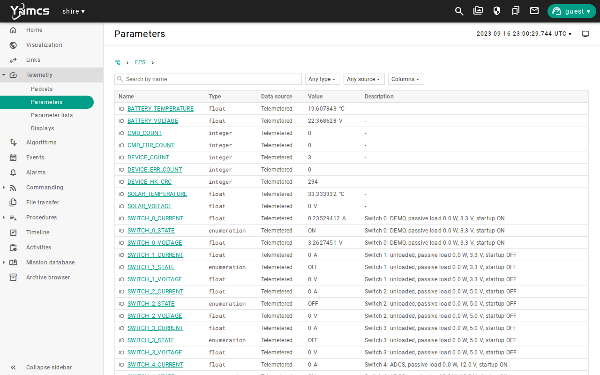

The EPS simulator has a backdoor that sets the battery state of charge.
The voltage is 16 V plus 8 V times the state of charge, so a state of charge of 40 percent is about 19.2 V.
Open `/EPS/BACKDOOR_EPS_SET_SOC`.
Set `SOC_PPM` to `400000`, then send the command.
The value is in millionths, so `400000` is 40 percent.

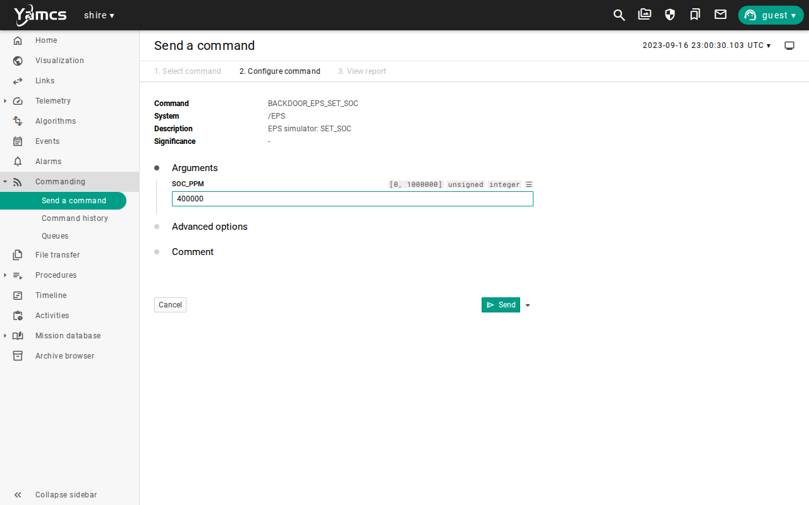

The EPS publishes housekeeping every 10 simulated seconds, so wait for fresh telemetry.
Return to the EPS parameters.
The voltage is now about 19.2 V, shown in red with a downward arrow to mark the side of the limit that it crossed.

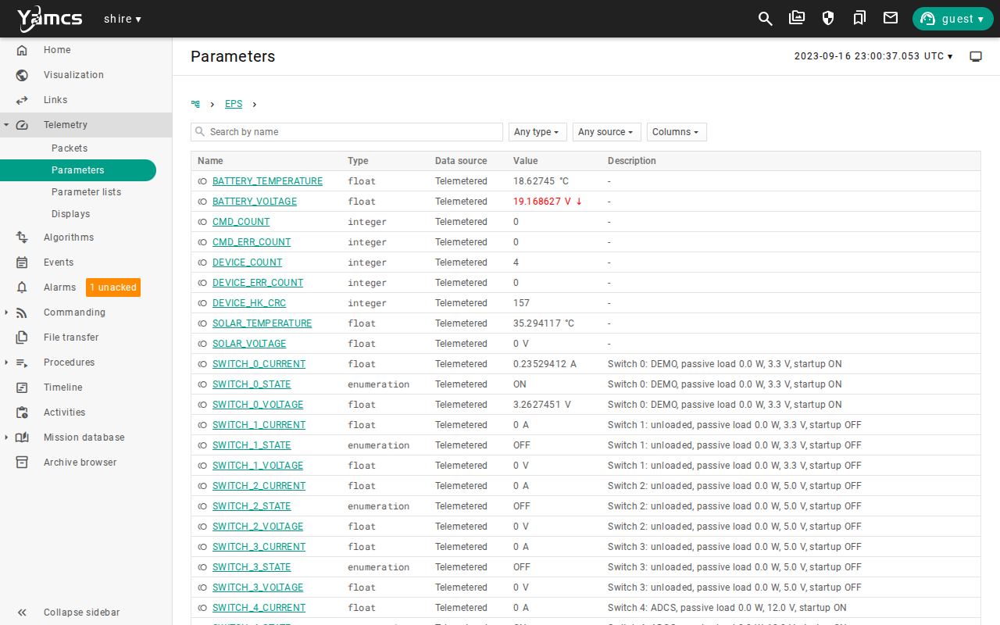

The **Alarms** item in the sidebar now has an amber badge with one unacknowledged alarm.
Open **Alarms** and select the `/EPS/BATTERY_VOLTAGE` row.
The detail panel shows a severity of `WARNING`, the number of violations, the value that triggered the alarm, and the live value.
YAMCS draws `WARNING` in amber, which is the yellow limit.

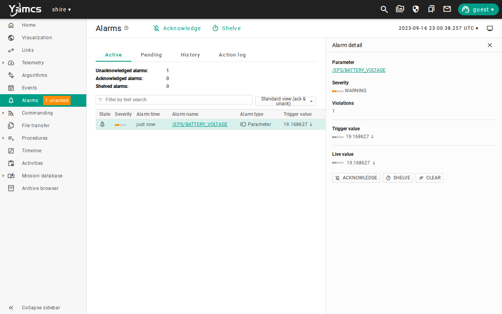

Drain the battery further.
Send `/EPS/BACKDOOR_EPS_SET_SOC` with `SOC_PPM` set to `150000`, which is about 17.2 V.
Wait for fresh housekeeping and return to **Alarms**.
The same alarm has escalated to `CRITICAL`, which is the red limit.
The severity bars and the sidebar badge are now red, and the violation count has increased.

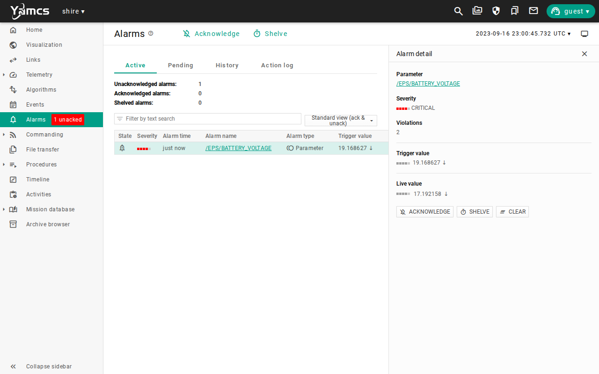

Acknowledge the alarm to tell the team that you have seen it.
Select **Acknowledge**, enter a comment, and select **OK**.

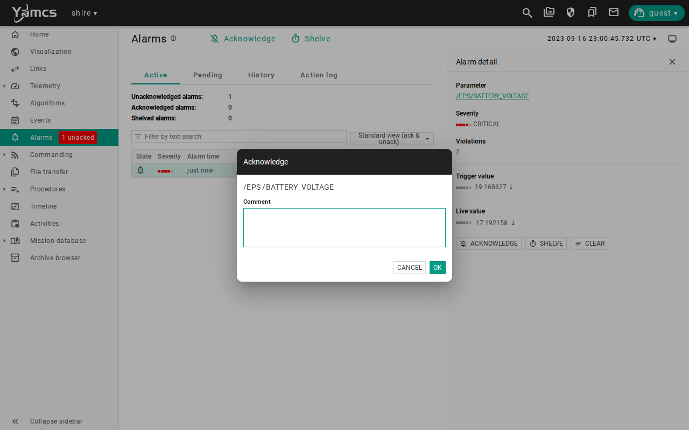

The alarm is still active because the battery is still low, but it now shows as acknowledged and the sidebar badge reads `1 acked`.

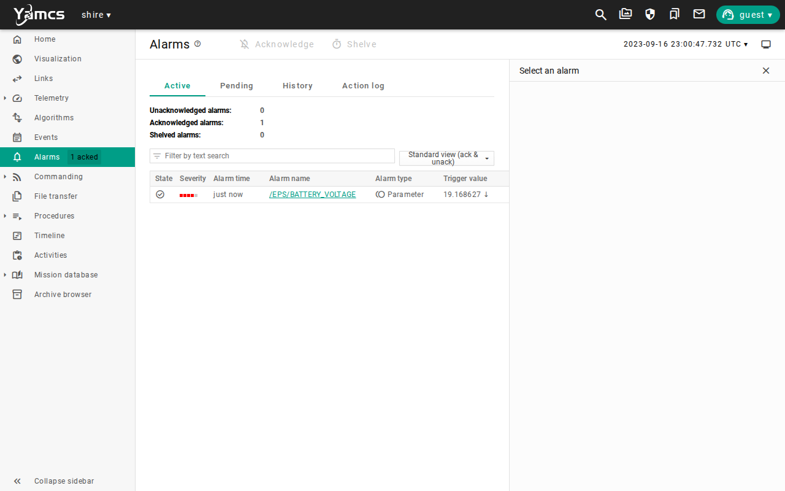

Resolve the condition.
Send `/EPS/BACKDOOR_EPS_SET_SOC` with `SOC_PPM` set to `800000`, wait for fresh housekeeping, and return to **Alarms**.
Because the alarm was acknowledged and the value is back inside its limits, it leaves the **Active** list.

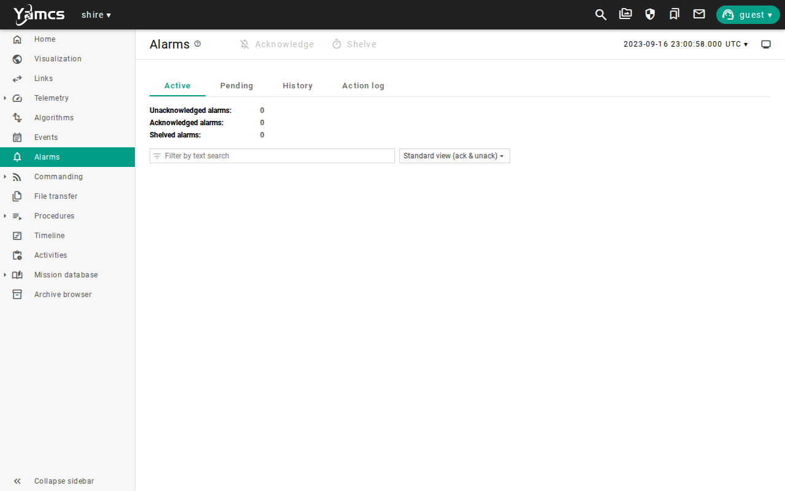

Open the **History** tab.
YAMCS recorded the alarm with its start time, stop time, and duration.
An alarm that you had not acknowledged would have stayed in the **Active** list after the recovery until someone acknowledged it.

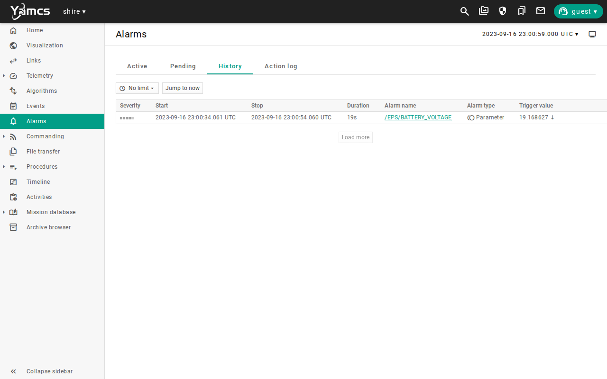

## Run the Cmd/Tlm stacks

Three procedure stacks check the rest of this scenario.
Each one is under **Procedures**, then **Stacks**.

| Stack | What it checks |
| --- | --- |
| `CmdTlmLimits.ycs` | Commands are counted and rejected correctly, and the battery moves through its limits. |
| `CmdTlmStoredCommands.ycs` | A stored command table is uploaded, activated, and run. |
| `CmdTlmPatches.ycs` | Flight software patches work, bad patches are caught, and every patch is undone. |

For each stack, select the first step, then select **Run all from selected step**.
The labels beside each check show the current telemetry value, so a check can read not satisfied after the value has moved on.
The check mark beneath each step records the result when that step ran.

### Commands and limits

`CmdTlmLimits.ycs` does the following:

* Resets the cFE Executive Services counters, sends a NOOP, and confirms that the command counter rises by exactly one
* Sends an invalid RTS number to Stored Command and confirms that the error counter rises and the command counter does not
* Drives the battery to a full charge, then to 40 percent and to 15 percent, and checks the voltage against 20 V and 18 V
* Restores the charge and confirms the voltage is back above 22 V

It takes about half a minute.
It raises the same alarm that you saw above, so acknowledge it in **Alarms** when the stack finishes.

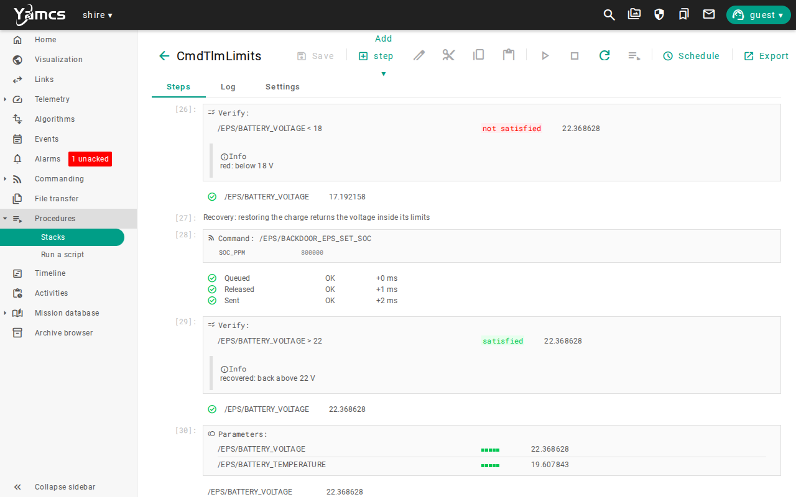

### Stored commands

A Relative Time Sequence, or RTS, is a list of commands that Stored Command sends at fixed delays after it starts.
RTS 12 is empty when the spacecraft boots.
The DRM builds a replacement table for it with the flight software, named `up_sc_rts012.tbl`, which sends a NOOP to cFE ES, cFE TBL, and cFE SB one second apart.

`CmdTlmStoredCommands.ycs` follows the same path an operator would:

* Starts RTS 12 and confirms that Stored Command rejects it because the table is empty
* Uploads the table by CFDP with the `/CCSDS/CFDP_UPLOAD` command, which completes when the transfer does
* Loads the table, validates it, and activates it with the cFE Table Services commands
* Enables RTS 12, because activating a table leaves its RTS disabled, and starts it
* Confirms that the ES, TBL, and SB command counters each rose by exactly one
* Loads the empty boot table from `/cf`, so the spacecraft is back in its boot state and the stack can run again

The first step is meant to fail.
The flight software log shows an `SC` error event, `Start RTS 012 Rejected: Invld Len Field for 1st Cmd in Sequence`, with a command length of 7.
An empty table has a length of zero in its first command, so Stored Command refuses to start it.
That event and the `CMDERRCTR` count of one are the expected result.

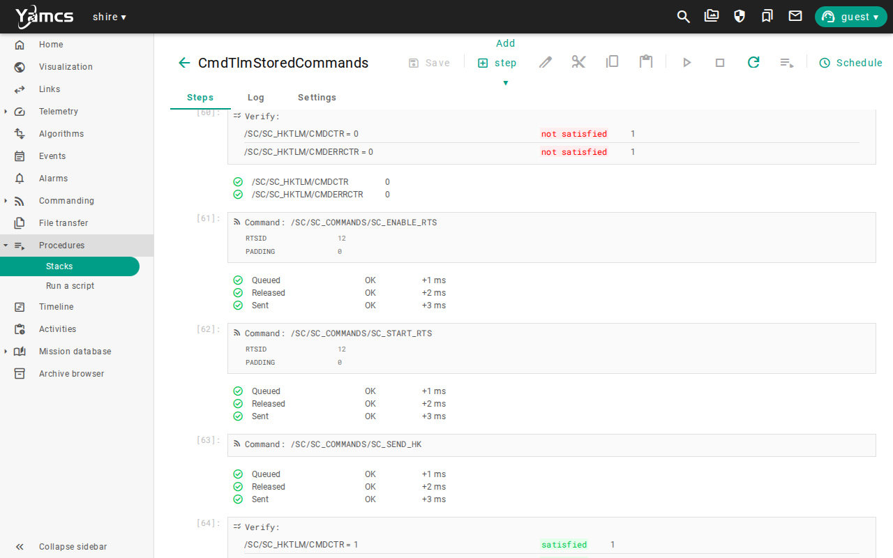

Open **File transfer** to see the upload.
The local file is in the `cfdpUp` bucket, the remote file is under `/d`, and the transfer shows as complete.
You can start an upload yourself from this page with **New transfer**, because the files that are built for uplink are already in the bucket.

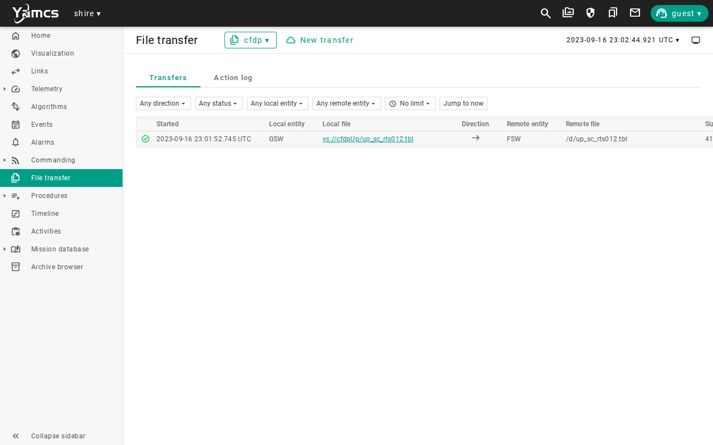

## Patch the EPS application

An application patch replaces the running module with a new build.
The DRM carries a patched EPS module, `up_eps.so`.
It refuses to switch on switch 5, the 20 W load bank that can run the battery down, and it changes nothing else.

First look at what is running.
Send `/EPS/EPS_NOOP_CC`, then send `/CFE_ES/CFE_ES_COMMANDS/CFE_ES_QUERY_ONE` with `APPLICATION` set to `EPS_APP`.
Open the `CFE_ES_ONEAPPTLM` parameters.
`APPINFO_FILENAME` is `/cf/eps.so`, the module that the spacecraft booted with.

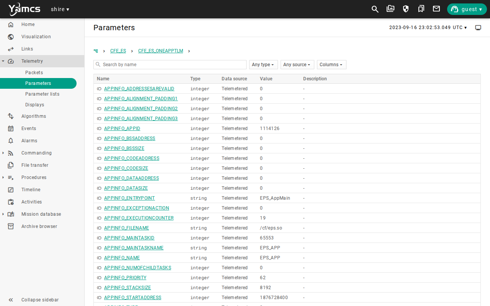

Upload the patched module.
Open `/CCSDS/CFDP_UPLOAD`.
Set `OBJECT_NAME` to `up_eps.so` and `REMOTE_PATH` to `/d/up_eps.so`, then send the command.

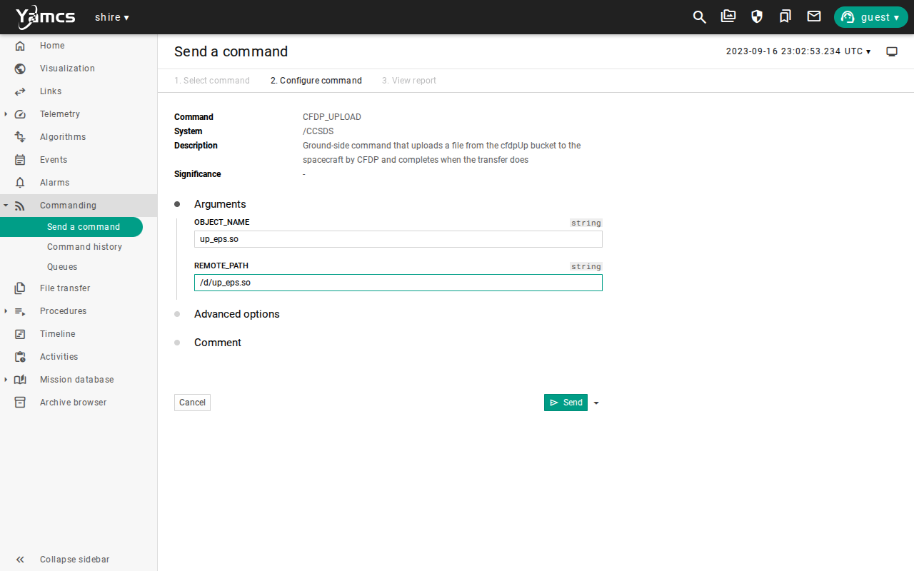

Open **File transfer** and wait for the transfer to complete.

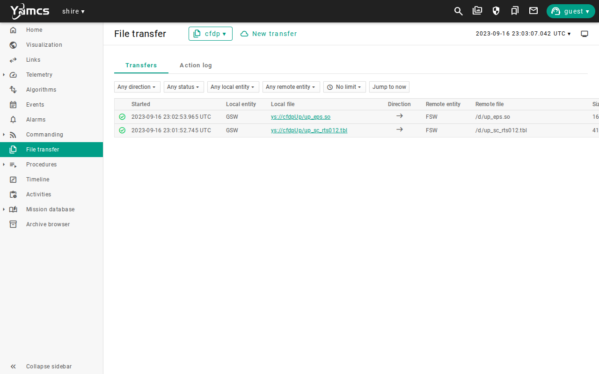

Reload the application from the patched module.
Open `/CFE_ES/CFE_ES_COMMANDS/CFE_ES_RELOAD_APP`.
Set `APPLICATION` to `EPS_APP` and `APPFILENAME` to `/d/up_eps.so`, then send the command.

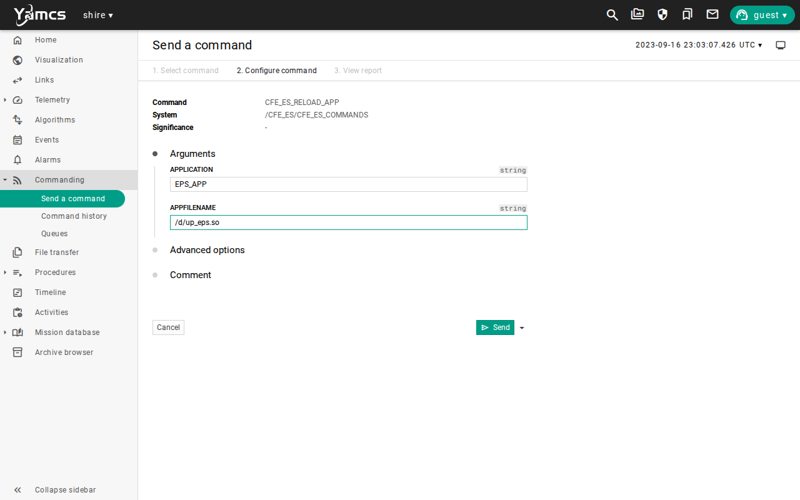

The application stops and starts again, so its counters start from zero.
Wait until the EPS `CMD_COUNT` reads `0`, then query the application again.
`APPINFO_FILENAME` is now `/d/up_eps.so`, and the application ID has changed because ES started a new instance.


Test the patch.
Send `/EPS/EPS_SWITCH_ON_CC` with `SWITCH_NUMBER` set to `5`.
The flight software refuses the command and reports that the switch is protected.

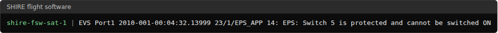

Request fresh EPS housekeeping with `/EPS/EPS_REQ_HK` and open the EPS parameters.
`CMD_ERR_COUNT` is `1` because the refused command counts as an error, and `CMD_COUNT` is still `0`.

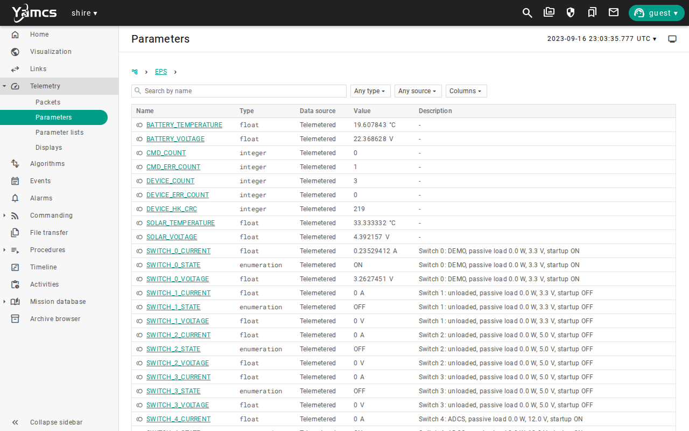

Search for `SWITCH_5` to confirm that the load bank is still off.
Other switches still work, and you can confirm this by switching one on and off.

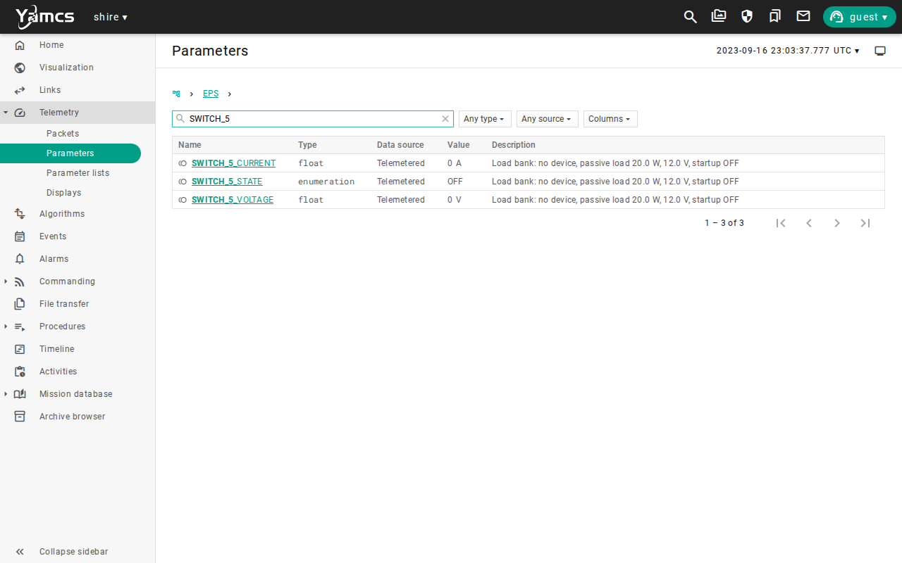

Undo the patch.
Reload the application with `APPFILENAME` set to `/cf/eps.so` and wait until `CMD_ERR_COUNT` reads `0`.
Query the application again to confirm that `APPINFO_FILENAME` is `/cf/eps.so`.


Reloading an application restarts it in its boot state, so a device that the application had enabled is disabled again.
Do not reload the Radio application during a pass, because it restarts disabled and the uplink is lost until it is enabled again.

## Run the patch stack

`CmdTlmPatches.ycs` repeats the EPS patch with assertions and adds three more patches:

* Uploads an LC watchpoint table that adds watchpoint 12, which watches whether the battery voltage is below 20 V
* Confirms that LC goes from three watchpoints to four, that the new watchpoint is false with a full battery and true when the battery is drained to 40 percent, and that it is false again after recovery
* Restores the boot LC table from `/cf`
* Uploads a deliberately corrupt RTS 13 table, confirms that Stored Command rejects it during validation, aborts the load, and confirms that RTS 13 is still empty
* Reloads an application from a file that was never uploaded and confirms that ES refuses it before it touches the application

The LC watchpoint is the onboard twin of the yellow limit.
The ground limit raises an alarm for people, and the watchpoint lets the flight software act on the same condition without the ground.
The stack drains the battery to 40 percent to exercise the watchpoint, so it raises the yellow alarm again.
Acknowledge it in **Alarms** when the stack finishes.

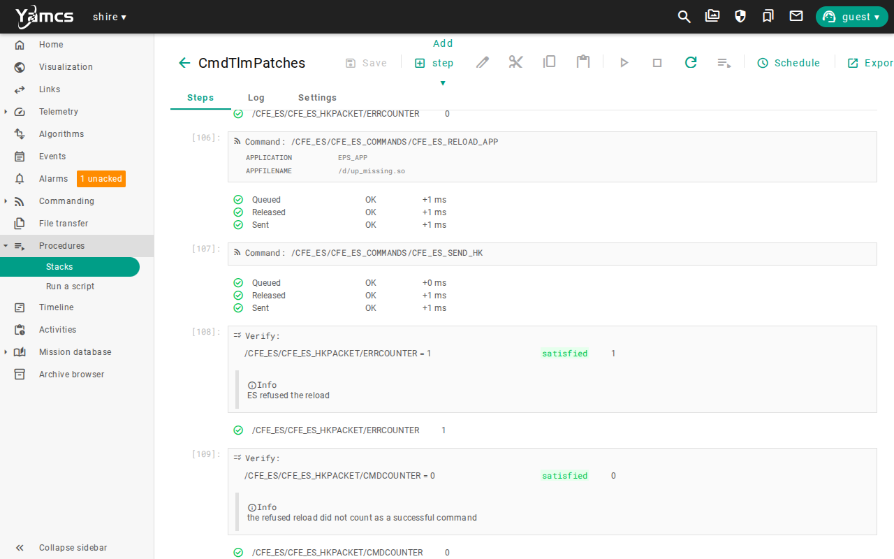

## Run it automatically

All three stacks can run without anyone at the keyboard:

```bash
make scenario SCENARIO=cmd-tlm-validation
```

The run takes a few minutes.
It passes when every command is accepted and every numeric check holds.
It does not assert on alarms, because the alarm display is part of the manual exercise above.

## Review

Cmd/Tlm validation of the available DRM systems is complete.

You have:

* Confirmed that commands are accepted, counted, and rejected correctly
* Watched a yellow limit and a red limit raise an alarm, acknowledged it, and seen it resolve
* Uploaded a stored command table, activated it, and run it
* Patched an application from the ground and proved the patch by its behavior and by its module file
* Seen an onboard watchpoint match a ground limit
* Seen a corrupt table and a missing file refused

This walkthrough leaves the spacecraft in its boot configuration.
Every patch is undone, and the only things left behind are the alarm history and the file transfer records.

For a clean repeat, save the evidence, run `make stop`, then start a new DRM.

***
Last reviewed: 20261026
