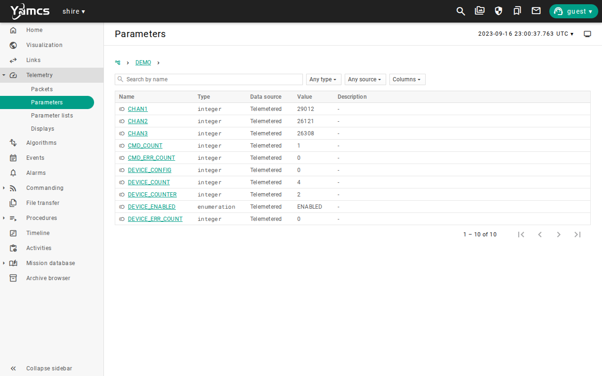
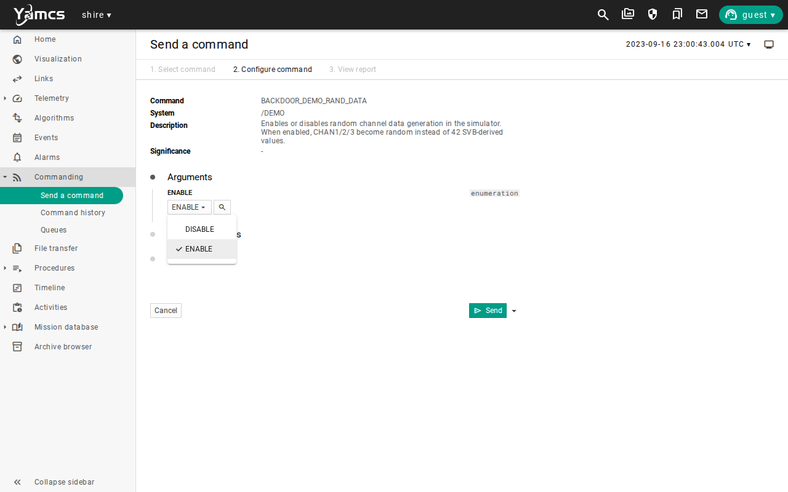
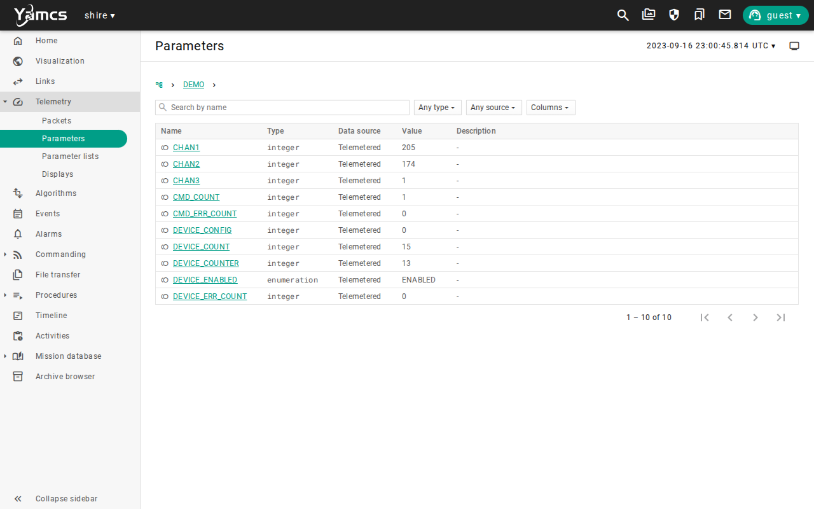
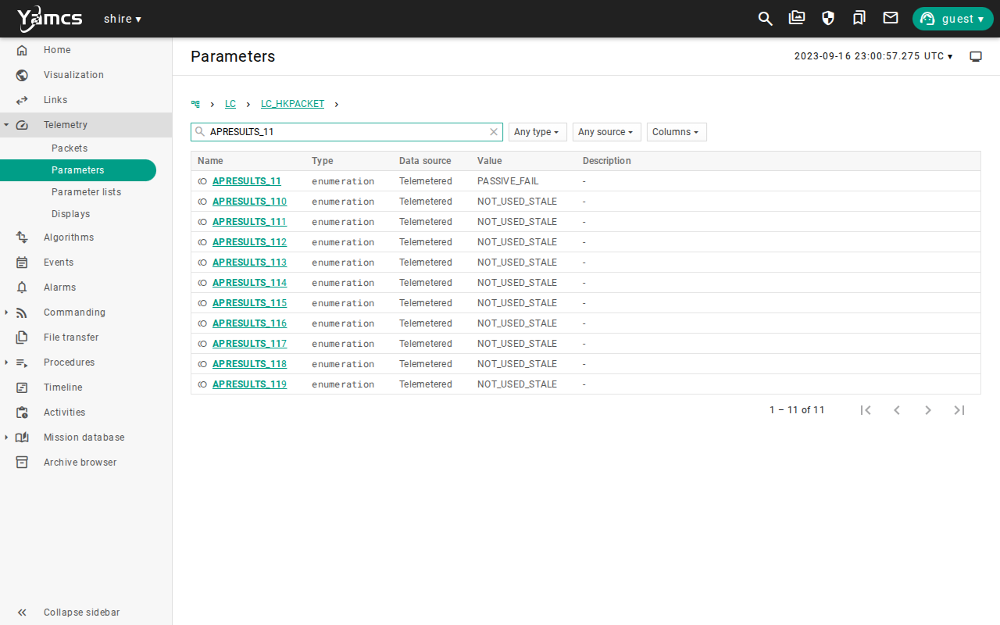
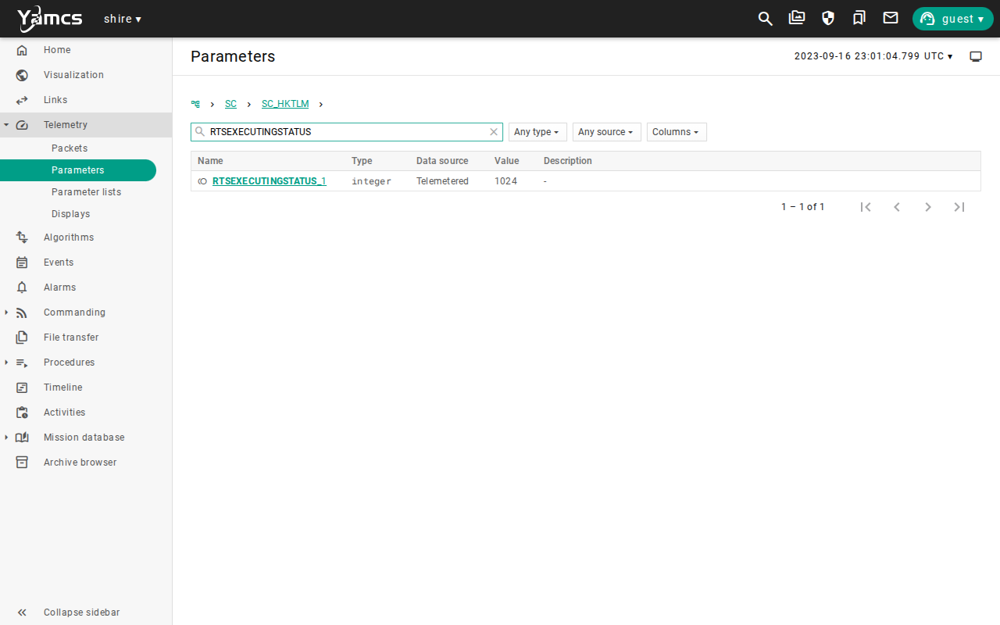
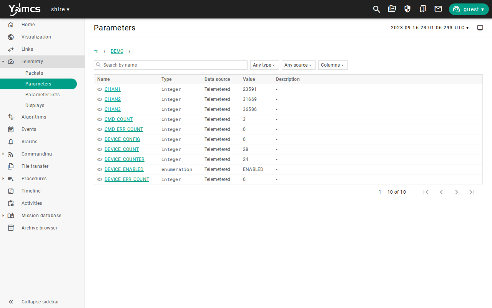
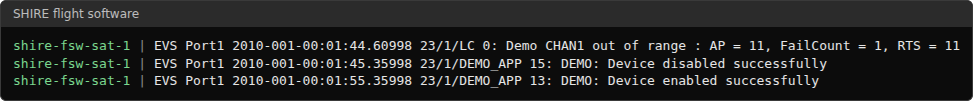
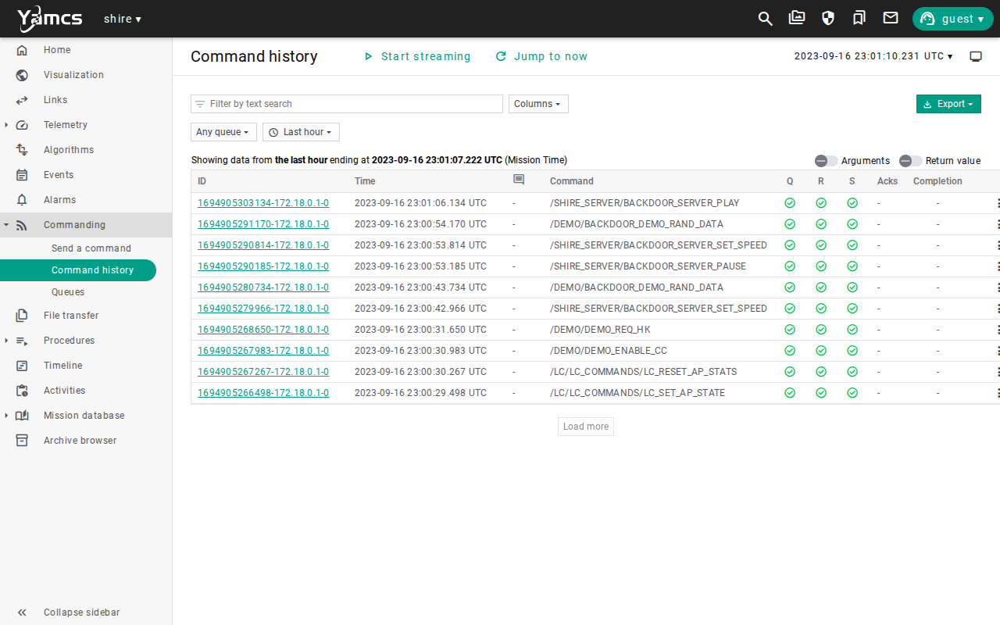

# Fault Detection and Recovery

## Mission brief

The spacecraft spends most of its time out of contact.
A device can fail in the minutes between passes, and a controller on the ground cannot see it, let alone fix it.
The spacecraft has to notice the fault and recover on its own, and the team has to be able to prove afterward that it did.
This is the eighth lesson in the [lesson plan](overview.md#the-lesson-plan), in the Autonomy and operations unit.

## Objective

In this scenario, you will learn how the spacecraft detects a fault and recovers without a command from the ground.
As the flight controller, your job is to establish a healthy baseline, inject a fault into a payload device, watch the flight software detect it and restart the device, and prove from the evidence that the ground did not do it.

## Prerequisites

This lesson needs three earlier lessons, [Commissioning](commissioning.md), [Simulation Time and Repeatability](simulation-time-repeatability.md), and [Cmd/Tlm Validation](cmd-tlm-validation.md).
You use these skills from them:

* Sending a command from its form and reading a parameter page
* Pausing the simulation and changing its speed
* Reading limits and stored command status

Before you begin, ensure you have:

* Completed [Getting Started](../manual/handbook/getting-started.md)
* Selected the default `sat-1` configuration with `scenario: nominal` in `build/active.yaml`, and run `make`
* About 30 minutes

This lesson starts from a freshly booted spacecraft, so it does not need anything that an earlier lesson left behind.
Stop any running lab with `make stop` before you start a new one.

## Overview

The spacecraft protects itself with two flight applications that work together.
Limit Checker, or LC, watches telemetry and compares values with limits.
Stored Command, or SC, holds the command sequences that the spacecraft runs on its own, which are called Relative Time Sequences, or RTS.

The two meet in an action point.
A watchpoint is one comparison, such as a value below a limit.
An action point combines watchpoints with logic, and when its result fails often enough, it starts an RTS.
In this lesson the payload is the Demo device, which streams three channels of data.
Three tables in the flight software define the response.

| Element | Role in this lesson |
| --- | --- |
| LC watchpoint 10 | Checks that the Demo device enabled byte in Demo housekeeping equals 1. |
| LC watchpoint 11 | Checks whether Demo channel 1 is below 256, when healthy readings sit around 32768. |
| LC action point 11 | Combines both watchpoints with a logical AND, starts active, and requests RTS 11 after one failure. |
| RTS 11 | Disables the Demo device, waits ten seconds, and enables it again. |

Because the action point needs the device to be enabled as well as the channel to be out of range, a device that was switched off on purpose does not trigger a restart.

The Demo simulator can play the fault.
The `BACKDOOR_DEMO_RAND_DATA` command makes it send random channel values, which is a device that has gone bad.
It is a backdoor into the simulator, so it injects the fault without changing any flight software.

You will follow these phases:

* Establish the baseline
* Inject the fault
* Watch the response
* Recover and arm again

The screenshots below show one completed run.
Simulation times, counters, and values will differ in your run.

## Establish the baseline

Start the lab and wait for the startup sequences to settle, as you did in [Commissioning](commissioning.md#startup):

```bash
make start
```

Send these commands, which make the starting state explicit.

1. Send `/LC/LC_COMMANDS/LC_SET_AP_STATE` with `APNUMBER` set to `11` and `NEWAPSTATE` set to `LC_APSTATE_ACTIVE`.
2. Send `/LC/LC_COMMANDS/LC_RESET_AP_STATS` with `APNUMBER` set to `11` and `PADDING` set to `0`.
3. Send `/DEMO/DEMO_ENABLE_CC`, then `/DEMO/DEMO_REQ_HK`.

Open **Telemetry**, then **Parameters**, and select the `/DEMO` system.



`DEVICE_ENABLED` is `ENABLED`, and the three channels hold values far above the limit of 256.
Now read the onboard rule.
Open the `/LC/LC_HKPACKET` system and search for `APRESULTS_11`.


The search also matches `APRESULTS_110` through `APRESULTS_119`, which are unused, so look at the first row.
`ACTIVE_PASS` says that action point 11 is armed and that its watchpoints agree that the device is healthy.

## Inject the fault

The response is short, so slow the simulation down to look at it.
Send `/SHIRE_SERVER/BACKDOOR_SERVER_SET_SPEED` with `SPEED` set to `0.5`.
Open `/DEMO/BACKDOOR_DEMO_RAND_DATA`, set `ENABLE` to `ENABLE`, and send it.



Open the `/DEMO` parameters again.



All three channels dropped below 256, so the device is still enabled and is now sending nonsense.
The flight software did not change, and only the data did.
A fault like this is easy to see in a parameter table, and the ground might not look at that table for hours.

## Watch the response

You do not need to send anything now, because the spacecraft is already responding.
Wait until `/SC/SC_HKTLM/RTSEXECUTINGSTATUS_1` reads `1024`, which is the value of bit 10 and says that RTS 11 is running.
Then send `/SHIRE_SERVER/BACKDOOR_SERVER_PAUSE`, so the response is frozen while you read it.
Open `/LC/LC_HKPACKET` and search for `APRESULTS_11`.



The result is `PASSIVE_FAIL`.
The action point detected the failure, and LC made it passive when it tripped, so it cannot request the RTS again while the fault continues.
Open the `/DEMO` parameters.


`DEVICE_ENABLED` is `DISABLED`, so the restart is under way.
Open the `/SC/SC_HKTLM` system and search for `RTSEXECUTINGSTATUS`.



The status is `1024`.
You have now seen all three parts of the response together, which are the failed action point, the running sequence, and the disabled device.

## Recover and arm again

Send `/SHIRE_SERVER/BACKDOOR_SERVER_PLAY` and set the speed back to `1`.
Send `BACKDOOR_DEMO_RAND_DATA` with `ENABLE` set to `DISABLE`, which removes the fault.
Wait for `DEVICE_ENABLED` to read `ENABLED` and for the channels to climb back above 256.



The device is back, and its data is valid.
RTS 11 enabled it again ten seconds after it disabled it, and you did not command either.
The flight software wrote the events that tell the story, and you can read them.

```bash
docker logs shire-fsw-sat-1 | grep -E "LC 0:|DEMO_APP 1[35]:"
```



The detection and the disable are under a second apart in simulation time, and the enable follows ten seconds later.
Now prove that the ground did not do it.
Open **Commanding**, then **Command history**.



Every command in the history is one you sent, and none of them disables or enables the Demo device after the fault began.
The restart is not in the command history, because it did not come from the ground.
The flight software events are the only record of it.

Last, arm the action point again.
LC made action point 11 passive when it tripped, and it stays passive until you change it.
Send `LC_SET_AP_STATE` with `APNUMBER` `11` and `NEWAPSTATE` `LC_APSTATE_ACTIVE`, and send `LC_RESET_AP_STATS` with `APNUMBER` `11`.


The action point is `ACTIVE_PASS` again, and the spacecraft is back in its boot configuration.
Rearming is an operator decision on a real mission, because a fault that returns after a restart would otherwise start a restart loop.

## Run it automatically

`make scenario SCENARIO=demo-fdir` runs `DemoFDIR.ycs` headless.
The stack arms the action point, enables the device, injects the fault, checks that RTS 11 is executing and that the device is disabled and then enabled, checks that the channels return above 256, and arms the action point again.
The scenario also checks the flight software log for the detection event once, the disable event once, and the enable event twice, because the response is onboard and the log is the record of it.
It takes about two and a half minutes, most of it starting the lab.
See [Scenarios and initial conditions](../manual/how-to/scenarios.md) for every registered scenario.

## Limitations

This scenario shows one fault and one response, and it does not qualify a fault protection design.
Keep these limits in mind when you read its results:

* The fault is a device that sends random data, and the lesson shows no other failure, such as a stuck value, a silent device, or a bad command.
* The response restarts one device, and the spacecraft has no Safe mode, so a fault that a restart does not cure has no further response.
* There is no onboard response to a low battery, a pointing fault, or a rejected radio frame, because no limit checker action point exists for them in this configuration.
* The detection is one failure of one action point, which restarts the device on the first bad sample, and a real design would usually wait for several.
* The action point stays passive after it trips, so a second fault in the same run needs you to arm it again.
* The ground does not see the restart except through the flight software events and the housekeeping that it happens to sample.
* The stack samples a short lived state, so a loaded host can make a verify step miss it, and the automated scenario does not prove timing limits.
* The screenshots show one run, so values will differ in yours.

Use the [evidence packet](overview.md#evidence-packet) when you need to retain the result of a run.

## Review

You can now tell a fault that the spacecraft handled from one that the ground handled, and show which it was.

You have:

* Established a healthy baseline for the Demo device and read the onboard action point that guards it
* Injected a fault into the device with a simulator backdoor
* Watched Limit Checker detect the fault and Stored Command run the response
* Shown from command history and flight software events that the ground did not restart the device
* Armed the action point again so the response can run a second time

This lesson adds a habit to the evidence packet.
Record the events and the stored command status as a timeline, with the time of the fault, the detection, the disable, and the enable.
Telemetry shows the state, and the flight software events show the order in which things happened.

Check that you can answer these before you move on:

* Why does the action point need the device enabled as well as the channel out of range?
* Why did LC make the action point passive when it tripped, and what do you do about it?
* Where is the evidence that the ground did not restart the device?

The [lesson plan](overview.md#the-lesson-plan) continues with [Nominal Operations](nominal-operations.md).
There you bring every skill together in one complete pass.

***
Last reviewed: 20261029
