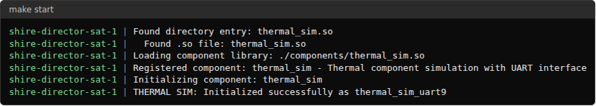
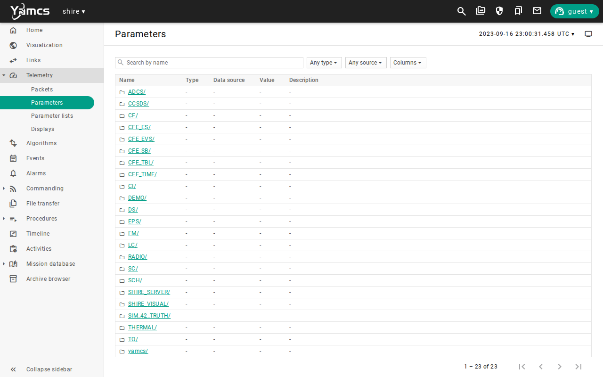
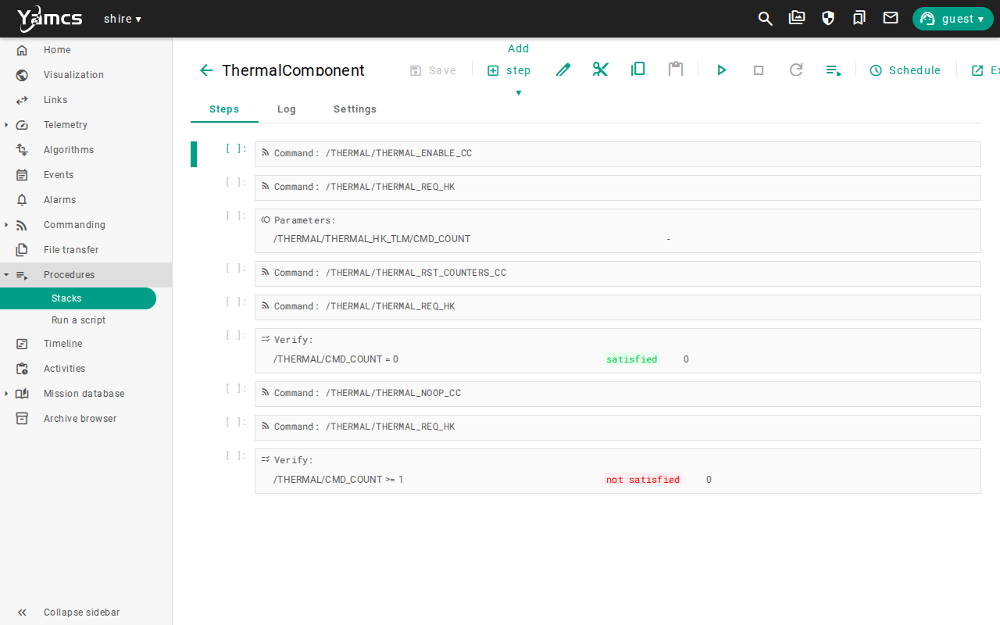
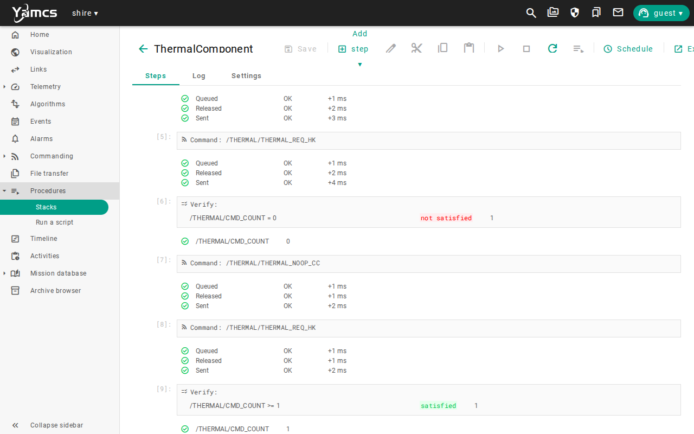
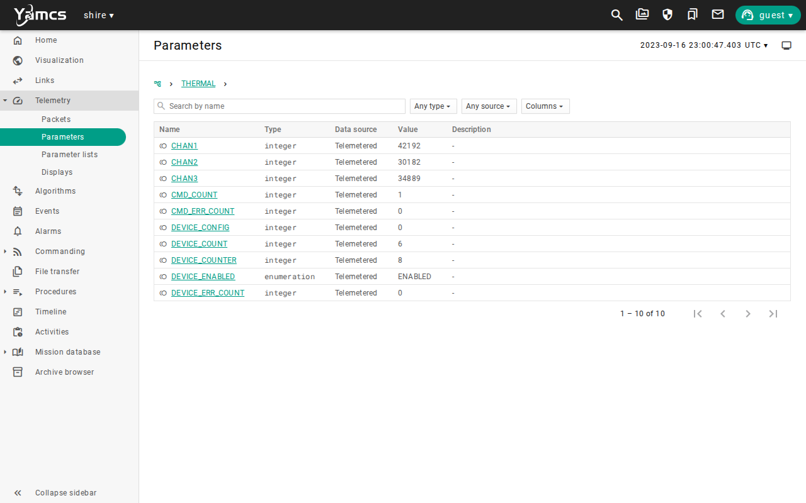
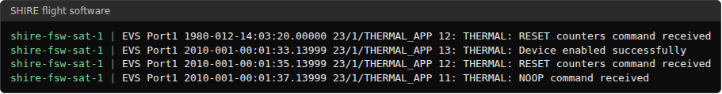

# New Component Development

## Mission brief

The team wants to fly a new device, and the spacecraft has nothing that can talk to it.
Writing a component from nothing takes weeks, and most of the work is the same for every device.
SHIRE starts the team from a working component and leaves it the part that belongs to the new device.
This is the eleventh lesson in the [lesson plan](overview.md#the-lesson-plan), in the Engineering and analysis unit.
The engineering lessons work in files and terminals, so this one shows command output and a few screenshots.

## Objective

In this scenario, you will learn how a component joins the spacecraft.
As an engineer, your job is to create a component from the mold, wire it into the flight software and the ground software, test its simulator, start the lab with it, and run its checkout stack, and to know which work the mold leaves to you.
The lesson walks part of the [Development Workflow](../manual/core-concepts/development-workflow.md), and it assumes that you have read all of it.

## Prerequisites

This lesson needs three earlier lessons, [Commissioning](commissioning.md), [Radio Link and Command Paths](radio-link-command-paths.md), and [Cmd/Tlm Validation](cmd-tlm-validation.md).
You use these skills from them:

* Reading the YAMCS telemetry pages and running a stack from **Procedures**
* Knowing that a command reaches the spacecraft and a counter proves it
* Reading flight software events

Before you begin, ensure you have:

* Read the [Development Workflow](../manual/core-concepts/development-workflow.md) from start to finish, which is the one thing in this list that you must not skip
* Completed [Getting Started](../manual/handbook/getting-started.md), and run `make` once so the images exist
* A clean checkout with no uncommitted work in `cfg/`, `comp/`, or the `yamcs/` submodule, because this lesson edits them
* About two hours

The Development Workflow is the process that every SHIRE component follows, from its interface document to a board with the physical device.
This lesson does only a part of it, and without the whole you cannot tell which part, or what the rest asks of you.
Pay particular attention to these parts of the workflow:

* The order of the stages, which moves from the smallest test to the largest and returns to the simulator after every change that the hardware forces
* The rule that the simulator is a development model that the physical device overrules
* The hardware transition checklist, because it names the evidence that a new target needs

This lesson starts from a clean checkout, and it does not need the lab running.
Stop any running lab with `make stop` before you start.
The component that you create is an exercise, so the last section shows how to remove it.

## Overview

A component in SHIRE is four things that share one name.
A flight application talks to the device over a bus, a simulator stands in for the device and talks back, ground definitions describe the commands and telemetry for YAMCS, and tests check each of them.
The mold, `make mold`, copies the Demo component and renames everything, so the new component starts life as a working clone of Demo.

| Part | Folder | What it holds |
| --- | --- | --- |
| Flight application | `src/`, `shared/` | The cFS application and the device protocol it speaks |
| Simulator | `sim/` | The device model that the Director runs, and its handling of the bus |
| Ground definitions | `gsw/` | The XTCE for YAMCS, a display, and the checkout stacks |
| Tests | `test-fsw/`, `test-sim/` | Unit tests for the application and the simulator |
| Command line tool | `cli/` | A program that drives the device simulator without cFS |

The example in this lesson is a thermal sensor, named `thermal`.
The mold does not know what a thermal sensor is, so the clone behaves like the Demo device and reports three channels derived from the Sun vector.
The lesson is about joining the spacecraft, and the model of the device is the work you do afterward.

The lesson covers the first three stages of the workflow and part of the fourth.

| Stage of the workflow | Where this lesson does it |
| --- | --- |
| 1, Review the template and create the component mold | Create the component and Check the identifiers |
| 2, Run the CLI with the simulator | Not done, because the clone's CLI is Demo's and teaches nothing new here, but a real device starts here |
| 3, Run cFS with the simulator | Wire it in, Test the simulator, and Start the lab and run the checkout |
| 4, Continue system development in SHIRE | See what is left names the work |
| 5 and 6, Board CLI and reconciliation | Not done, because they need the physical device |

You will follow these phases:

* Create the component
* Check the identifiers
* Wire it into the flight software
* Wire it into the ground software
* Test the simulator
* Start the lab and run the checkout
* See what is left

The screenshots below show one completed run.

## Create the component

From the repository root, run the mold with the new name.

```bash
make mold COMP=thermal
```

The names are lowercase letters, numbers, and underscores.
The mold copies `comp/demo/` to `comp/thermal/`, replaces every `demo`, `Demo`, and `DEMO` it finds in the text files it knows, and renames the files that carry the name.
It also changes the UART path and handle from 5 to 9, and it moves the four cFS message IDs from `0x18FA`, `0x18FB`, `0x08FA`, and `0x08FB` to `0x18FC`, `0x18FD`, `0x08FC`, and `0x08FD`.
It ends by listing the five flight software files and the one ground file that you must edit by hand.

```text
Next steps:
  1. Review the generated component in ./comp/thermal
  2. Add the component to your active mission, default is ./cfg/drm/drm.yaml
  3. Add the component to the FSW definitions:
       ./cfg/shire_defs/cpu1_cfe_es_startup.scr
       ./cfg/shire_defs/tables/sch_def_msgtbl.c
       ./cfg/shire_defs/tables/sch_def_schtbl.c
       ./cfg/shire_defs/tables/to_lab_sub.c
       ./cfg/shire_defs/targets.cmake
  4. Add the component to the GSW definitions:
       ./yamcs/src/main/yamcs/etc/yamcs.shire.yaml
```

## Check the identifiers

The mold chooses the new UART handle and message IDs because they are less likely to collide with Demo.
It does not take them from a registry, so nothing guarantees that they are free.
Search the repository for each one before you use it.

```bash
grep -rniI "0x18FC\|0x08FC\|0x18FD\|0x08FD" --include=*.h --include=*.c --include=*.xtce --include=*.yaml --include=*.cmake cfg comp
grep -rn "usart_9\|handle: 9" cfg comp --include=*.yaml --include=*.h --include=*.c
```

In this checkout, the only matches are inside `comp/thermal`, so the identifiers are free.
If either search finds another component, change the identifier in `comp/thermal` before you go on.

## Wire it into the flight software

The component exists, and the spacecraft does not know about it yet.
Five files and the spacecraft definition tell it what to start, when to ask it for data, and what to send down.

**Build target.**
Add `thermal` to the component list in `cfg/shire_defs/targets.cmake`, after `radio`.

**Startup script.**
Add a line for the application to `cfg/shire_defs/cpu1_cfe_es_startup.scr`, after the Radio.

```text
CFE_APP, thermal,     THERMAL_AppMain,    THERMAL_APP,  64,    8192, 0x0, 0;
```

**Scheduler messages.**
The Scheduler sends two requests to Demo, one for housekeeping and one for device data, and the new component needs the same two.
In `cfg/shire_defs/tables/sch_def_msgtbl.c`, include `thermal_msgids.h`, and replace the unused entries for command IDs 45 and 51.

```c
    /* command ID #45 - Thermal Request HK */
  { { CFE_MAKE_BIG16(THERMAL_REQ_HK_MID),  CFE_MAKE_BIG16(0xC000), CFE_MAKE_BIG16(0x0001), 0x0000 } },
    /* command ID #51 - Thermal Request Telemetry */
  { { CFE_MAKE_BIG16(THERMAL_REQ_HK_MID),  CFE_MAKE_BIG16(0xC000), CFE_MAKE_BIG16(0x0001), 0x0001 } },
```

**Schedule slots.**
In `cfg/shire_defs/tables/sch_def_schtbl.c`, use one unused activity to send message 45 every ten seconds and another to send message 51 every second.

```c
  {  SCH_ENABLED,  SCH_ACTIVITY_SEND_MSG, 10,  8, 45, SCH_GROUP_CFE_HK },   /* Thermal HK Request */
  {  SCH_ENABLED,  SCH_ACTIVITY_SEND_MSG,  1,  0, 51, SCH_GROUP_CFE_HK },   /* Thermal Telemetry Request */
```

The first goes after the Radio request in slot 1, which uses offset 8 where Demo, EPS, and Radio use 2, 4, and 6, and the second goes after the Demo telemetry request.

**Telemetry output.**
In `cfg/shire_defs/tables/to_lab_sub.c`, include `thermal_msgids.h` and subscribe the telemetry output to the two new telemetry messages.

```c
    {CFE_SB_MSGID_WRAP_VALUE(THERMAL_HK_TLM_MID), {0, 0}, 4},
    {CFE_SB_MSGID_WRAP_VALUE(THERMAL_DEVICE_TLM_MID), {0, 0}, 4},
```

**Spacecraft.**
In `cfg/drm/spacecraft/sat-1.yaml`, list the component and give it the bus settings that the mold chose.

```yaml
components:
  - name: "thermal"

thermal:
  string: "/dev/usart_9"
  handle: 9
  baudrate_hz: 115200
  ms_timeout: 250
```

The list already holds the four other components, and the new name goes after them.
The `thermal:` block goes at the end of the file.

## Wire it into the ground software

YAMCS loads each component's XTCE from a list in `yamcs/src/main/yamcs/etc/yamcs.shire.yaml`.
That file is in the `yamcs/` submodule, so a change to it for a real component needs its own pull request.
Add the entry after the Demo one.

```yaml
  - type: xtce
    args:
      file: mdb/components/thermal/thermal.xtce
```

The build copies the component's `gsw/` files into that path, so the file itself needs nothing else.

The mold has one more gap.
It does not rewrite `.ycs` stacks or `.par` displays, so the generated `ThermalComponent.ycs` still commands `/DEMO/DEMO_ENABLE_CC`.
Run unchanged, it passes, and it checks Demo.
A checkout that passes for the wrong component is worse than one that fails, so rename the names in the three files.

```bash
sed -i 's/DEMO/THERMAL/g; s/Demo/Thermal/g; s/demo/thermal/g' \
  comp/thermal/gsw/procedures/ThermalComponent.ycs \
  comp/thermal/gsw/procedures/ThermalFDIR.ycs \
  comp/thermal/gsw/displays/Thermal.par
```

Check that no `/DEMO/` path remains in the stacks.

```bash
grep -c "DEMO" comp/thermal/gsw/procedures/*.ycs
```

Each file reports a count of `0`.
`ThermalFDIR.ycs` now names thermal telemetry, and it still depends on the Limit Checker action point 11 and the Stored Command sequence that belong to Demo, so it will not pass for the new component until you write rules for it.

## Test the simulator

The mold copies Demo's tests with the new names, so the simulator has tests that pass before you change anything.

```bash
make test-sim
```

```text
Test #1: ThermalSimTests ..................   Passed    0.15 sec
Test #2: ThermalSimFailureTests ...........   Passed    0.00 sec
100% tests passed, 0 tests failed out of 2
```

When you change the model, these tests change with it.
They hold Demo's expected values, and a model that no longer matches them fails, which is how you know that you updated the tests and not only the code.

## Start the lab and run the checkout

Build and start the lab.

```bash
make
make start
```

The Director loads the new simulator and the flight software starts the new application.



Open **Telemetry**, then **Parameters**.



`THERMAL` is a space system beside `DEMO`, so YAMCS has loaded the component's XTCE.
Open **Procedures**, then **Stacks**, and open `ThermalComponent.ycs`.



Select the first step and choose **Run all from selected step**.



The last verify is satisfied, with `CMD_COUNT` at 1 after the NOOP.
The verify of the reset counter above it can show `not satisfied` for the old value while the line beneath it shows the new value, `0`, because the stack checks before the next housekeeping packet arrives.
The headless run of the same stack waits for the value, and passes.
Open the `/THERMAL` telemetry.



The device is enabled and the channels carry values, which come from the Sun vector in the clone's model.
The flight software wrote the events for the commands.



The counter, the events, and the telemetry agree, so the application starts, takes commands, and reads the simulated device.
You can also run the stack headless without the screenshots.

```bash
python3 yamcs/yamcs_commander.py --stack comp/thermal/gsw/procedures/ThermalComponent.ycs
```

It ends with `PASS: 0/9 step(s) failed`.
To make it a scenario of its own, add a file under `cfg/drm/scenarios/` with this stack in `verify_stacks`, and register it in `cfg/drm/drm.yaml`, as the other scenarios do.

## See what is left

The clone works, and it is not yet a thermal sensor.
These parts of the work are still yours.

* **The device model.**
  Replace the Sun vector channels in `comp/thermal/sim/thermal_sim.c` with your device, and change the protocol in `shared/thermal_device.c` to match.
  Update `test-sim/` as you go.
* **The flight tests.**
  `make test-fsw` runs the flight software unit tests, and the new component adds its own under `test-fsw/`, which still hold Demo's expectations.
* **The names the mold does not reach.**
  Search `comp/thermal` for `DEMO` in the descriptions and comments, and for names in files it does not rewrite.
* **Data storage and limits.**
  The Data Storage filter table, the Limit Checker tables, and the Stored Command sequences know nothing about the new messages.
* **Power.**
  The EPS wires its switches to the Demo, ADCS, and Radio loads, so the new device has no switch until you add one.
* **A real device.**
  The simulator proves the application against a model, and a real bus needs the hardware checks that [Processor in the Loop](processor-in-the-loop.md) begins.
* **The rest of the workflow.**
  Stages 2, 4, 5, and 6 of the [Development Workflow](../manual/core-concepts/development-workflow.md) are the way from this clone to a flight component, so reread them now that you have done the first stages.

## Remove the exercise

The component is not part of the DRM, so remove it again when you are done.

```bash
make stop
rm -rf comp/thermal
git checkout -- cfg/shire_defs cfg/drm/spacecraft
git -C yamcs checkout -- src/main/yamcs/etc/yamcs.shire.yaml
make
```

The last command rebuilds the images without the component.
Check `git status` before you move on, because a checkout that you edited for other work would show it there too.

## Limitations

This lesson shows how a component joins the spacecraft, and it does not make a flight ready component.
Keep these limits in mind when you read its results:

* The thermal component is a clone of Demo, and it reports the Sun vector, so the checkout shows that the plumbing works and says nothing about a thermal device.
* The mold's identifiers are not allocated from a registry, and the search in this lesson is the only check that they are free.
* The mold does not rewrite stacks or displays, so a clone that is not renamed passes its checkout for the wrong component.
* The scheduler slots and message numbers used here were free in this checkout, and a checkout that has changed may need other ones.
* The change to `yamcs.shire.yaml` is in a submodule, and a real component needs a pull request there.
* The lesson does not change the model, the tests, or the flight software unit tests, and it does not run `make test-fsw`.
* Nothing in this lesson touches hardware, and it skips the CLI stage of the workflow, so it is not a substitute for reading the workflow.
* The screenshots show one run, so values will differ in yours.

Use the [evidence packet](overview.md#evidence-packet) when you need to retain the result of a run.
See the [Component Mold](../manual/how-to/component-mold.md) guide for every substitution that the mold makes.

## Review

You can now add a device to the spacecraft and check that it works.

You have:

* Created a component from the mold and read what it generated
* Checked that its identifiers are not used by another component
* Wired it into the flight software and the ground software
* Found and fixed the names that the mold leaves in the stacks
* Run its simulator tests and its checkout stack against a running lab
* Listed the work the mold leaves to you
* Placed this lesson in the Development Workflow and named the stages that it did not do

This lesson adds a habit to the evidence packet.
Record the generated files and the checkout result against the reference component, which here is Demo, so a reader can tell what you changed from the clone.
A passing checkout is evidence only when you know it ran against the component you meant.

Check that you can answer these before you move on:

* Why does a checkout stack that still names Demo pass, and why is that a problem?
* Why must you search for the message IDs and the UART handle that the mold chose?
* Which parts of a new component does the mold leave to you?
* Which stages of the Development Workflow did this lesson skip, and when would you do them?

The [lesson plan](overview.md#the-lesson-plan) continues with Processor in the Loop.
There the team moves the flight software off the host and onto a processor.

***
Last reviewed: 20261030
