# Nominal Operations

## Mission brief

The spacecraft is commissioned, protected, and ready for routine work.
A normal day is one pass that begins with a check, ends with data on the ground, and leaves the spacecraft in a known state.
Nothing in a nominal pass is hard on its own, and the difficulty is doing every step in order and proving each one.
This is the ninth lesson in the [lesson plan](overview.md#the-lesson-plan), in the Autonomy and operations unit, and it brings together everything you have learned.

## Objective

In this scenario, you will learn how to run a complete pass.
As the flight controller, your job is to plan the pass before you start, prepare the spacecraft and the ground, open the radio window, review health, collect payload data, select a stored file and download it over the radio path, prove that the file arrived intact, and close the pass with an evidence packet.

## Prerequisites

This lesson uses every earlier lesson.
You use these skills from them:

* Reading link state, sending commands, and starting a pass with RTS 6 from [Commissioning](commissioning.md)
* Recording the simulation time and the run from [Simulation Time and Repeatability](simulation-time-repeatability.md)
* Reading battery values and limits from [Power and Eclipse](power-eclipse.md)
* Choosing a command path and proving which one carried a command from [Radio Link and Command Paths](radio-link-command-paths.md)
* Reading alarms and counting commands from [Cmd/Tlm Validation](cmd-tlm-validation.md)
* Rejecting what does not belong on the link from [Space Link Security](space-link-security.md)
* Arming the onboard protection from [Fault Detection and Recovery](fault-detection-recovery.md)

[Attitude Control](attitude-control.md) is the one lesson that this pass does not repeat, because the spacecraft stays in its boot pointing.

Before you begin, ensure you have:

* Completed [Getting Started](../manual/handbook/getting-started.md)
* Selected the default `sat-1` configuration with `scenario: nominal` in `build/active.yaml`, and run `make`
* About an hour

This lesson starts from a freshly booted spacecraft, so it does not need anything that an earlier lesson left behind.
Stop any running lab with `make stop` before you start a new one.

## Overview

A pass is a window in which the spacecraft can talk to the ground.
In the DRM, RTS 6 opens it by putting the Radio in Duplex mode, which lets the Radio send telemetry as well as receive commands.
The same sequence closes the window by returning the Radio to Receive mode after 480 scheduler wakeups, which is about eight minutes.
The payload is the Demo device, and the Data Storage application records its telemetry into files under `/d`.
The Radio sends a file down with the CFDP file transfer protocol, as you did in [Commissioning](commissioning.md#download-data).

You will follow these phases:

* Plan the pass
* Prepare the pass
* Open the window
* Review health
* Collect payload data
* Select the file
* Downlink the file
* Check the integrity
* Close the pass

The screenshots below show one completed run.
Simulation times, counters, and values will differ in your run.

## Plan the pass

Decide what a good pass looks like before you start, and do not choose limits after you see the result.
This pass uses these decisions.

| Decision | Choice for this pass |
| --- | --- |
| Command path | The debug path for setup, and the radio path for the file transfer command |
| Errors allowed | None, so the command error counters stay at `0` |
| Battery | Above its yellow limit of 20 V, with no active alarm |
| Window | The Radio reaches Duplex mode after RTS 6 starts, and returns to Receive mode at the end |
| Payload | The Demo device is enabled with a marker configuration of `10` |
| File | The file the flight software opened at boot, named for that time |
| Integrity | The size and the SHA 256 hash of the received file equal those of the flight file |
| End state | The Radio in Receive mode, and the Demo restart still armed |

If any of these fails, stop and keep the evidence, as the [Scenarios overview](overview.md#stop-or-recover-a-run) describes.

## Prepare the pass

Start the lab and wait for the startup sequences to settle, as you did in [Commissioning](commissioning.md#startup):

```bash
make start
```

Note the simulation time and the date, and keep the repository revision, because they belong in the evidence packet.
Open **Links**.

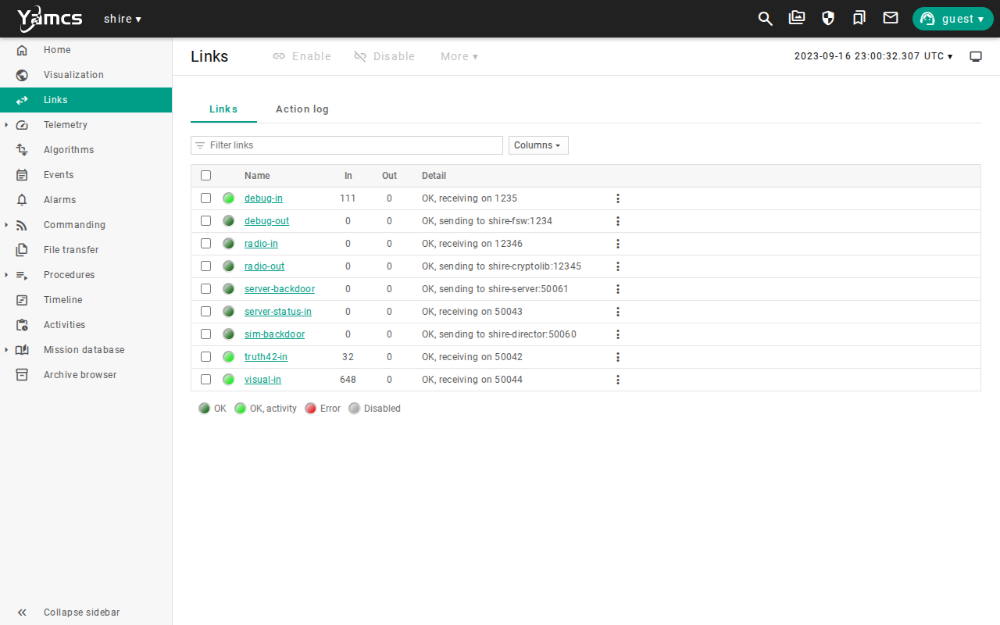

The state is what the [Radio Link and Command Paths](radio-link-command-paths.md) lesson showed.
Both command links are enabled, and the Radio is in Receive mode, so `radio-in` is idle.
Send `/SHIRE_GROUND/USE_DEBUG_UPLINK`, so that setup commands do not depend on the radio path.
Open **Alarms**.

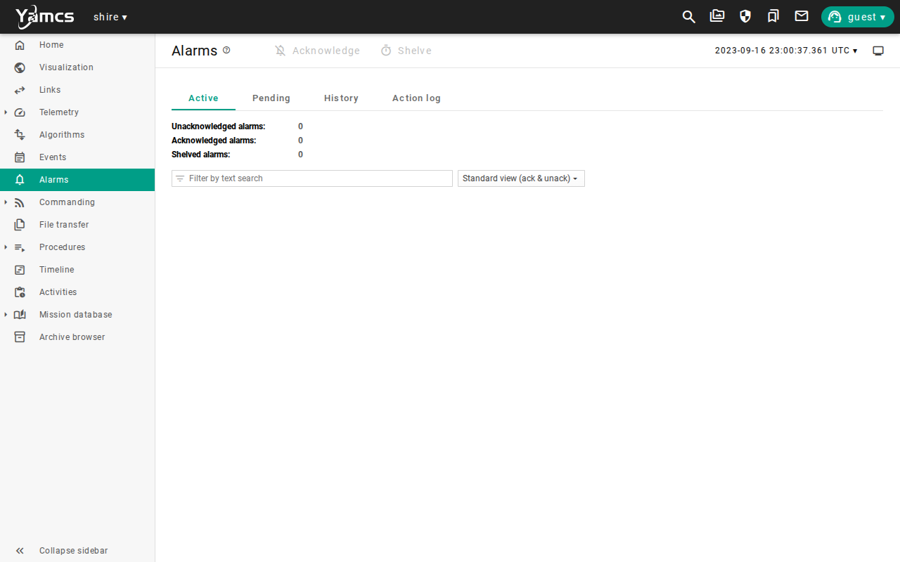

There are no alarms, so nothing needs attention before the pass.
Now record a zero baseline for the counters that this pass uses.
Send `/CFE_ES/CFE_ES_COMMANDS/CFE_ES_RESET` and `/CF/CF_COMMANDS/CF_RESET_COUNTERS` with `RESET_TYPE`, `SPARE1`, and `SPARE2` set to `0`, and then `CFE_ES_SEND_HK`.

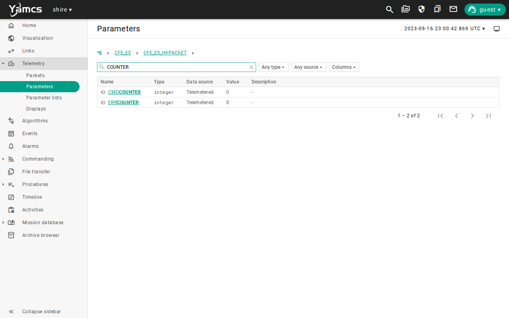

Both counters are `0`.
Any error that appears later is then an error from this pass.
Arm the Demo restart by sending `LC_SET_AP_STATE` with `APNUMBER` `11` and `NEWAPSTATE` `LC_APSTATE_ACTIVE`, and `LC_RESET_AP_STATS` with `APNUMBER` `11`, as you did in [Fault Detection and Recovery](fault-detection-recovery.md#recover-and-arm-again).

## Open the window

Open `/SC/SC_COMMANDS/SC_START_RTS`, set `RTSID` to `6`, and `PADDING` to `0`.

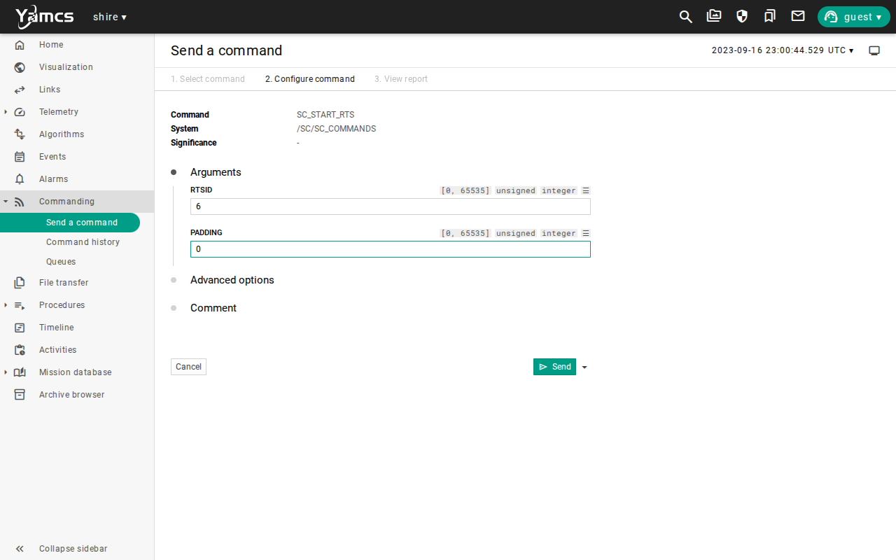

Send it, and open the Radio telemetry.

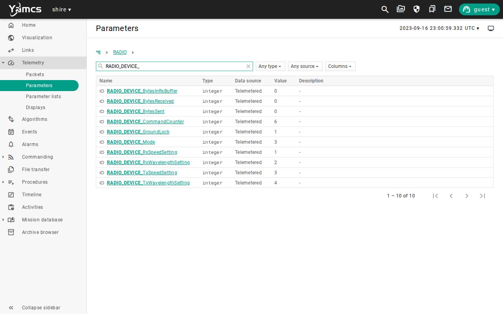

`RADIO_DEVICE_Mode` is `3`, which is Duplex mode.
The window is open, so the Radio can send telemetry as well as receive commands.
The sequence takes about a second to run.
The Radio reports the mode only after it has changed, so read it after a short wait.

## Review health

Before you collect data, check that the spacecraft is healthy enough to do it.
Open the `/EPS` telemetry and search for `BATTERY`.

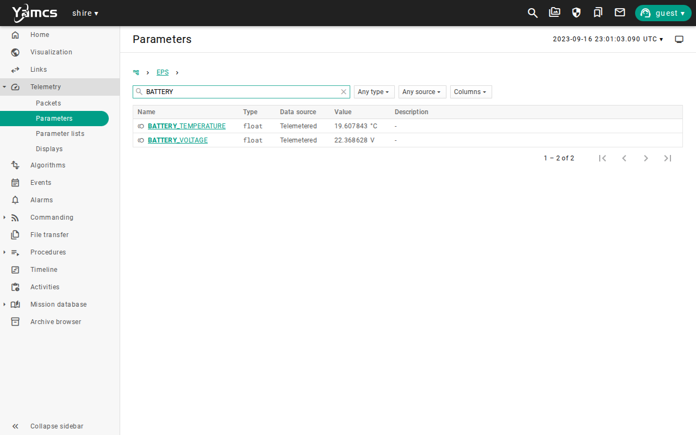

The battery is at about 22.4 V, which is above its yellow limit of 20 V, and the alarm page is still clear.
A battery near its limit would be a reason to stop and wait, because a pass loads the spacecraft with more work.
This is the same check that [Power and Eclipse](power-eclipse.md) and [Cmd/Tlm Validation](cmd-tlm-validation.md) taught.

## Collect payload data

Send `/DEMO/DEMO_ENABLE_CC`.
Send `/DEMO/DEMO_CONFIG_CC` with `DEVICE_CONFIG` set to `10`, and send `/DEMO/DEMO_REQ_HK`.
Open the `/DEMO` telemetry.

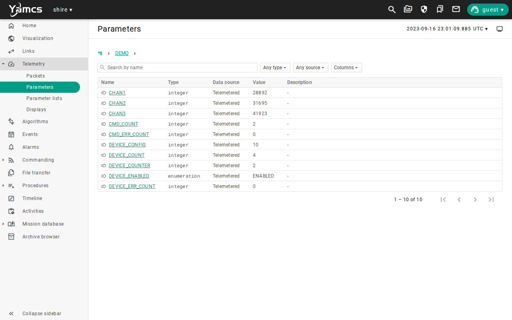

The device is enabled and reports the marker configuration of `10`.
The marker is an observation point, and it does not prove that a file holds only this activity.
Data Storage records the Demo telemetry into a file, and the file grows by about 230 bytes for each simulated second.
Let the simulation run for a few minutes at the speed you prefer, so that there is data to download.

## Select the file

Close the files so that the one you choose is complete.
Send `/DS/DS_COMMANDS/DS_CLOSE_ALL`.
Then send `/FM/FM_COMMANDS/FM_GET_DIR_PKT` with `DIRECTORY` set to `/d`, `DIRLISTOFFSET` set to `0`, and `GETSIZETIMEMODE` set to `1`, and open the `/FM/FM_DIRLISTPKT` telemetry.

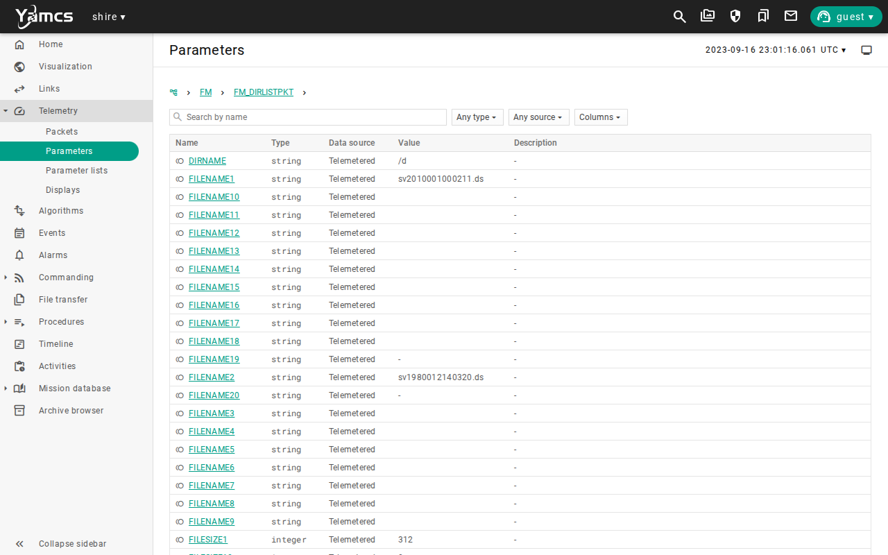

The listing shows two files.
The boot file is named for the time the flight software started, and it holds everything recorded since then.
The second file is the one that Data Storage opened when you closed the first, and it is named for the current time and is nearly empty.
Choose the boot file, because it is complete and it is the one with the data.
Record its name and its size, which was 21003 bytes in this run.
The order of the listing is not fixed, so read the names and sizes and do not choose a row by its position.

## Downlink the file

Send the file over the radio path.
Do these steps in order and without a long pause, because the lab restores the debug path 30 seconds after `USE_RADIO_UPLINK`.

1. Send `/SHIRE_GROUND/USE_RADIO_UPLINK`.
2. Open `/CF/CF_COMMANDS/CF_TX_FILE`, fill in the form, and send it.
3. Send `/SHIRE_GROUND/RESTORE_UPLINK`.

Set `CFDP_CLASS` to `CLASS 2 - WITH FEEDBACK`, `KEEP_FILE` to `KEEP`, `CHANNEL` to `CHANNEL 0`, `PRIORITY` to `0`, and `DESTINATION_ENTITY_ID` to `23`.
Set `SOURCE_FILENAME` to `/d/` and the name you chose, and `DESTINATION_FILENAME` to the name alone.

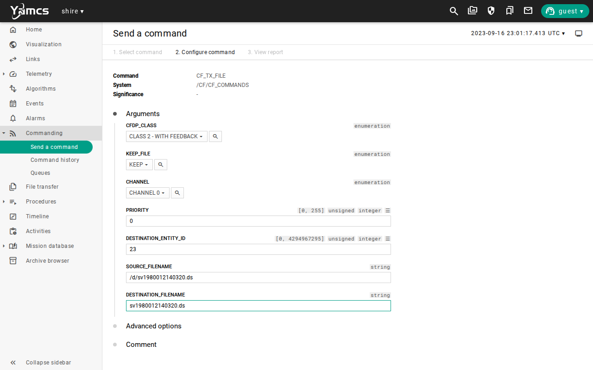

`KEEP` leaves the flight file in place, which you need for the integrity check.
Open **File transfer**.

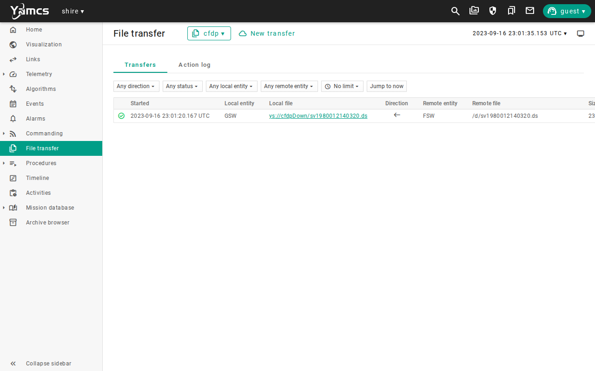

The transfer completes in a few seconds.
Now prove that the command crossed the radio, and not only the debug path.
Send `/RADIO/RADIO_REQ_HK` and open the Radio telemetry.


`RADIO_DEVICE_BytesReceived` counts what the Radio received from the ground, and it is `180`, which is the single transmit command with its two file names.
Nothing else crossed the radio path in this lesson, because the setup commands used the debug path.
`RADIO_DEVICE_BytesSent` is large, because the Radio sends telemetry down in Duplex mode.

## Check the integrity

A completed transfer shows that the protocol finished, and it does not show that the content is the same.
Compare the file that the flight software holds with the one that the ground received, using the same hash on both.
The flight file is under `/app/d` in the flight software container, and the ground file is in the `cfdpDown` bucket that YAMCS serves.
Use the file name you chose.

```bash
docker exec shire-fsw-sat-1 sha256sum /app/d/sv1980012140320.ds
curl -s http://localhost:8090/api/buckets/shire/cfdpDown/objects/sv1980012140320.ds | sha256sum
```

The two hashes are identical, and so are the sizes, which you can read from the `FILESIZE1` value and the **File transfer** page.
The file is complete, because DS no longer writes it.
If the hashes differ, treat the pass as failed, keep both files, and do not delete the flight copy.

## Close the pass

Send `/SC/SC_COMMANDS/SC_STOP_RTS` with `RTSID` `6`, so that the sequence cannot change the Radio again.
Send `/RADIO/RADIO_CONFIG_CC` with `MODE` set to `Receive Only Mode`, `RX_SPEED` set to `1`, `RX_WAVE` set to `2`, `TX_SPEED` set to `0`, and `TX_WAVE` set to `0`.
Open the Radio telemetry.

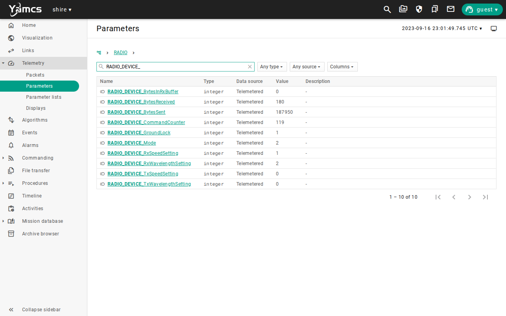

`RADIO_DEVICE_Mode` is `2`, so the Radio is back in Receive mode, as the plan required.
If you leave RTS 6 to finish, it does the same thing after 480 wakeups, and stopping it does not leave the Radio waiting for it.
Send `/CF/CF_COMMANDS/CF_SEND_HK` and read the CF counters.

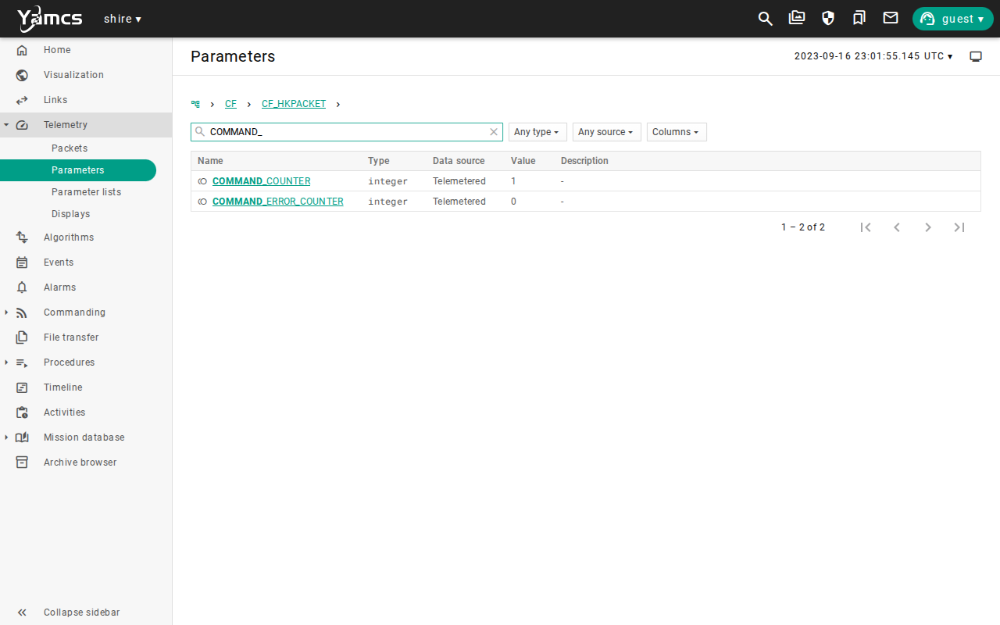

CF counted the one transmit command and no errors, so the counters agree with the plan.
The pass is over, and the spacecraft is in a known state, with the Demo device enabled and its restart armed.

## Run it automatically

`make scenario SCENARIO=nominal-pass` runs the pass headless.
`NominalPass.ycs` waits for the startup sequences, records a zero baseline, arms the Demo restart, checks the battery against its limit, starts RTS 6, enables the Demo device, checks the Radio mode, closes the data files, and downloads the boot file over the radio path.
It checks that the transfer finished with that file and that the Radio received the command, and it closes the pass in Receive mode.
The scenario also checks the flight software log for the close of the data files.
It takes about four minutes, most of it starting the lab and letting the simulation run long enough to hold data.
It does not compare the hashes, which you did by hand.
See [Scenarios and initial conditions](../manual/how-to/scenarios.md) for every registered scenario.

## Limitations

This scenario shows a pass in the DRM, and it does not qualify an operations concept.
Keep these limits in mind when you read its results:

* The pass is a window that RTS 6 opens by changing the Radio mode, and the link is in view the whole time, so no geometry limits the pass.
* One file and one device are involved, and a real pass carries many data products and competes for the window.
* The file name is the one the flight software opens at boot, so a run that starts later or sets the time differently names its files differently.
* The hash comparison is a manual step, and the headless scenario proves that the transfer finished and not that the content matches.
* The plan and the limits in it are the ones this lesson chose, and a real mission sets them in a reviewed procedure.
* Nothing here covers a problem during the pass, which is what the earlier lessons showed one failure at a time.
* The ADCS stays in its boot mode, so the pass does not check pointing.
* The screenshots show one run, so values will differ in yours.

Use the [evidence packet](overview.md#evidence-packet) when you need to retain the result of a run.

## Review

You can now run a complete pass and show that it did what the plan said.

You have:

* Planned the pass before the run and kept to the plan
* Prepared the spacecraft and the ground with a zero baseline
* Opened the window with RTS 6 and read the Radio mode
* Reviewed the battery and the alarms before loading the spacecraft
* Selected a complete file from the directory listing and downloaded it over the radio path
* Compared the hash of the flight file with the hash of the ground file
* Closed the pass in Receive mode

This lesson completes the evidence packet.
Each earlier lesson added one habit, and a nominal pass uses all of them.

| Lesson | Evidence in this pass |
| --- | --- |
| Commissioning | The link state before the pass and the command acknowledgements |
| Simulation Time and Repeatability | The simulation time and the repository revision, so the run can be replayed |
| Power and Eclipse | The battery voltage and the alarm state with their times |
| Attitude Control | Not used, because the pass leaves the pointing alone |
| Radio Link and Command Paths | Which links were enabled and the counters on each path |
| Cmd/Tlm Validation | The alarm history and the file transfer record |
| Space Link Security | The log assertions, with keys and addresses removed |
| Fault Detection and Recovery | The state of the Demo restart as a timeline |
| Nominal Operations | The plan, the file name and size, and both hashes |

Check that you can answer these before you move on:

* Why did you decide what a good pass looks like before you started it?
* Why is a completed CFDP transfer not enough to show that the file arrived intact?
* Which evidence proves that the transmit command crossed the radio path and not the debug path?

The [lesson plan](overview.md#the-lesson-plan) continues with [Monte Carlo Analysis](monte-carlo-analysis.md).
There the engineering team asks how far it can trust the result of a single run.

***
Last reviewed: 20261029
