# Power and Eclipse

## Mission brief

The spacecraft is a few weeks old, and it makes all of its own power.
Sunlight charges the battery, and every device on board spends from it.
Once per orbit the spacecraft passes behind the Earth, and for about half an hour it has only the battery.
The team has to know what each device costs, what the Sun is giving, and how long the battery will last.
This is the third lesson in the [lesson plan](overview.md#the-lesson-plan), in the Spacecraft systems unit.

## Objective

In this scenario, you will learn how the electrical power system, or EPS, works and how to read it.
As the flight controller, your job is to read the power telemetry, see how attitude changes the power the array makes, switch a load and its device off and on, watch the spacecraft enter eclipse, and watch the battery cross a limit when a large load is added.

## Prerequisites

This lesson needs two earlier lessons, [Commissioning](commissioning.md) and [Simulation Time and Repeatability](simulation-time-repeatability.md).
You use these skills from them:

* Running a procedure stack from **Procedures**, **Stacks**, as you did for the ADCS and the Demo
* Sending a command from its form and reading a parameter page
* Setting the simulation speed with `/SHIRE_SERVER/BACKDOOR_SERVER_SET_SPEED`, and reading simulation time rather than the YAMCS header clock

Before you begin, ensure you have:

* Completed [Getting Started](../manual/handbook/getting-started.md)
* Selected the default `sat-1` configuration with `scenario: nominal` in `build/active.yaml`, and run `make`
* About 20 minutes, most of which is waiting for simulated time to pass

This lesson starts from a freshly booted spacecraft, so it does not need anything that an earlier lesson left behind.
Stop any running lab with `make stop` before you start a new one.

## Overview

The EPS has four parts, and the lesson follows them in turn.

| Part | What it does |
| --- | --- |
| Solar array | Makes up to 8 watts when its face points at the Sun, and nothing in eclipse. |
| Battery | Stores 40 watt hours, and reports a voltage that runs from 16 volts empty to 24 volts full. |
| Switches | Eight switched rails carry power from the battery to the devices. |
| Base load | 1.5 watts that the platform always draws, even with every switch off. |

The default wiring puts three devices on switches and one passive load, and leaves the other four switches unused.

| Switch | Label | Rail | State at start |
| --- | --- | --- | --- |
| 0 | Demo | 3.3 volts | On |
| 4 | ADCS | 12 volts | On |
| 5 | Load bank | 12 volts | Off |
| 6 | Radio | 24 volts | On |

The load bank is a passive 20 watt load with no device behind it.
It exists so that you can make the spacecraft spend a large amount of power on command.
Switches 1, 2, 3, and 7 are unused and off.

The EPS reports in whole steps, and the steps are coarse.
Battery voltage moves in steps of about 0.031 volts and switch current in steps of about 0.039 amps.
A load below one step reads as zero, so a switch can be on and still report 0 amps.
The solar voltage is only an indicator, which reads about 4.4 volts when the array makes power and 0 when it does not, and it does not measure watts.

The DRM sets two limits on the battery voltage.
A voltage below 20 volts is yellow, and a voltage below 18 volts is red.

You will follow these phases:

* Read the power system
* Point at the Sun
* Switch a device off and on
* Watch an orbit
* Add a load in eclipse

The screenshots below show one completed run.
Simulation times, counters, and voltages will differ in your run.

## Read the power system

Start the lab:

```bash
make start
```

Wait for the startup sequences to settle, as you did in [Commissioning](commissioning.md#startup).

In YAMCS, select **Telemetry**, then **Parameters**, and open the `EPS` system.
Search for `BATTERY`.
The battery voltage is about 22.4 volts, which is about 80 percent charged.
The EPS publishes this housekeeping every 10 simulated seconds, so a value changes at most that often.

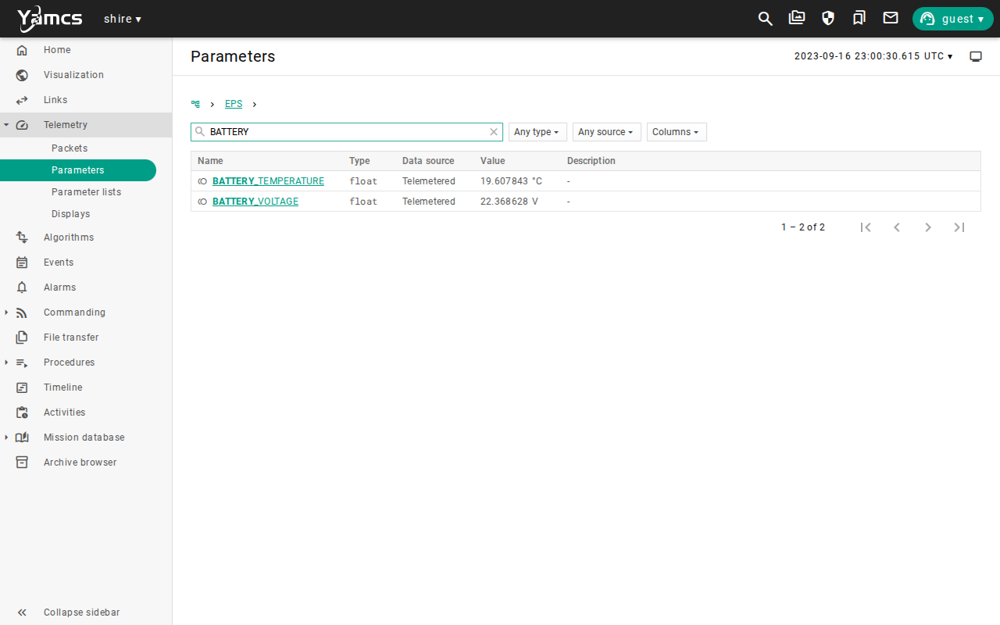

Now open the [visualization](http://localhost:8090/visualization/).
The **EPS** box on the right shows the same state in one place.
It lists the eight switches by their labels with their on and off states, and it plots the battery voltage.

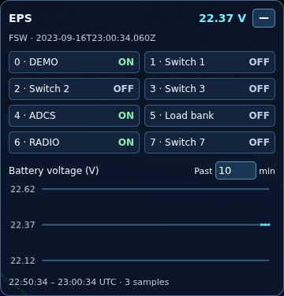

The switches match the table in the overview.
Open `/EPS/SWITCH_4_STATE` and `/EPS/SWITCH_4_CURRENT` in the parameter list.
The ADCS switch is on and its current is 0 amps, because the ADCS is powered and disabled, and it draws only 0.2 watts, which is below one step.

## Point at the Sun

The spacecraft starts with a slow tumble.
Its solar array is on one face, so the array only makes power while that face turns toward the Sun.

In the `EPS` parameters, search for `SOLAR_VOLTAGE` and watch it for a minute.
It alternates between about 4.4 volts and 0 as the array turns toward and away from the Sun.
The array makes power in bursts, so on average it makes less than its 8 watt peak.

Open `Procedures / Stacks / AdcsComponent.ycs` and run it with **Run all from selected step**, as you did in [Commissioning](commissioning.md#adcs).
The stack enables the ADCS and commands the Sun safe mode, which holds the array face toward the Sun.

When it finishes, return to `SOLAR_VOLTAGE`.
It now holds steady at about 4.4 volts.

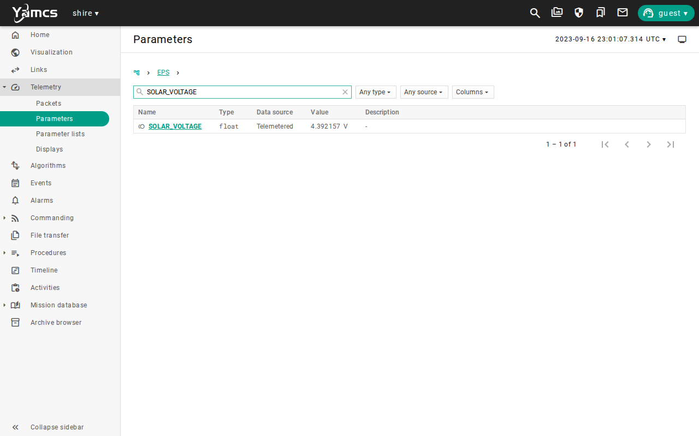

Search for `SWITCH_4`.
The ADCS switch now reports a current of about 0.078 amps.
That is two steps, or about 0.9 watts of the 1.25 watts that the ADCS draws in Sun safe mode.

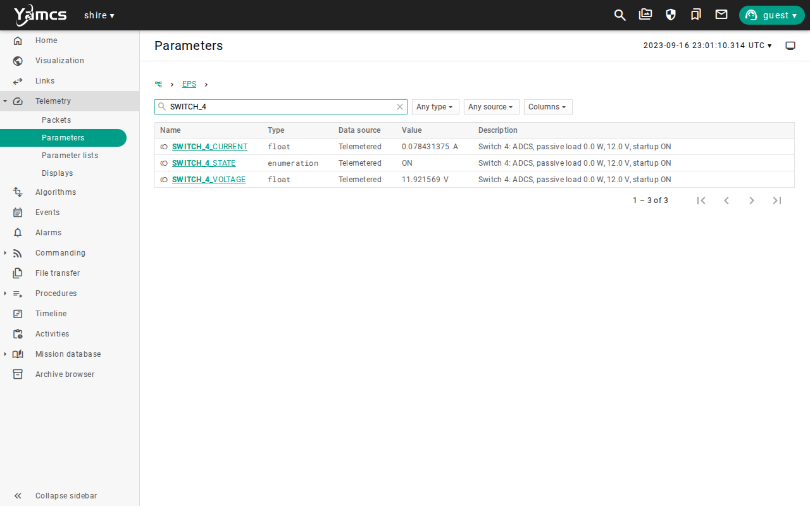

Pointing at the Sun costs about one watt of power and gains most of the 8 watts of the array.
Attitude is a power decision, and Attitude Control, the next lesson on this subject, is about how it is made.

## Switch a device off and on

A switch cuts the power to a device, and the flight software keeps trying to talk to it.
This is how a device that has lost power looks in telemetry.

Open `Procedures / Stacks / DemoComponent.ycs` and run it, as you did in [Commissioning](commissioning.md#demo-instrument).
It enables the Demo device.

Open the `DEMO` parameters and note `DEVICE_COUNT`, which counts successful device transactions, and `DEVICE_ERR_COUNT`, which counts failed ones.
`DEVICE_COUNT` grows steadily.

Open `/EPS/EPS_SWITCH_OFF_CC`, set `SWITCH_NUMBER` to `0`, and send the command.


Wait for fresh housekeeping, then compare the two systems.
`/EPS/SWITCH_0_STATE` reads `OFF` and its current reads 0.
In `DEMO`, `DEVICE_COUNT` has stopped and `DEVICE_ERR_COUNT` climbs with each attempt.
`DEVICE_ENABLED` still reads `ENABLED`, because the flight software has not changed its mind, and the device has simply gone silent.

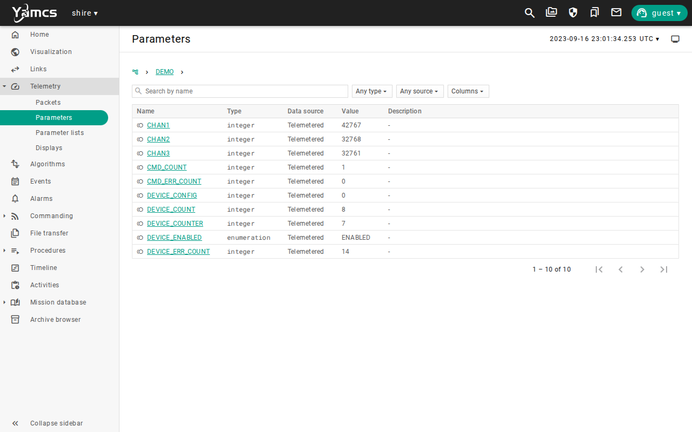

Send `/EPS/EPS_SWITCH_ON_CC` with `SWITCH_NUMBER` set to `0`.
The device needs a short time to boot, so a few more errors can appear.
Wait about 30 seconds, then read the `DEMO` parameters again.
`DEVICE_ERR_COUNT` has stopped climbing, and `DEVICE_COUNT` is growing again.


The pattern to remember is a transaction count that stops, an error count that climbs, and a switch that reads off.
Together those tell you that a device has lost its power and has not failed by itself.

Do not switch off switch 6 in this lesson.
The Radio is the spacecraft's link to the ground, and in flight, cutting its power would end your ability to command the spacecraft at all.
The lab has a second path that would still carry the command, which a real spacecraft does not have.

## Watch an orbit

An orbit takes about 93 minutes, so speed the clock up.
Send `/SHIRE_SERVER/BACKDOOR_SERVER_SET_SPEED` with `SPEED` set to `16`, as you did in [Simulation Time and Repeatability](simulation-time-repeatability.md#change-the-speed).

Watch the EPS box in the visualization while the clock runs.
In sunlight with the array pointed at the Sun, the battery voltage creeps up by one step every two to three minutes of simulation time.
The array makes about 8 watts and the devices spend about 3.75 watts, so the battery gains the difference.

At about 22 minutes of simulation time, which is about 80 seconds at 16x, the spacecraft reaches the shadow of the Earth.
The left panel changes from `Sunlit` to `Eclipse`, the ground track shows the violet eclipse arc, and `/SHIRE_VISUAL/ECLIPSE` changes to `1`.

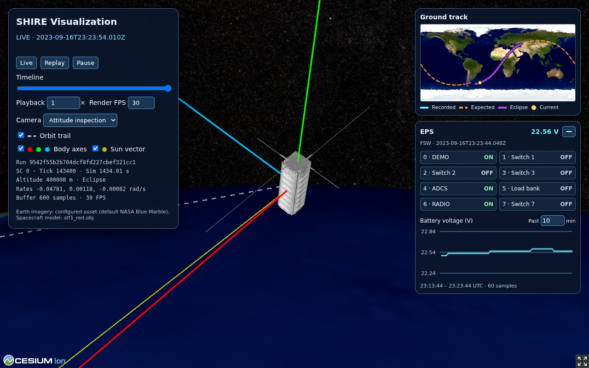

Open `SOLAR_VOLTAGE` in the `EPS` parameters.
It reads 0, and it stays 0 for the whole eclipse.

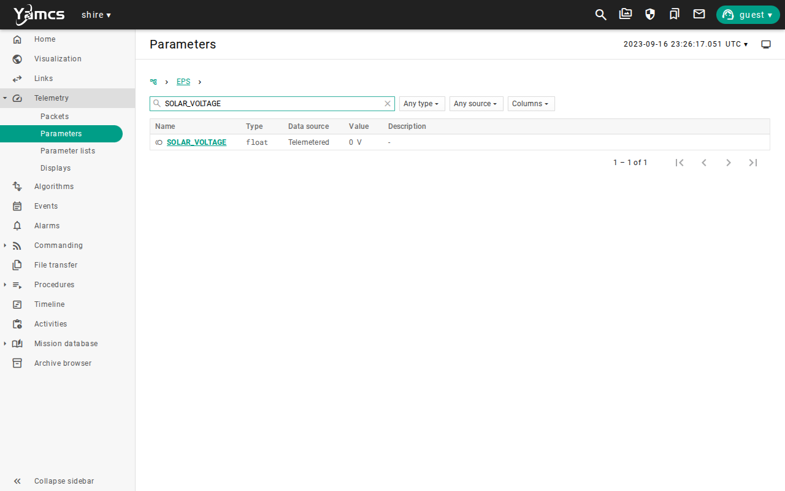

The array stops, but the devices do not, so the battery now only discharges.
The voltage falls by one step every two to three minutes.
This eclipse ends at 23:57:48 on the simulation clock, about 36 minutes after it starts.
At that rate the battery loses about 0.5 volts, which is an easy cost for a battery of this size.

## Add a load in eclipse

The load bank turns the same arithmetic into something dramatic.
Open `/EPS/EPS_SWITCH_ON_CC`, set `SWITCH_NUMBER` to `5`, and send the command.

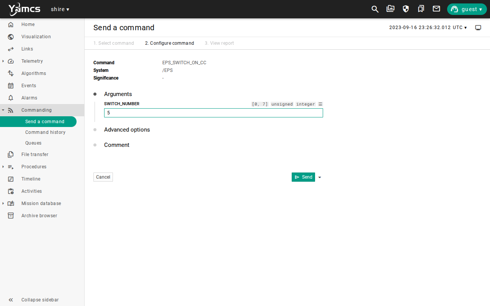

Wait for fresh housekeeping, then search for `SWITCH_5`.
The state is `ON` and the current is about 1.65 amps at about 11.9 volts, which is about 19.6 watts.


The battery now falls by one step about every 24 seconds of simulation time, which is about 1.5 seconds of wall time at 16x.
Watch the EPS box graph slope downward.
After about half an hour of simulation time, about two minutes at 16x, the voltage crosses 20 volts.

In the `EPS` parameters the battery voltage turns red with a downward arrow, which marks the side of the limit that it crossed.
Open **Alarms**.
A warning alarm for `/EPS/BATTERY_VOLTAGE` is active and unacknowledged.

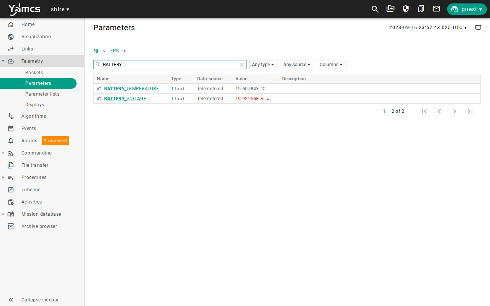

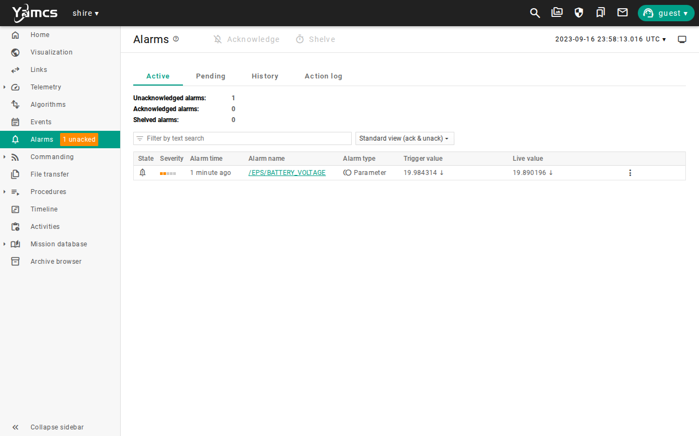

Now act on it.
Send `/EPS/EPS_SWITCH_OFF_CC` with `SWITCH_NUMBER` set to `5`.
Wait for fresh housekeeping and confirm that `SWITCH_5_STATE` reads `OFF` and its current reads 0.
The discharge slows to the rate of the other devices, and once the spacecraft is back in sunlight with its array pointed at the Sun, the battery starts to recover.

The spacecraft did nothing about the low battery by itself.
You saw the alarm and you removed the load, and that is the job of the flight controller until onboard fault protection exists.
[Cmd/Tlm Validation](cmd-tlm-validation.md) shows how limits and alarms are configured and acknowledged.
Send `/SHIRE_SERVER/BACKDOOR_SERVER_SET_SPEED` with `SPEED` set to `1` to return the clock to real time.

## See it on the timeline

The parameter pages show one value at a time, and the Timeline shows how they change together.
In YAMCS, select **Timeline**, then choose the **Power** view from the view menu at the top.
Choose **Jump to...**, enter the date `2023-09-16` and the time `23:30:00`, and choose **OK**.
Choose **1 hour**.
The window now runs from 23:00 to 00:00, which holds the whole lesson.
The simulation clock starts at 23:00:00, so these times are the same in every run.

The view has five bands, from top to bottom.

| Band | What it shows |
| --- | --- |
| Sunlit or Eclipse | Yellow while the spacecraft is in sunlight and purple in the shadow of the Earth. |
| Battery Voltage | The battery voltage in volts. |
| Solar Voltage | The solar array indicator, about 4.4 volts when the array makes power and 0 when it does not. |
| Load Bank Current | The current on the load bank switch, in amps. |
| ADCS Switch Current | The current on the ADCS switch, in amps. |

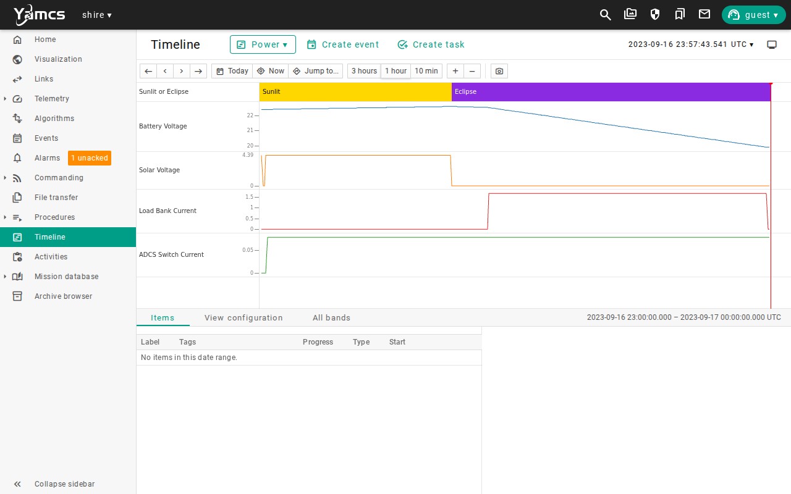

Read it from left to right, and match each change to something that you did.

* The solar voltage flickers while the spacecraft tumbles, and then holds steady once the ADCS points at the Sun.
* The ADCS switch current steps up at the same moment, because the ADCS now draws more power in Sun safe mode.
* The battery voltage creeps up in sunlight, and it starts to fall when the band turns purple and the solar voltage drops to 0.
* The load bank current steps up, and the battery voltage then falls much faster, until it passes 20 volts.
* The load bank current steps back down when you switch it off.

Each step in the current is something that you commanded, each change in the slope of the battery voltage is the result, and the order of the events is visible.
The default **Design Reference Mission** view shows the enabled state of the Demo and the ADCS and the Radio mode in the same way.

Stop the lab with `make stop`.

## Run it automatically

`make scenario SCENARIO=eps-functional` runs `EpsPowerFunctional.ycs` headless.
It exercises all eight switches through real flight commands, and checks that each mapped device loses power and recovers.
It takes about five minutes.
`make scenario SCENARIO=eps-backdoor-testing` adds the simulator backdoors and the injected faults.
See the [EPS validation](../manual/how-to/eps-validation.md) guide for what those scenarios assert, their campaigns, and the report they produce.

## Limitations

This scenario shows how the EPS and eclipse behave in the DRM, and it does not qualify a power design.
Keep these limits in mind when you read its results:

* The power figures are illustrative defaults, not measurements of a real battery, array, or device.
* The battery is a simple energy store whose voltage is a straight line from 16 volts empty to 24 volts full, with no aging, and no change with temperature or load.
* The solar array is one face of the body and makes 8 watts times the cosine of the angle to the Sun, so it does not model panels on several faces, or efficiency losses.
* Eclipse is a yes or no flag from 42's cylindrical shadow test, so there is no partial shadow.
* The solar voltage is an indicator, so it cannot tell you how many watts the array is making.
* The load bank has no device behind it, so it does not show how a real payload would change its demand.
* The spacecraft has no safe mode and no automatic load shedding, so a low battery needs a command from you.
* The screenshots show one run, so times and voltages will differ in yours.

Use the [evidence packet](overview.md#evidence-packet) when you need to retain the result of a run.

## Review

You can now read the power state of the spacecraft and say why it is changing.

You have:

* Read the battery, solar, and switch telemetry in YAMCS and in the visualization
* Seen how attitude changes the power the array makes
* Switched a device off and on, and recognized a device without power by its counters
* Watched the spacecraft enter eclipse and the battery stop charging
* Added a large load and watched the battery cross a yellow limit and raise an alarm
* Removed the load and returned the lab to real time
* Read the whole hour on the timeline, with the battery voltage beside the eclipse, the solar voltage, and the switch currents

This lesson adds a habit to the evidence packet.
Record each parameter value and its limit state with the simulation time, such as a battery voltage of 19.92 volts, which was yellow at 23:57:43.
Without the time, a voltage means little, because the same value is safe on the way up and a concern on the way down.
A timeline image with its window times is a compact way to keep the whole sequence.

Check that you can answer these before you move on:

* Why does a switch that is on sometimes report 0 amps?
* What does a device look like in telemetry when its switch is off, and how is that different from a device that is disabled?
* What happens to the battery when the spacecraft enters eclipse, and what did you have to do when the load bank pushed it below its limit?

The [lesson plan](overview.md#the-lesson-plan) continues with [Attitude Control](attitude-control.md).
There you learn how the spacecraft finds the Sun and holds a pointing mode, which you used here to feed the array.

***
Last reviewed: 20261029
