# Radio Link and Command Paths

## Mission brief

The spacecraft is under control, and now the team has to talk to it.
Contact with a spacecraft in low Earth orbit is scarce and imperfect.
A pass lasts minutes, a signal can be late or lost, and a command that left the ground may never arrive.
The team has to learn which path a command travels, what each part of the path can prove, and what to do when contact is lost.
This is the fifth lesson in the [lesson plan](overview.md#the-lesson-plan), in the Ground control unit.

## Objective

In this scenario, you will learn how commands and telemetry travel between the ground and the spacecraft.
As the flight controller, your job is to send the same command over both paths and prove from counters which path carried it, take the spacecraft out of contact and recover, add delay and packet loss to the link, and interrupt a file transfer and recover it.

## Prerequisites

This lesson needs two earlier lessons, [Commissioning](commissioning.md) and [Simulation Time and Repeatability](simulation-time-repeatability.md).
You use these skills from them:

* Sending a command from its form and reading a parameter page
* Reading the **Links** page and the Radio housekeeping
* Starting a CFDP file transfer with `CF_TX_FILE` and reading **File transfer**
* Changing the simulation speed and reading simulation time

Before you begin, ensure you have:

* Completed [Getting Started](../manual/handbook/getting-started.md)
* Selected the default `sat-1` configuration with `scenario: nominal` in `build/active.yaml`, and run `make`
* About an hour

This lesson starts from a freshly booted spacecraft, so it does not need anything that an earlier lesson left behind.
Stop any running lab with `make stop` before you start a new one.

## Overview

Every command you have sent so far went to the flight software by one of two paths.

| Path | Command route | Telemetry route |
| --- | --- | --- |
| Debug | YAMCS `debug-out` to the flight software on UDP 1234 | The flight software to YAMCS `debug-in` on UDP 1235 |
| Radio | YAMCS `radio-out` to CryptoLib on UDP 12345, then to the Radio simulator | The Radio simulator to CryptoLib, then to YAMCS `radio-in` on UDP 12346 |

The debug path is a direct lab connection that a real mission does not have.
The radio path crosses more of the chain a real spacecraft uses, including the Radio and the link between the ground station and the spacecraft.
Each path is made of two YAMCS links, one that sends and one that receives, and each link can be enabled or disabled on its own.

Both command links are enabled when the lab starts, and while both are enabled YAMCS sends each command by `radio-out` alone.
`debug-out` carries commands only while `radio-out` is disabled, and there is no automatic fallback.
The radio path delivers a command only while the Radio is enabled in a receiving mode and the spacecraft is in view.
A green link on the **Links** page means that YAMCS has a socket, and it does not prove that a particular command crossed that path.
Three counters together prove it, which are the **Out** count on the link, the command counter in the flight software, and the byte counter in the Radio.

Three ground only commands in the `/SHIRE_GROUND` space system choose the path.
They change YAMCS link state and send no spacecraft packet.

| Command | Effect |
| --- | --- |
| `USE_DEBUG_UPLINK` | Disables `radio-out` and enables `debug-out`, which stays in place until you change it. |
| `USE_RADIO_UPLINK` | Disables `debug-out` and enables `radio-out`, then restores the saved link states after 30 seconds. |
| `RESTORE_UPLINK` | Restores the link states saved by `USE_RADIO_UPLINK`, and is refused if the 30 seconds have passed. |

The Radio simulator sits in the radio path and models what a real link does to traffic.
You control the model with backdoor commands in the `/RADIO` space system.

| Command | Effect |
| --- | --- |
| `BACKDOOR_RADIO_SET_LINK_MODE` | Chooses `AUTO`, `ALWAYS_IN_VIEW`, or `NEVER_IN_VIEW`. |
| `BACKDOOR_RADIO_SET_DELAY` | Sets a one way delay in milliseconds for the uplink, the downlink, or both. |
| `BACKDOOR_RADIO_SET_DROP_RATE` | Sets the chance in parts per million that a packet is dropped, per direction. |
| `BACKDOOR_RADIO_SET_SEED` | Seeds the loss generator, so a run drops the same packets again. |
| `BACKDOOR_RADIO_RESET_LINK` | Restores the configured link, which is always in view with no delay and no loss. |

In `AUTO` mode the link is up only while the spacecraft is above the horizon of a ground station, and the DRM has two stations, in San Diego and in Denver.
The default is `ALWAYS_IN_VIEW`, so every other lesson has an ideal link.

You will follow these phases:

* Read the links
* Send the same command two ways
* Lose contact
* Add delay and loss
* Make the radio the only path
* Interrupt a file transfer

The screenshots below show one completed run.
Simulation times, counters, and values will differ in your run.

## Read the links

Start the lab and wait for the startup sequences to settle, as you did in [Commissioning](commissioning.md#startup):

```bash
make start
```

In YAMCS, select **Links**.
Four of the links matter in this lesson.
`debug-out` and `radio-out` send commands, and `debug-in` and `radio-in` receive telemetry.

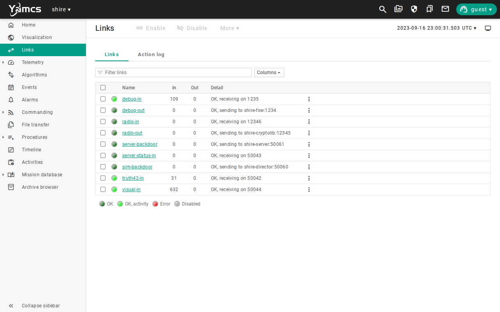

`debug-in` is counting packets, and `radio-in` is not.
The Radio starts in Receive mode, which can take commands from the ground and cannot send anything down.
It sends telemetry only in Duplex mode, as you saw when RTS 6 started the pass in [Commissioning](commissioning.md#first-contact).

## Send the same command two ways

A harmless command with a visible effect is the best test.
The ES NOOP command adds one to the ES command counter and does nothing else.
Start with the links as they are.
Open `/CFE_ES/CFE_ES_COMMANDS/CFE_ES_RESET`, which resets the ES counters, and send it.
Open **Links**.


Both command links are enabled, and only `radio-out` shows an **Out** count.
YAMCS did not send the command on both links, and the radio path is the one it chose.
That path works because the Radio has been in Receive mode since Do No Harm.

Now choose the debug path and read the counters before the trial.

1. Open `/SHIRE_GROUND/USE_DEBUG_UPLINK` and send it.
2. Open `/RADIO/RADIO_REQ_HK` and send it, and note `RADIO_DEVICE_BytesReceived` on the Radio telemetry page.
3. Open `/CFE_ES/CFE_ES_COMMANDS/CFE_ES_SEND_HK` and send it, and confirm that `CMDCOUNTER` is `0`.

Now send the NOOP on the debug path.
Open `/CFE_ES/CFE_ES_COMMANDS/CFE_ES_NOOP` and send it, then send `CFE_ES_SEND_HK` again.
`CMDCOUNTER` is now `1`.
Open **Links** and compare it with your first look.

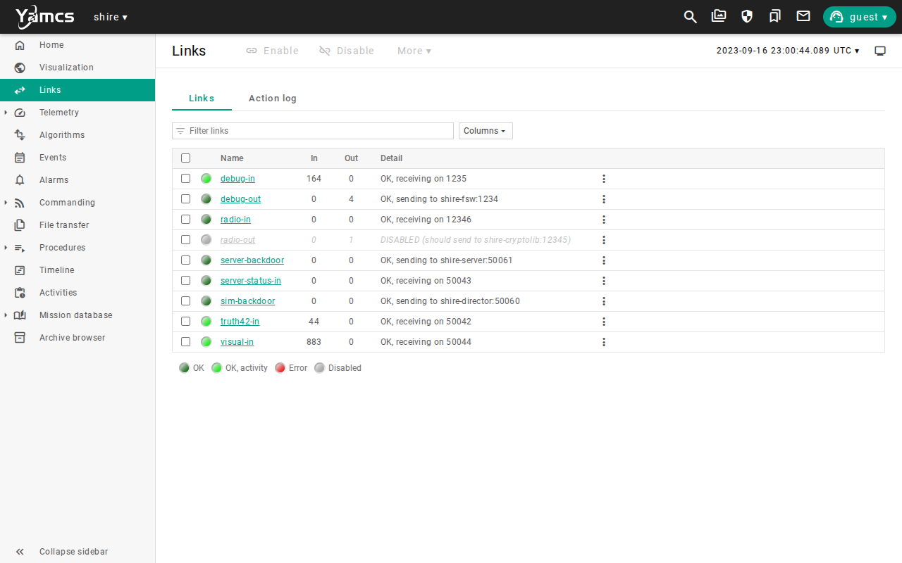

`radio-out` is disabled now, so the command left by `debug-out`, and its **Out** count went up.
The Radio never saw it.

Now send the same command on the radio path.
Do these steps in order and without a long pause, because the lab restores the debug path 30 seconds after `USE_RADIO_UPLINK`.

1. Send `/SHIRE_GROUND/USE_RADIO_UPLINK`.
2. Send `/CFE_ES/CFE_ES_COMMANDS/CFE_ES_NOOP`.
3. Open **Links**.
4. Send `/SHIRE_GROUND/RESTORE_UPLINK`.

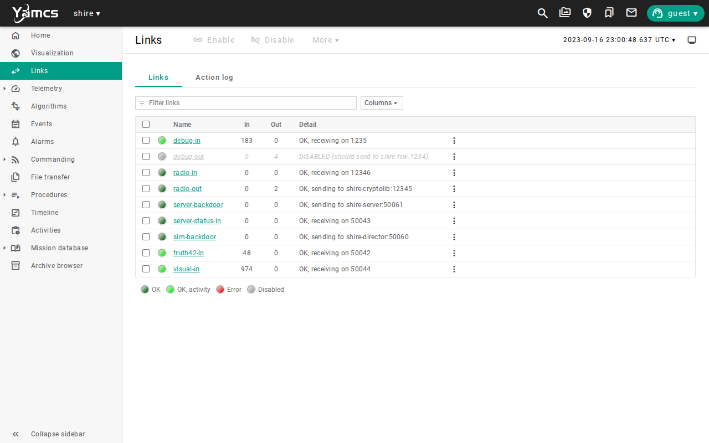

This time `debug-out` is disabled, and the **Out** count of `radio-out` went up.
If you wait more than 30 seconds, the lab restores the links on its own, and `RESTORE_UPLINK` is refused because there is nothing left to restore.

Send `CFE_ES_SEND_HK` and read the ES counters.


`CMDCOUNTER` is `2`, so the flight software counted both commands, and `ERRCOUNTER` is `0`.
That tells you that the commands arrived, and it does not yet tell you which path carried the second one.
The Radio does.
Send `RADIO_REQ_HK`, and open the Radio telemetry.

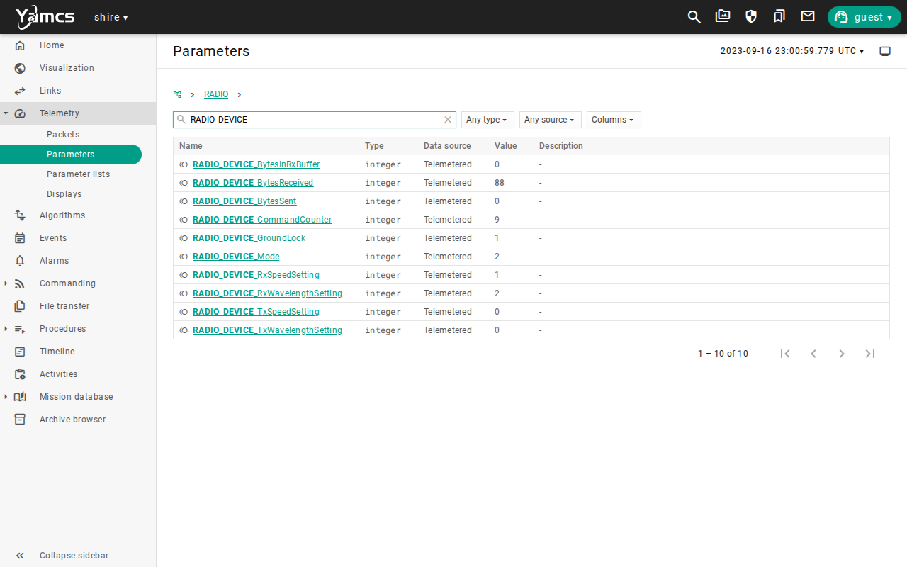

`RADIO_DEVICE_BytesReceived` counts what the Radio received from the ground, and each command is 44 bytes.
It is 44 higher than the reading you noted before the trial, and the debug path command did not move it.
Together, the **Out** count, the flight counter, and the Radio byte counter show that the second command crossed the Radio and the first did not.

## Lose contact

A real spacecraft is out of contact most of the time.
`NEVER_IN_VIEW` puts the link in that state.

Open `/RADIO/BACKDOOR_RADIO_SET_LINK_MODE`, set `MODE` to `NEVER_IN_VIEW`, and send it.

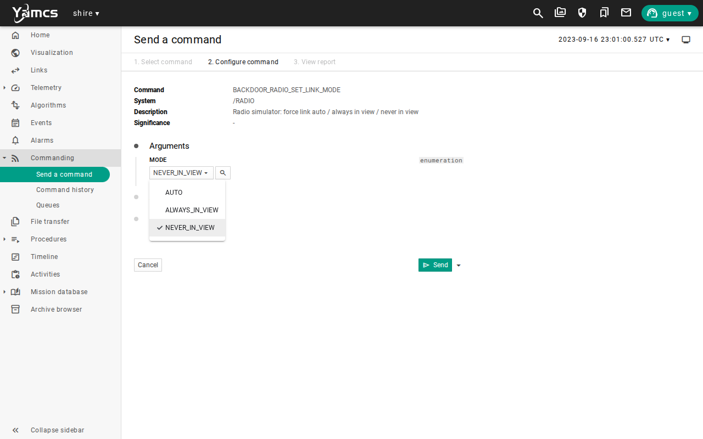

Send `RADIO_REQ_HK`, which travels by the debug path, and read the Radio telemetry.


`RADIO_DEVICE_GroundLock` is `0`, which is the Radio's own report that it has no contact.

Now send the same NOOP on the radio path.
Send `USE_RADIO_UPLINK`, then `CFE_ES_NOOP`, then `RESTORE_UPLINK`.
Open **Commanding** and then **Command history**.

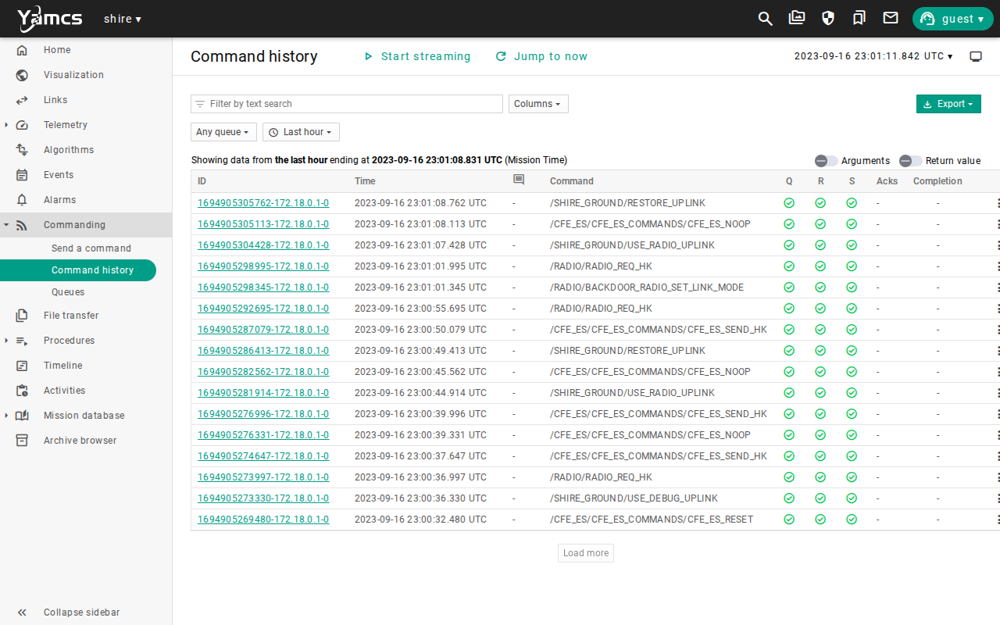

YAMCS reports the command as sent, and from where it stands that is true.
Send `CFE_ES_SEND_HK` and read `CMDCOUNTER`.

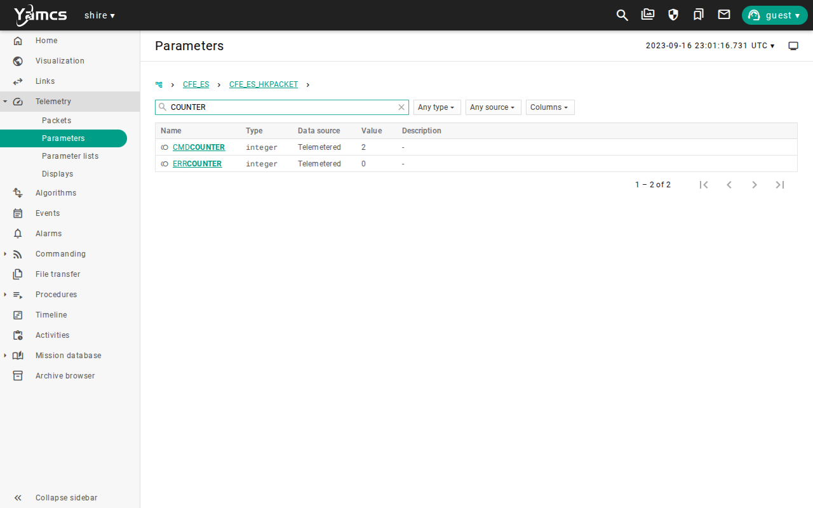

The counter is still `2`.
The command left the ground and never reached the flight software.
The Radio threw it away because the spacecraft was out of view.
Command history shows what the ground did, and only the flight counter shows what the spacecraft received.
The command gives you no error, so a quiet loss is something you check for, and you do not wait for an alarm.

Restore the view with `BACKDOOR_RADIO_SET_LINK_MODE` and `ALWAYS_IN_VIEW`.
The Radio prints its packet counters whenever you send a backdoor command, and the discarded packet is in them.

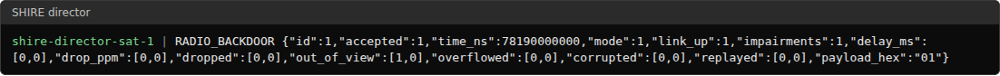

The `out_of_view` pair counts the packets discarded in each direction, the uplink first.
A one means the Radio discarded the NOOP you sent.

You recover from lost contact by commanding what you can reach.
Send the NOOP again on the debug path, send `CFE_ES_SEND_HK`, and confirm that `CMDCOUNTER` is `3`.
The lost command is not counted, and nothing replays it, so the ground has to decide whether to send it again.

## Add delay and loss

A real link also takes time and drops packets.
Set a delay first.
Send `BACKDOOR_RADIO_SET_DELAY` with `DIRECTION` set to `UPLINK` and `DELAY_MS` set to `8000`.
Then send `USE_RADIO_UPLINK`, `CFE_ES_NOOP`, and `RESTORE_UPLINK`, and open the ES counters straight away.


The counter is still `3`, because the command is in flight.
In a few seconds it moves.


The counter reached `4` between 8 and 12 seconds after you sent the command, which is the 8 seconds of delay plus up to 4 seconds for the next housekeeping packet.
The ES housekeeping is sent every four seconds, so what you read is always a little older than the spacecraft.
Delay is counted in simulated time, so it is the same at any speed.
Send `BACKDOOR_RADIO_RESET_LINK` to remove it.

Now add loss.
Send `BACKDOOR_RADIO_SET_SEED` with `SEED` set to `1`, and `BACKDOOR_RADIO_SET_DROP_RATE` with `DIRECTION` set to `UPLINK` and `DROP_PPM` set to `500000`, which drops half of the uplink packets.
The 30 seconds that `USE_RADIO_UPLINK` lasts are too short for ten commands, so select `radio-out` on the **Links** page and select **Enable**, which makes the radio the path again.
Send `CFE_ES_NOOP`, then select **Resend this command** and **Send** nine more times.
Send `USE_DEBUG_UPLINK` to return to the debug path, send `CFE_ES_SEND_HK`, and read the counter.


The counter went from `4` to `8`, so four of the ten commands arrived and six were lost.
Every one of the ten shows as sent in command history.
The seed makes the loss repeatable, so the same seed and the same ten commands lose the same six, and a different seed gives a different count.
That repeatability is what lets you test a procedure against a bad link and get the same answer twice.
Send `BACKDOOR_RADIO_RESET_LINK` to restore the ideal link.

## Make the radio the only path

So far, `debug-in` has carried the telemetry that you read, whichever path the command took.
A lost contact on the radio path can only matter to a transfer if nothing else carries it.
Make the radio the only path in both directions.

Send `/RADIO/RADIO_CONFIG_CC` with `MODE` set to `Duplex Mode`, `RX_SPEED` set to `1`, `RX_WAVE` to `2`, `TX_SPEED` to `3`, and `TX_WAVE` to `4`.
The Radio now sends telemetry as well as receiving commands.
Open **Links**, select `debug-in` and `debug-out`, and select **Disable**.
Then select `radio-out` and select **Enable**.

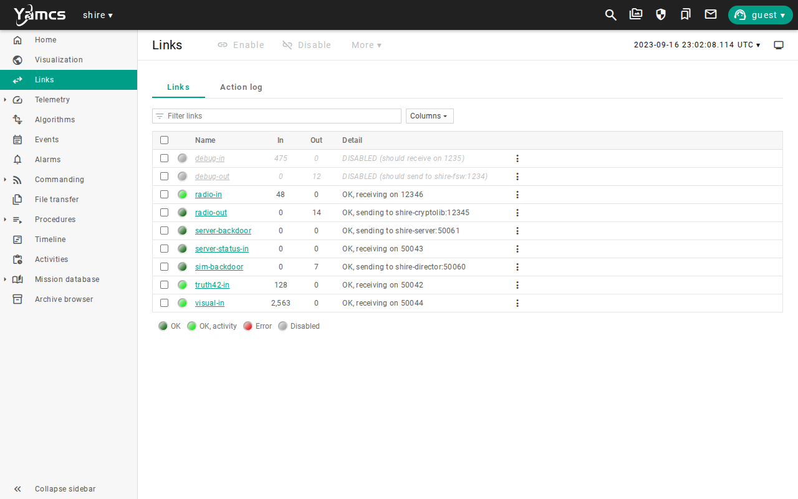

Every command to the spacecraft and every telemetry packet from it now uses the Radio.
A command that the Radio discards is lost, and so is any telemetry it discards.

## Interrupt a file transfer

Contact breaks in the middle of a file transfer, and you need to know what that leaves behind.
You need a stored file that takes a minute or more to send.
The flight software writes about 230 bytes each simulated second into the file it started at boot, which is named for the time it started, such as `sv1980012140320.ds`.
After about 15 minutes of simulation time it holds about 200 kilobytes, which the radio sends in about 85 seconds.
If your simulation time is below 900 seconds, set the speed to 16 with `/SHIRE_SERVER/BACKDOOR_SERVER_SET_SPEED` until it is not, and then set it back to 1.

Send `/DS/DS_COMMANDS/DS_CLOSE_ALL`, then `/FM/FM_COMMANDS/FM_GET_DIR_PKT` with `DIRECTORY` set to `/d`, `DIRLISTOFFSET` to `0`, and `GETSIZETIMEMODE` to `1`.
The listing is not sorted, so look for the file with the largest size, as you did in [Commissioning](commissioning.md#download-data).
Start a Class 2 transfer of it with `/CF/CF_COMMANDS/CF_TX_FILE`, and open **File transfer**.

### A short outage

Ten seconds into the transfer, send `BACKDOOR_RADIO_SET_LINK_MODE` with `NEVER_IN_VIEW`.
Wait a few seconds and look at the transfer.

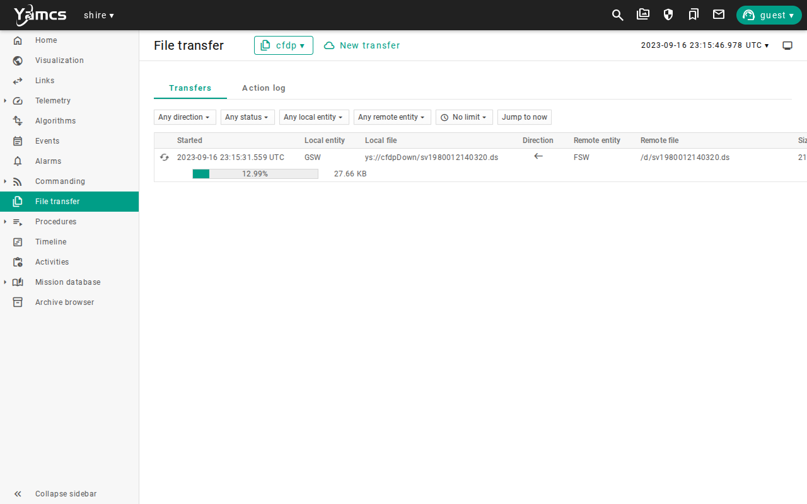

The transfer is still running, and the size transferred does not grow.
Restore the view with `ALWAYS_IN_VIEW` within about 20 seconds of cutting it.

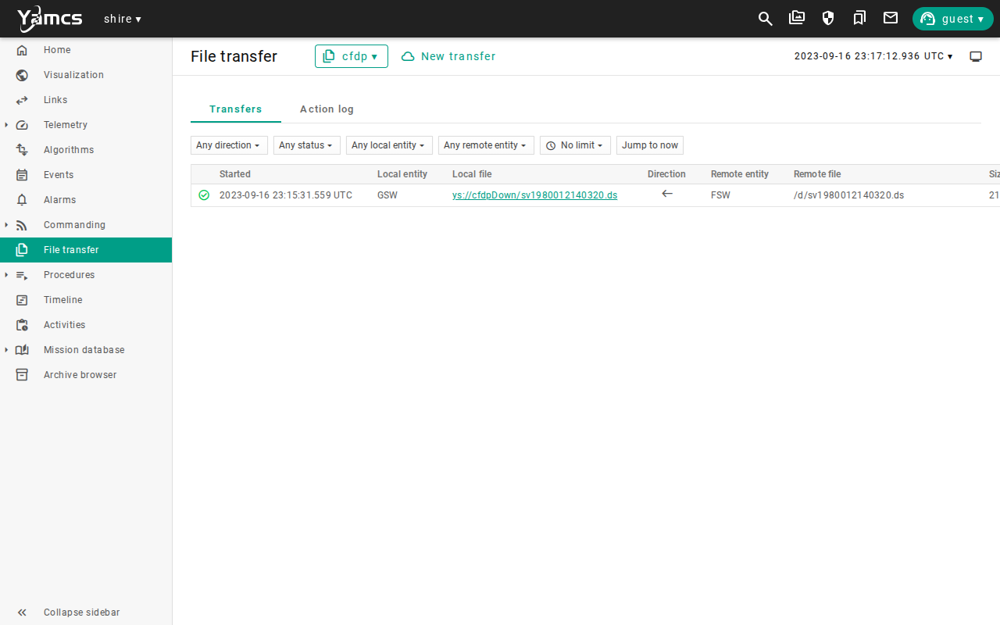

The transfer picks up where it stopped and completes.
Class 2 transfers are acknowledged, so the flight software sends the pieces again that the ground did not confirm.

### A long outage

Send `CF_TX_FILE` for the same file again.
Ten seconds in, send `NEVER_IN_VIEW`, and this time wait a minute.

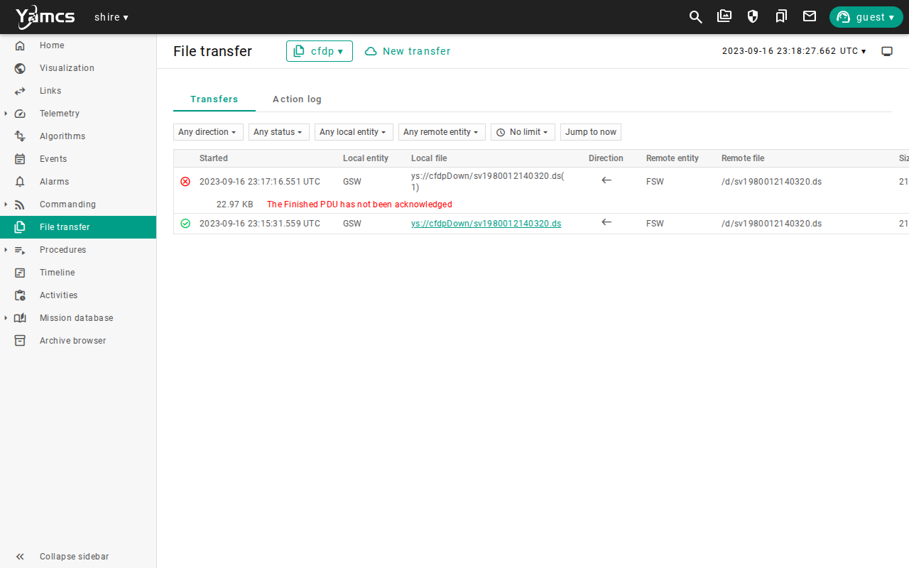

YAMCS gives up on a transfer that has been silent for 30 seconds.
It ends the transfer as failed, with the reason `The Finished PDU has not been acknowledged`, and the part of the file that arrived is incomplete.

Restore the view with `ALWAYS_IN_VIEW`.
The flight software ends its half of the transfer too, and it reports an event.

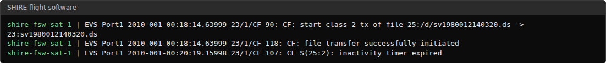

Depending on timing, the event reads `inactivity timer expired` or `got early FIN -- cancelling`.
The first means that the inactivity timer of the flight software ran out, and the second means that the ground's cancellation reached it first.

Now send `CF_TX_FILE` for the same file a third time.

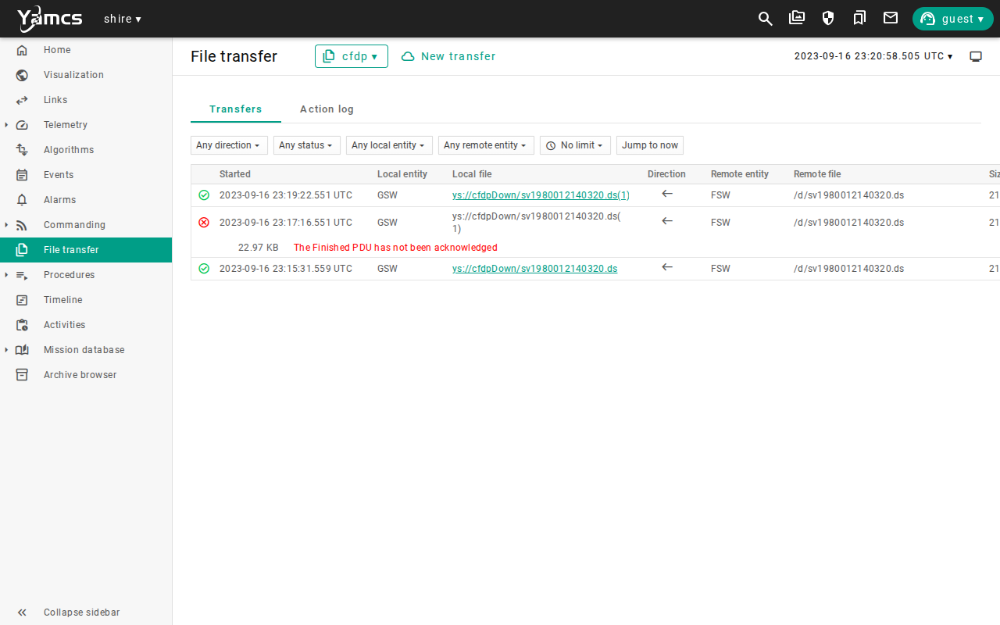

The new transfer starts again from the first byte and completes.
Nothing resumed the failed one, so a pass that ends early costs you the whole transfer.
Do not send a second `CF_TX_FILE` for a file while its first transfer is still running, because the flight software refuses it with `file already open`.

## Run it automatically

`make scenario SCENARIO=radio-link-testing` runs two stacks headless.
`RadioLinkBackdoor.ycs` forces the link out of view and back and checks `GroundLock` after each change.
`RadioCommandPaths.ycs` sends the ES NOOP over the debug path and over the radio path, loses one out of view, delays one by 6 seconds, and sends ten through a link that drops half of the uplink packets.
It checks the ES counter after each, and the scenario also checks the director log for the packets that the Radio discarded and dropped.
It takes about two minutes, most of it starting the lab.
It does not interrupt a file transfer, which is manual.
See the [Radio validation](../manual/how-to/radio-validation.md) guide for the link model and every backdoor command.

## Limitations

This scenario shows how the radio path works in the DRM, and it does not qualify a communications design.
Keep these limits in mind when you read its results:

* The link model has visibility, delay, and loss, and it has no signal strength, no Doppler shift, no antenna pointing, and no weather.
* The ground station visibility in `AUTO` mode uses a spherical Earth and two stations with a 5 degree elevation mask, so a real pass would differ in its start and length.
* Delay and loss are set by you with backdoor commands, which no real operator has, and they apply to the uplink and the downlink separately.
* The path commands change YAMCS links and send nothing to the spacecraft, so they prove which path carried a command only together with the counters.
* The file transfer timings come from the YAMCS inactivity timeout of 30 seconds and the CF application settings in this configuration, so another configuration fails or recovers at other times.
* The automated scenario does not interrupt a file transfer.
* The `AUTO` link mode follows the real ground station geometry, and the first pass of this orbit starts about ten simulated hours in, so this lesson forces visibility instead.
* After about ten simulated hours out of view, the first pass did not return telemetry in a test run, because the ground CryptoLib rejected the downlink frames with status `-23`, which means outside the anti-replay window.
* The radio path is encrypted by CryptoLib, and this lesson does not test that, which is the subject of the Space Link Security lesson.
* The screenshots show one run, so values will differ in yours.

Use the [evidence packet](overview.md#evidence-packet) when you need to retain the result of a run.

## Review

You can now say which path carried a command and what to do when contact is lost.

You have:

* Read the links and sent the same command over the debug path and the radio path
* Shown from three counters that the second command crossed the Radio
* Taken the spacecraft out of contact and seen that command history still reports a command as sent
* Added delay and loss, and repeated a lossy run with a seed
* Made the radio the only path and interrupted a file transfer, short and long

This lesson adds a habit to the evidence packet.
Record which links were enabled and the counters on each path, which are the link **Out** counts, the flight command counter, and the Radio byte counter.
A command that shows as sent is evidence of the ground only, and a counter on the spacecraft is evidence of the flight software.

Check that you can answer these before you move on:

* Why is a green `radio-out` link not proof that a command crossed the radio path?
* How can a command show as sent in command history and still never have reached the spacecraft?
* What happens to a file transfer when contact is lost for 20 seconds, and what happens when it is lost for a minute?

The [lesson plan](overview.md#the-lesson-plan) continues with [Cmd/Tlm Validation](cmd-tlm-validation.md).
There you prove that commands, limits, and uploads behave before you trust routine work.

***
Last reviewed: 20261029
