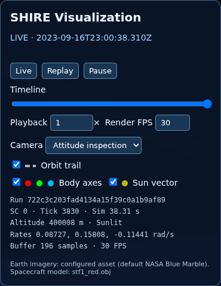
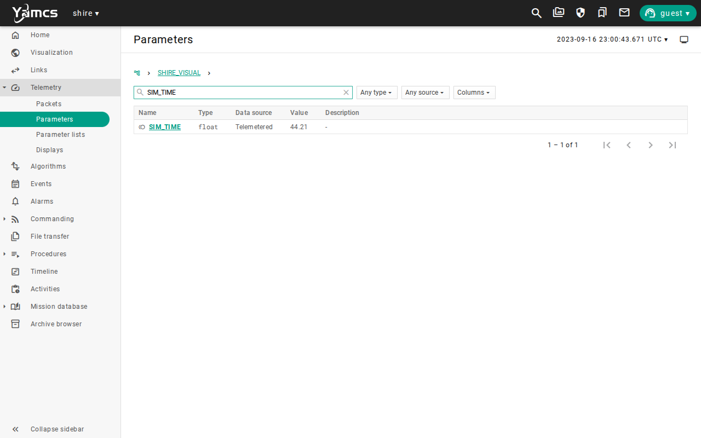
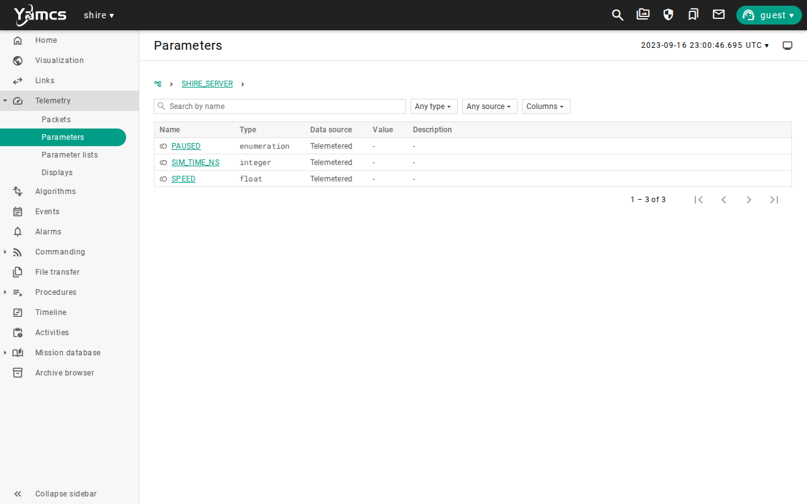
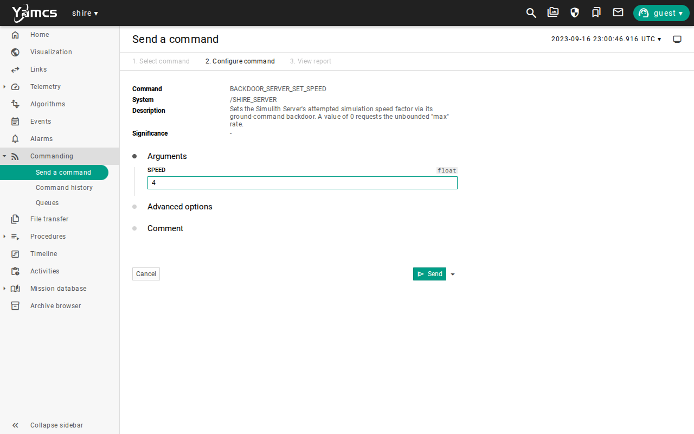
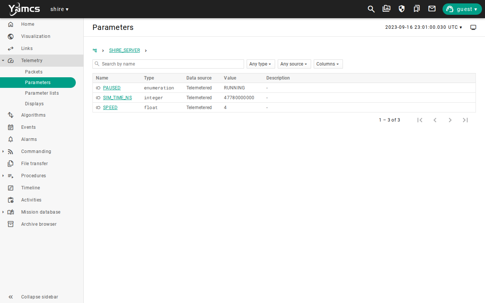
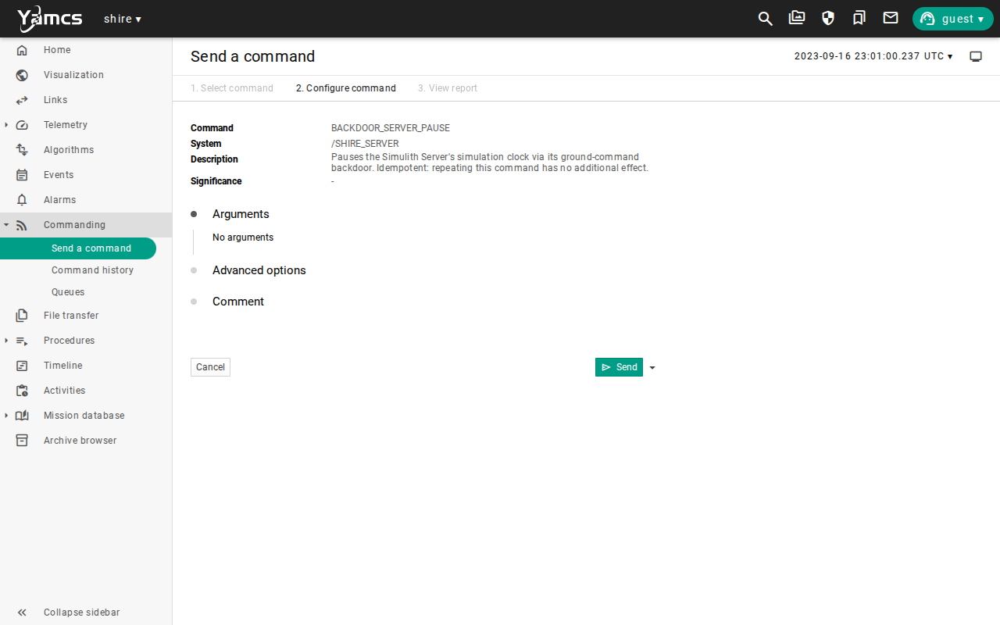
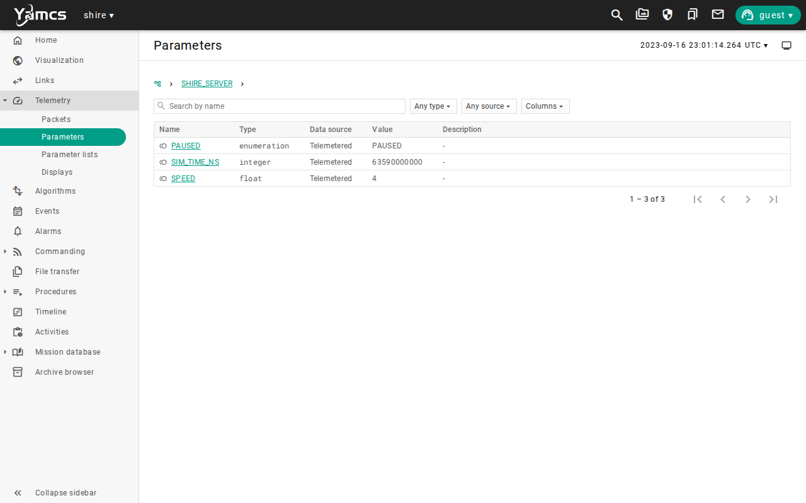
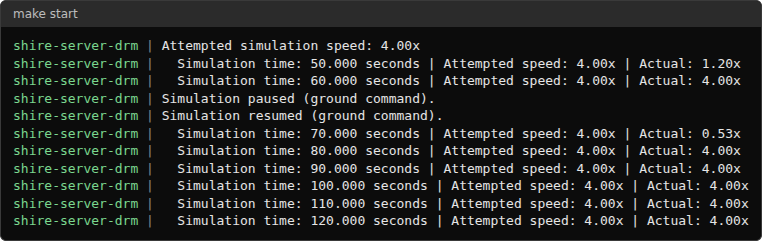

# Simulation Time and Repeatability

## Mission brief

The spacecraft has made first contact, and the team now needs to trust the environment it rehearses in.
Before anyone relies on a result, the team has to know which clock it is reading, how to stop that clock, and how to run an exercise again and get the same answer.
This is the second lesson in the [lesson plan](overview.md#the-lesson-plan), in the Foundations unit.

## Objective

In this scenario, you will learn how SHIRE keeps time and how to control it.
As the flight controller, your job is to read the simulation clock, change its speed, pause and resume it, choose where a run starts, and run or replay an exercise so that a colleague can check your result.
Every later lesson uses these skills.

## Prerequisites

This lesson needs one earlier lesson, [Commissioning](commissioning.md).
You use these skills from it:

* Starting the lab with `make start` and opening the YAMCS web interface
* Sending a command from its form and reading telemetry on a parameter page

Before you begin, ensure you have:

* Completed [Getting Started](../manual/handbook/getting-started.md), where you built and started the lab
* Selected the default `sat-1` configuration with `scenario: nominal` in `build/active.yaml`, as described in [Configuration](../manual/how-to/configuration.md)
* Run `make` so the lab matches the selected scenario

This lesson starts from a freshly booted spacecraft, so it does not need anything that Commissioning left behind.
A previous run does not affect it, but stop that lab with `make stop` before you start a new one.

## Overview

SHIRE runs on two clocks, and mixing them up is the most common mistake when reading a result.

| Clock | What it is |
| --- | --- |
| Simulation time | The time the spacecraft, the dynamics model, and the simulated devices experience, which the Simulith Server owns and advances in steps of 10 milliseconds. |
| Wall time | The time on the clock of your host computer, which is the time you experience. |

The Server decides how fast simulation time runs against wall time.
That ratio is the speed.
At 1x one simulated second takes one real second, and at 4x it takes a quarter of a second.
The spacecraft does not notice the difference, because the flight software runs exactly one scheduler slot per step.

Simulation time starts at an epoch that comes from the initial condition of the run.
The default epoch is 2023-09-16 at 23:00:00 UTC.
Telemetry from the spacecraft is stamped with simulation time, so its dates are in 2023.
The Server's own status is stamped with wall time, so its dates are your real date.

You will follow these phases:

* Read the clocks
* Change the speed
* Pause and resume
* Choose where a run starts
* Run it again and compare
* Replay a recorded run

The screenshots below show one completed run.
Simulation times, counters, and run identifiers will differ in your run.

## Read the clocks

Open a terminal, navigate to the SHIRE repository, and start the lab:

```bash
make start
```

Leave this terminal open.
It shows service output, and you use it again in this lesson.
Near the top it prints a line that names the run, such as `[archive] run=722c3c203fad4134a15f39c0a1b9af89`.
That identifier is how you find this run again, so copy it into your notes.

Wait for the startup sequences to settle, as you did in [Commissioning](commissioning.md#startup).

Open the [visualization](http://localhost:8090/visualization/).
The left panel shows three things to read:

* The `LIVE` line is the simulation date and time.
* The `Sim` value in the diagnostics is the number of simulated seconds since the run began, so the `LIVE` time is the epoch plus that number.
* The `Run` value is the identifier you copied from the terminal.



Now open the YAMCS ground software and select **Telemetry**, then **Parameters**.
Open `/SHIRE_VISUAL` and search for `SIM_TIME`.
It reports elapsed simulation seconds, and it changes every 0.05 seconds because the visualization data arrives at 20 hertz.
Watch the value grow by about one for each real second.



The terminal that ran `make start` reports the same clock.
Every 10 simulated seconds the Server prints a line such as `Simulation time: 60.000 seconds | Attempted speed: 1.00x | Actual: 1.00x`.

The clock at the top right of every YAMCS page is not the one to trust for this.
It starts from simulation time and keeps advancing while the simulation is paused.
Read `SIM_TIME` or the `Sim` value in the visualization instead.

The 42 truth stream also carries a clock, `/SIM_42_TRUTH/DYN_TIME`, which is the dynamics time in UTC seconds since J2000, updated once per second.

## Change the speed

Open `/SHIRE_SERVER` in the parameter list.
It has three parameters, `PAUSED`, `SPEED`, and `SIM_TIME_NS`, and none of them shows a value.



The Server reports its status only when it receives a command, so the values stay empty until your first Server command.
An empty `SPEED` does not mean the simulation is stopped.

Open `/SHIRE_SERVER/BACKDOOR_SERVER_SET_SPEED`, set `SPEED` to `4`, and send the command.



Return to `/SHIRE_SERVER`.
`SPEED` now reads `4` and `PAUSED` reads `RUNNING`.
`SIM_TIME_NS` is the simulation time in nanoseconds at the moment the Server received the command.
It does not change again until the next Server command, so it is a record of when you acted and not a live clock.



Measure the speed yourself.
Read `SIM_TIME`, wait 10 real seconds, and read it again.
The difference should be close to 40 simulated seconds.

The speed you request is an attempt.
The Server accepts values from 1/64x through 1024x, and a request of `0` asks for the fastest rate the host can sustain.
A value outside that range is ignored, and the current speed stays in effect.
The terminal reports both the `Attempted speed` and the `Actual` speed, and the host's performance sets the difference.
See [Performance](../manual/how-to/performance.md) to measure how much margin your host has.

## Pause and resume

Open `/SHIRE_SERVER/BACKDOOR_SERVER_PAUSE` and send the command.



The `PAUSED` parameter now reads `PAUSED`, and `SIM_TIME_NS` records the time of the pause.
Read `SIM_TIME`, wait at least 10 seconds, and read it again.
The value has not changed, because while the clock is paused the flight software, the dynamics model, and every simulated device wait for the next step.




A pause can last as long as you need.
Use it to study a state, to take notes, or to step away.
The header clock keeps moving while you wait, so do not use it to decide whether the simulation is paused.
In the screenshot above, the header reads 23:01:17 while `SIM_TIME` holds at 63.56, which is 23:01:03, so the header is about 14 seconds ahead of the frozen clock.

Open `/SHIRE_SERVER/BACKDOOR_SERVER_PLAY` and send the command.
`PAUSED` returns to `RUNNING`, and `SPEED` still reads `4`, because a pause does not change the speed.
`SIM_TIME` continues from the value it held when you paused.


Now look at the terminal.
The Server logged each change, and its next speed report covers the interval that included the pause, so its `Actual` speed is well below 4x.



Send `BACKDOOR_SERVER_SET_SPEED` again with `SPEED` set to `1` to return to real time.
Then stop the lab with `make stop`.

## Choose where a run starts

A run has two separate parts.
The scenario says what happens, and the initial condition, or IC bin, says where the run starts.
An IC bin sets the epoch, the orbit, the attitude, and optionally the state of a component.
The scenario selects the bin by name.
See [Scenarios and initial conditions](../manual/how-to/scenarios.md#initial-condition-ic-bins) for the schema.

The default mission has three bins, and each has a scenario that selects it.

| Scenario | Initial condition | Where the run starts |
| --- | --- | --- |
| `nominal` | `nominal-baseline` | 23:00:00 UTC on the epoch date, with the spacecraft tumbling slightly in sunlight. |
| `eclipse-entry-adcs` | `eclipse-entry` | 23:21:41.94 UTC, at the moment the spacecraft enters the shadow of the Earth. |
| `eclipse-exit-adcs` | `eclipse-exit` | 23:57:47.98 UTC, at the moment the spacecraft leaves the shadow. |

Start from the eclipse entry.
Open `build/active.yaml` and change the scenario line:

```yaml
scenario: eclipse-entry-adcs
```

Then rebuild and start, which renders the new IC into the 42 configuration:

```bash
make
make start
```

When the lab has started, open the visualization.
The `LIVE` time begins near 23:21:41.94 and not near 23:00, and the panel reports `Eclipse` where the nominal run reported `Sunlit`.
In YAMCS, `/SHIRE_VISUAL/ECLIPSE` is `1`, where the nominal run reports `0`.
The spacecraft did not travel there during the run, because the run began at that point.

Every `make` also writes a record of what the run started from:

```bash
cat build/drm/scenario/eclipse-entry-adcs.snapshot.yaml
```

```text
scenario_name: eclipse-entry-adcs
initial_conditions: eclipse-entry
resolved_ic:
  name: eclipse-entry
  epoch:
    month: 9
    day: 16
    year: 2023
    hour: 23
    minute: 21
    second: 41.94
...
git_sha: ec1de86a58782e6d6307d75449b998824069c0ba
```

The snapshot holds the scenario, the fully resolved initial condition, and the revision of the repository.
Together they let someone else start the same run.
Your `git_sha` will differ.

Stop the lab with `make stop`, then change `scenario:` in `build/active.yaml` back to `nominal` and run `make`.

## Run it again and compare

A run is repeatable when the same scenario, initial condition, and build give the same result every time, however fast you run them.
`make scenario-smoke` checks that.
It runs the active scenario twice at the fastest speed the host can sustain and compares the two results:

```bash
make scenario-smoke
```

```text
Trial       Achieved   Tick p50   Tick p95    Ticks
max #1      133.240x      52.5 us     230.0 us     7500
max #2       91.418x      70.7 us     319.0 us     7500
...
Scenario / IC: nominal / nominal-baseline
Cross-trial repeatability: PASS
```

The two trials ran at different speeds, 133x and 91x, because the host was busy in different ways.
Both reached the same 7500 steps and the same result.
The comparison checks the step count, the simulated time, the synchronization counts, the commands delivered, and the final state of the dynamics model, which must agree to within a tolerance of 1e-12.
The command also writes a report, and its last line names the path.

This takes about a minute on a built lab.
The speed a run achieves changes its wall time and not what the flight software and the dynamics model produce, so a fast run can stand in for a slow one.

## Replay a recorded run

Running again and replaying are different.
Running again executes the simulation a second time and checks that you get the same result.
Replaying shows the data that a run recorded, without executing anything.

Every `make start` records its telemetry in a run archive, and the archive stays after `make stop`.
List the archives:

```bash
make replay-list
```

```text
RUN_ID                            STARTED_UTC       MISSION  SPACECRAFT  SCENARIO
722c3c203fad4134a15f39c0a1b9af89  20261028T215159Z  drm      sat-1       manual
```

The `STARTED_UTC` column is wall time.
`manual` is the scenario name that `make start` gives its runs.
Find your run with the identifier you copied.
With the lab stopped, replay it:

```bash
make replay RUN=722c3c203fad4134a15f39c0a1b9af89
```

```text
Replay: http://localhost:8090/visualization/?mode=replay&run=722c3c203fad4134a15f39c0a1b9af89
Stop: docker stop shire-replay-722c3c203fad && docker rm shire-replay-722c3c203fad
```

Open the address it prints to play back the recorded run in the viewer.
Open YAMCS at [http://localhost:8090](http://localhost:8090) and select the SHIRE instance, as you do during a run.
No simulation is running in a replay, so there is nothing to command.
See [Visualization and replay](../manual/how-to/visualization-replay.md) for the viewer controls.

### Read the recorded telemetry

In YAMCS, select **Telemetry**, then **Parameters**.
A replay has no live values, so every **Value** column shows a dash and the Home page shows no packet flow.
The recorded values are on the **Historical data** tab of each parameter.

The Server status is the record of what you did to the clock, so start there.
Open `/SHIRE_SERVER/PAUSED`, select **Historical data**, and choose **No limit** from the range menu.
The default range, **Last hour**, is wall time, so it shows nothing once the run is more than an hour old.
Each row is a status that the Server sent after one of your commands, newest first, with its wall time and the value `RUNNING` or `PAUSED`.
Open `SPEED` and `SIM_TIME_NS` the same way to read the speed and the simulation time at each command.

To see all three side by side, export them together:

```bash
curl -fsSG 'http://localhost:8090/api/archive/shire:exportParameterValues' \
  --data-urlencode 'parameters=/SHIRE_SERVER/PAUSED,/SHIRE_SERVER/SPEED,/SHIRE_SERVER/SIM_TIME_NS' \
  --data-urlencode 'delimiter=COMMA'
```

```text
Time,PAUSED,SPEED,SIM_TIME_NS
2026-10-28T21:52:58.487Z,RUNNING,4.0,47780000000
2026-10-28T21:53:02.440Z,PAUSED,4.0,63590000000
2026-10-28T21:53:18.664Z,RUNNING,4.0,63590000000
2026-10-28T21:53:34.637Z,RUNNING,1.0,127480000000
```

The rows follow your commands in order.
The first sets the speed to 4, the second pauses, the third resumes, and the fourth sets the speed back to 1.
The second and third rows have the same `SIM_TIME_NS`, 63.59 seconds, and are 16 real seconds apart.
That is the pause as the archive records it, with no simulation time passing.

Now read the simulation clock across the same pause.
Open `/SHIRE_VISUAL/SIM_TIME` and select **Historical data**.
The simulation data is stamped with simulation time, so the **Last hour** range finds nothing here either.
Choose **Custom** and enter a start a few seconds before the pause and an end a few seconds after it.
The pause happened at the epoch plus `SIM_TIME_NS`, so for 63.59 seconds that is 23:01:03.59, and a range of 23:01:02 to 23:01:05 on 2023-09-16 covers it.

The values step by 0.05 seconds, from 63.51 through 63.56 and on to 63.61, with no gap at the pause.
No simulation time passed while the clock was paused, so the simulation data has no trace of the 16 seconds, and only the Server status, which carries wall time, records them.
Together the two views show both clocks, and the run identifier is what lets you find them again.

Stop the replay with the command it printed.

## Run it automatically

`make scenario SCENARIO=checkout` runs `ServerPauseResume.ycs` headless, after `CheckoutTest.ycs`.
It sets the speed, holds a 12 second pause, and fails if `SIM_TIME` moves during the pause or does not advance again after the resume.
`make scenario-smoke` is the repeatability check from this lesson.
See [Scenarios and initial conditions](../manual/how-to/scenarios.md) for how scenario runs work.

## Limitations

This scenario shows how SHIRE keeps and controls time, and it does not qualify any flight timing behavior.
Keep these limits in mind when you read its results:

* The speed you request is an attempt, and the host sets the speed you get, so check the `Actual` speed before you trust a timing.
* Pause and speed changes are simulation controls that go over a test backdoor, and a real spacecraft has no equivalent.
* Services inside YAMCS, such as file transfers and the header clock, run on wall time and are not paced by the Server.
* `make scenario-smoke` compares two runs on one host and one build, so it does not prove the same result on another host.
* The comparison excludes the count of periodic ground output packets, because that count depends on wall time.
* The default mission ships three initial conditions, all on one orbit, and none starts at a ground station pass.
* A replay shows what a run recorded, and it does not execute the flight software again.
* The screenshots show one run, so times and identifiers will differ in yours.

Use the [evidence packet](overview.md#evidence-packet) when you need to retain the result of a run.

## Review

You can now control and read the clock of a run.

You have:

* Read simulation time in the visualization, in YAMCS, and in the terminal
* Told simulation time from wall time, including the Server status, which is stamped with wall time
* Changed the speed and measured the result
* Paused for longer than a few seconds and resumed from the same simulation time
* Started a run from the eclipse entry initial condition and read its snapshot
* Checked repeatability with `make scenario-smoke`
* Listed a run archive, replayed it, and read its recorded telemetry in YAMCS and as an export

This lesson adds a habit to the evidence packet.
Record the simulation time and the run identifier, with the revision from the snapshot, so a colleague can start or replay the same run.

Check that you can answer these before you move on:

* How can you tell that the simulation is paused, and why is the clock at the top of YAMCS not a reliable indicator?
* What is the difference between running a scenario again and replaying a run, and which command does each?
* What would you record so that a colleague could start the same run again?

The [lesson plan](overview.md#the-lesson-plan) continues with Power and Eclipse.
There you learn how the loads, the battery, and the solar input behave, and why eclipse matters, using the eclipse starting points you met here.

***
Last reviewed: 20261028
