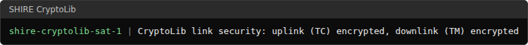
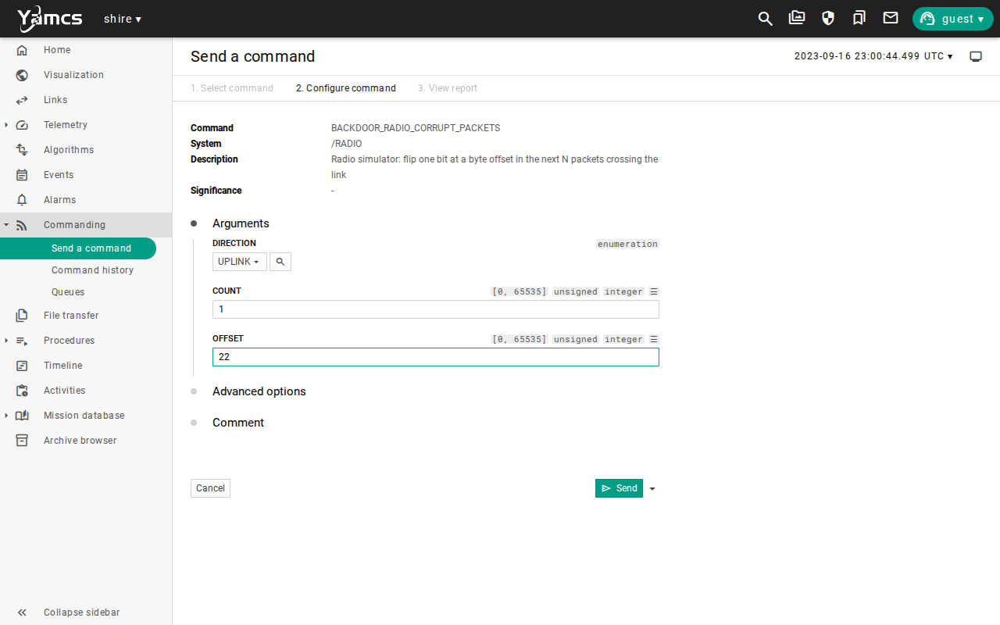
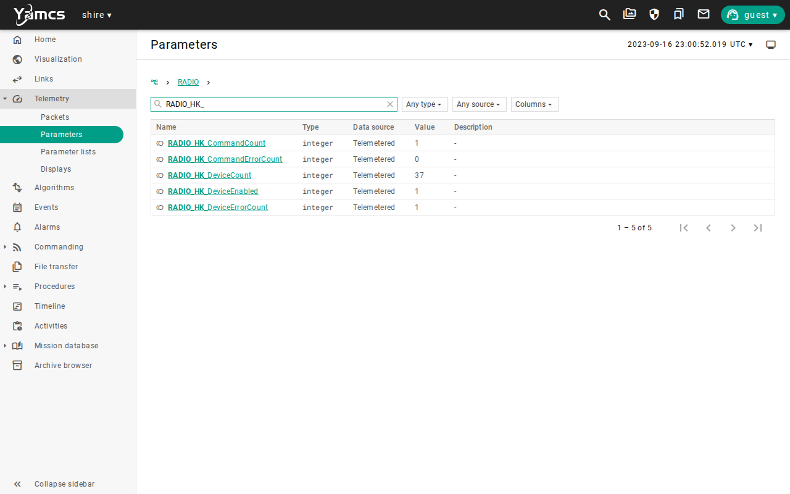
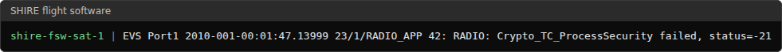
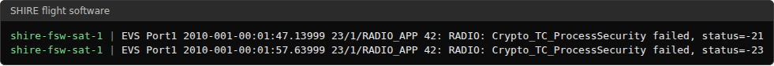
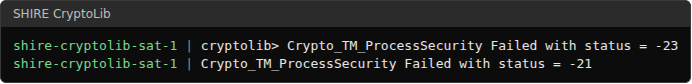

# Space Link Security

## Mission brief

The link works, and now someone interferes with it.
A radio link is open to anyone with an antenna, so a command that arrives is not necessarily a command the team sent.
The spacecraft has to accept the commands that belong to the mission and reject the rest, and the team has to know when it did.
This is the seventh lesson in the [lesson plan](overview.md#the-lesson-plan), in the Ground control unit.

## Objective

In this scenario, you will learn how the radio link is protected and what a rejected frame looks like.
As the flight controller, your job is to send a genuine command and prove that the spacecraft accepted it, tamper with a command and replay one and prove that the spacecraft rejected them, attack the telemetry on its way down and find the evidence on the ground, and then respond as you would to an incident.

## Prerequisites

This lesson needs two earlier lessons, [Commissioning](commissioning.md) and [Radio Link and Command Paths](radio-link-command-paths.md).
You use these skills from them:

* Sending a command from its form and reading a parameter page
* Choosing a command path with `USE_DEBUG_UPLINK`, `USE_RADIO_UPLINK`, and `RESTORE_UPLINK`
* Reading the Radio housekeeping and the Radio backdoor commands

Before you begin, ensure you have:

* Completed [Getting Started](../manual/handbook/getting-started.md)
* Selected the default `sat-1` configuration with `scenario: nominal` in `build/active.yaml`, and run `make`
* About 45 minutes

This lesson starts from a freshly booted spacecraft, so it does not need anything that an earlier lesson left behind.
Stop any running lab with `make stop` before you start a new one.

## Overview

Commands and telemetry on the radio path are encrypted and authenticated by CryptoLib, which implements the CCSDS Space Data Link Security Protocol, or SDLS.
It runs in two places, in the `shire-cryptolib` container on the ground and in the Radio application on the spacecraft.
The ground container encrypts each command on its way to the Radio, and the Radio application decrypts it.
The Radio application encrypts each telemetry frame, and the ground container decrypts it.
The cipher is AES 256 GCM, which hides the content and also signs it, so a frame that was changed in transit fails its check.

Two attacks matter on a link like this.

| Attack | What the attacker does | What stops it |
| --- | --- | --- |
| Tampering | Changes the bits of a frame in transit | The signature check fails, and the receiver reports status `-21` |
| Replay | Sends a genuine frame again later | The frame number is not new, and the receiver reports status `-23` |

The Radio simulator can play the attacker.
Two backdoor commands in the `/RADIO` space system do it.

| Command | Effect |
| --- | --- |
| `BACKDOOR_RADIO_CORRUPT_PACKETS` | Flips one bit at a chosen byte offset in the next packets that cross the link, in the direction you choose. |
| `BACKDOOR_RADIO_REPLAY_PACKET` | Sends the last packet that crossed the link again, in the direction you choose. |

The debug path does not pass through CryptoLib, so it protects nothing, and this lesson reads its housekeeping over the debug path and sends its test commands over the radio path.
That keeps the instrument you read separate from the link you attack.

You will follow these phases:

* Read the protection
* Send a genuine command
* Tamper with a command
* Replay a command
* Attack the downlink
* Respond to the incident

The screenshots below show one completed run.
Simulation times, counters, and values will differ in your run.

## Read the protection

Start the lab and wait for the startup sequences to settle, as you did in [Commissioning](commissioning.md#startup):

```bash
make start
```

In a second terminal, read what the ground CryptoLib reported when it started:

```bash
docker logs shire-cryptolib-sat-1 | grep "link security"
```



Both directions are encrypted, and the flight Radio application is built with the same settings.
The configuration renders one setting into both ends, so they cannot disagree.

Now prepare the instrument.
Send these commands, which choose the debug path for your housekeeping requests and put the Radio in Duplex mode so that it sends telemetry as well as receiving commands:

1. Send `/SHIRE_GROUND/USE_DEBUG_UPLINK`.
2. Send `/RADIO/RADIO_CONFIG_CC` with `MODE` set to `Duplex Mode`.
3. Send `/RADIO/RADIO_RST_COUNTERS_CC` and then `/RADIO/RADIO_REQ_HK`.

Open **Telemetry**, then **Parameters**, then the `/RADIO` system, and search for `RADIO_HK_`.


Two counters matter.
`RADIO_HK_CommandCount` counts the commands that the Radio accepted.
`RADIO_HK_DeviceErrorCount` counts the frames that the Radio could not accept, and a frame that fails CryptoLib's checks is one of them.
Both are `0`, which is your baseline.

## Send a genuine command

Send a Radio NOOP over the radio path.
Do these steps in order and without a long pause, because the lab restores the debug path 30 seconds after `USE_RADIO_UPLINK`.

1. Send `/SHIRE_GROUND/USE_RADIO_UPLINK`.
2. Send `/RADIO/RADIO_NOOP_CC`.
3. Send `/SHIRE_GROUND/RESTORE_UPLINK`.
4. Send `/RADIO/RADIO_REQ_HK` and read the counters.


`CommandCount` is `1` and `DeviceErrorCount` is still `0`.
The command crossed the ground CryptoLib, which encrypted it, and the Radio decrypted it and accepted it.
Every command in the rest of this lesson uses the same four steps, and the only difference is what you do to the link first.

## Tamper with a command

Tell the Radio simulator to flip one bit in the next uplink packet.
Open `/RADIO/BACKDOOR_RADIO_CORRUPT_PACKETS`, set `DIRECTION` to `UPLINK`, `COUNT` to `1`, and `OFFSET` to `22`, and send it.



Offset 22 is a byte inside the encrypted part of the frame.
Now send a NOOP over the radio path with the four steps from the last section.



`CommandCount` stayed at `1`, and `DeviceErrorCount` went to `1`.
The command left the ground and reached the Radio, and the Radio refused it.
The flight software logs the reason.

```bash
docker logs shire-fsw-sat-1 | grep Crypto_TC_ProcessSecurity
```



Status `-21` means that the frame failed authentication, so the Radio could tell that someone changed it.
Command history would have shown this command as sent, as the [previous lesson](radio-link-command-paths.md#lose-contact) showed for a lost one.
The counters and the log are the evidence of what the spacecraft did with it.

Now send a genuine NOOP again with the four steps.
`CommandCount` becomes `2`, so a rejected frame does not break the link, and the next genuine command is accepted.

## Replay a command

A replayed frame is a genuine frame that arrives a second time.
Open `/RADIO/BACKDOOR_RADIO_REPLAY_PACKET`, set `DIRECTION` to `UPLINK`, and send it.
The simulator sends the last packet that crossed the link again, which is your accepted NOOP.
Send `RADIO_REQ_HK` and read the counters.


`CommandCount` stayed at `2`, and `DeviceErrorCount` went to `2`.
The frame is intact, and it carries a valid signature, but the Radio had already seen its frame number.



Status `-23` means that the frame number is outside the window that the Radio accepts.
Together, `-21` and `-23` tell you which attack you are looking at.
A `-21` is a frame that someone changed, and a `-23` is a frame that someone sent again.

Send a genuine NOOP again with the four steps.
`CommandCount` becomes `3`, so the link recovers from a replay as it did from tampering.

## Attack the downlink

The same protection runs in the other direction, and the ground container does the checking.
The Radio is in Duplex mode, so it has been sending telemetry down the link all along.
Send `BACKDOOR_RADIO_REPLAY_PACKET` with `DIRECTION` set to `DOWNLINK`, and send `RADIO_REQ_HK`.
Send `BACKDOOR_RADIO_CORRUPT_PACKETS` with `DIRECTION` set to `DOWNLINK`, `COUNT` set to `1`, and `OFFSET` set to `30`, and send `RADIO_REQ_HK` twice.
Read the ground CryptoLib log.

```bash
docker logs shire-cryptolib-sat-1 | grep "Crypto_TM_ProcessSecurity Failed"
```



The ground rejected the replayed frame with `-23` and the tampered frame with `-21`.
YAMCS shows none of this, because the frames never leave the ground container, and the flight software counted no new error.
A rejection on the downlink is visible only in the container log.
If you check only the YAMCS counters, an attack on the telemetry looks like a quiet gap in the data.

## Respond to the incident

The attacks are over, and now you act as a flight controller who has just seen the counters move.
SHIRE does not respond for you, so these steps are a procedure that you carry out and record.

### Detect

`DeviceErrorCount` rose while `CommandCount` did not, and that mismatch is the signal.
Nothing in this configuration watches the counter for you, so you only see it if you read it.

### Classify

Read the logs.
A `-21` is a frame that failed authentication and a `-23` is a replay, and both were rejected.
You know that nothing unauthorized was accepted, because `CommandCount` did not move for any of them.

### Contain

Stop sending commands over the radio path until you know what happened, and keep reading the spacecraft through the debug path.
The debug path is a lab convenience and protects nothing, so on a real mission containment means holding commanding, and not moving to a path that checks less.

### Restore

Repeat the baseline exchange, which is a genuine NOOP over the radio path, and read the counters.


`CommandCount` rose to `4` and `DeviceErrorCount` stayed at `2`.
The link accepts genuine commands again, and the two rejections are still in the record.
Do not reset the counters to tidy up, because the error count is part of the evidence.

### Retain

Keep the counters, the log lines with their status codes, and the time of each attack.
Remove anything that could expose key material or addresses before you share a log.
The log lines in this lesson hold only status codes, the names of the containers, and times.

## Run it automatically

`make scenario SCENARIO=radio-security-testing` runs the same attacks headless.
`RadioSecurity.ycs` sends the genuine commands, tampers with and replays one command each way, and checks the Radio counters after each.
The scenario also checks the CryptoLib log and the flight software log through its `log_assertions` option, because the downlink rejections show only there.
It asserts exactly one `-21` and one `-23` on each side, and no other security failure.
It takes about a minute and a half, most of it starting the lab.
See the [Radio security validation](../manual/how-to/radio-security-validation.md) guide for the configuration and the assertions.

## Limitations

This scenario shows how the link protection behaves in the DRM, and it does not qualify a security design.
Keep these limits in mind when you read its results:

* The keys are the built in test keys of CryptoLib, they are identical on both ends, and anyone with the repository has them, so the lesson shows the mechanism and not key management.
* The attacker is the Radio simulator, which flips one bit or repeats one frame on request, so the lesson does not show an attacker who forges frames, jams the link, or listens.
* The debug path bypasses CryptoLib, so a lab that leaves it enabled has an unprotected way in.
* A rejected frame is counted and logged, and nothing in this configuration reacts to it, because no limit checker watches the error counters.
* Rejections of downlink frames appear only in the ground container log, and not in YAMCS.
* The anti replay window is 65535 frames, which an ordinary loss of signal does not pass.
  After about ten simulated hours out of view, a test run rejected every downlink frame with `-23`.
  The cause was not confirmed, and the flight side may have counted more frames than the window while the link discarded them.
* The lesson does not compare with an unprotected link, which needs a configuration change and a rebuild, and which the [Radio security validation](../manual/how-to/radio-security-validation.md) guide describes.
* The screenshots show one run, so values will differ in yours.

Use the [evidence packet](overview.md#evidence-packet) when you need to retain the result of a run.

## Review

You can now tell a command that the spacecraft accepted from one it rejected, and say why it rejected it.

You have:

* Read the protection that CryptoLib applies to the radio link
* Sent a genuine command and proved from the counters that the spacecraft accepted it
* Tampered with a command and replayed one, and proved that both were rejected and that the link recovered
* Attacked the downlink and found the evidence in the ground container log
* Detected, classified, contained, restored, and retained, as an incident procedure

This lesson adds a habit to the evidence packet.
Record the log assertions with keys and addresses removed, so that the proof of a rejection can be shared without exposing the link.
A rejected frame leaves two kinds of proof, a counter that moved and a log line with a status code, and you need both.

Check that you can answer these before you move on:

* Why did `CommandCount` stay the same when the tampered command was rejected?
* How do a status `-21` and a status `-23` differ, and what attack does each point to?
* Where do you look for the evidence that the ground rejected a telemetry frame?

The [lesson plan](overview.md#the-lesson-plan) continues with [Fault Detection and Recovery](fault-detection-recovery.md).
There the spacecraft handles a fault on its own between passes.

***
Last reviewed: 20261029
